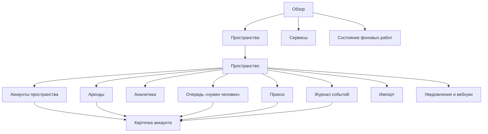

# Identity Hub — страницы админки и их данные

Статус: черновик на согласование  
Связанные документы: [`identity-hub-requirements.md`](../../identity-hub-requirements.md),
[`IMPROVEMENTS.md`](../plan/IMPROVEMENTS.md), [`план библиотеки`](../plan/PLAN.md),
[`план админки`](PLAN.md)

Документ описывает **какие страницы нужны и какая информация на каждой**, какие метрики и
временные разбивки считаются и из каких данных библиотеки они берутся. Визуальный дизайн и
компоновка — в шаблоне админки, здесь их нет.

Админка — отдельный пакет поверх read-моделей и API библиотеки. Она не пишет в таблицы напрямую:
все действия идут через методы библиотеки с `expected_revision`, причиной и автором.

---

## 1. Карта страниц

| # | Страница | Для чего |
|---|---|---|
| 1 | Обзор | Всё ли в порядке по всем доступным пространствам — одним экраном |
| 2 | Пространства | Сравнение пространств по составу и состоянию аккаунтов |
| 3 | Пространство | Состояние одного пространства: статусы по сервисам, аренды, тренды |
| 4 | Аккаунты пространства | Поиск, фильтры, таблица с пагинацией, массовые действия |
| 5 | Карточка аккаунта | Вся информация об одном аккаунте и ручные действия |
| 6 | Аренды | Кто сейчас держит аккаунты, метрики аренд за 15м / 1ч / 6ч / 24ч |
| 7 | Аналитика | Временные разбивки: добавления, верификации, авторизации, баны, воронки |
| 8 | Очередь «нужен человек» | Challenge, `action_required`, закреплённые расхождения |
| 9 | Прокси | Здоровье и загрузка прокси |
| 10 | Журнал событий | Поиск по событиям пространства |
| 11 | Импорт | Запуски импорта и их отчёты |
| 12 | Уведомления и вебхуки | Каналы, правила, endpoint'ы, журнал доставок |
| 13 | Сервисы | Что объявлено в коде: операции, квоты, верификации, коды платформ |
| 14 | Состояние фоновых работ | Диспетчер, очереди доставок, maintenance, пробы |

Все страницы, кроме «Обзора», «Сервисов» и «Фоновых работ», работают в рамках одного
пространства. «Обзор» и «Пространства» показывают только пространства, доступные пользователю
админки.

---

## 2. Общие правила

### 2.1. Окна и шаг разбивки

| Окно | Шаг графика | Где используется |
|---|---|---|
| 15 минут | 1 минута | аренды, операции, ошибки — оперативная картина |
| 1 час | 5 минут | то же |
| 6 часов | 15 минут | то же |
| 24 часа | 1 час | аренды, события, авторизации |
| 7 дней | 1 день | добавления, верификации, баны |
| 30 дней | 1 день | то же |
| произвольный диапазон | авто: ≤ 2 ч → 1 мин, ≤ 2 сут → 1 ч, иначе 1 сут | аналитика |

- Дневные границы считаются в **таймзоне пространства** (настройка пространства, по умолчанию
  таймзона админки), а не в UTC.
- Рядом с каждым значением за окно показывается значение за **предыдущее такое же окно** и
  изменение в процентах.
- Пустые интервалы показываются нулём, а не пропуском.

### 2.2. Что считается «добавлен», «авторизован», «верифицирован»

Метрики считаются по событиям `ih_events`, а не по текущему состоянию, — иначе нельзя ответить
«сколько было за вчера».

| Метрика | Определение | Событие |
|---|---|---|
| Добавлено | новые аккаунты | `identity.registered` + число id в `identity.imported` |
| Авторизовано | переход `auth → authenticated` | `identity.auth.changed`, `data.to = authenticated` |
| Успешных входов | успешные попытки входа | `identity.login.succeeded` |
| Неудачных входов | неудачные попытки | `identity.login.failed` |
| Потеряли сессию | переход в `session_invalid` | `identity.auth.changed`, `data.to = session_invalid` |
| Верифицировано | фактор перешёл в `verified` | `identity.verification.changed`, `data.to = verified`, разбивка по `factor` |
| Отказов верификации | фактор перешёл в `rejected` | то же, `data.to = rejected`, разбивка по `code` |
| Достигли уровня | уровень стал выполнен | вычисляется при переходе фактора (новый тип события `identity.tier.reached`, см. §5) |
| Забанено / заморожено / ограничено | переход standing | `identity.standing.changed`, `data.to ∈ {banned, frozen, limited}` |
| Разморожено / восстановлено | выход из тяжёлого состояния | `identity.standing.changed`, `data.from ∈ {frozen, banned}` |
| Ручных правок | override | `identity.state.overridden` |
| Выведено из парка | `lifecycle → retired` | `identity.lifecycle.changed` |

«Сколько аккаунтов сейчас в статусе X» — это срез текущего состояния из `ih_identities`, а не
событие. Тренд распределения по статусам во времени требует почасовых снимков (§5).

### 2.3. Статусы, которые показываются везде одинаково

У аккаунта пять регионов, поэтому «статус аккаунта» на всех страницах — это набор бейджей, а не
одно значение:

| Регион | Значения | Цвет бейджа |
|---|---|---|
| lifecycle | provisioning, ready, retired | нейтральный |
| standing | good, limited, frozen, appealing, banned, deleted | зелёный → красный |
| auth | no_session, logging_in, challenge, authenticated, session_invalid | синий / жёлтый / красный |
| availability | available, paused, cooling, quarantined | нейтральный / жёлтый |
| аренда | свободен / в аренде у `holder` | нейтральный |

Плюс **итоговый признак «пригоден к работе»** — вычисленная допустимость (lifecycle = ready,
standing ∈ {good, limited}, auth = authenticated, availability = available). Если не пригоден —
список причин (`blockers`), как в §3.9 ТЗ.

---

## 3. Страницы

### 3.1. Обзор

**Назначение:** за 10 секунд понять, есть ли проблемы.

**Блоки:**

1. **Итоги по всем доступным пространствам**
   - всего аккаунтов; пригодных к работе (число и %); сейчас в аренде;
   - в тяжёлом состоянии: banned, frozen, quarantined, session_invalid;
   - открытых challenge и `action_required` — ссылка в очередь «нужен человек».
2. **Тревоги** — то, что требует реакции сейчас:
   - пул пуст или ниже порога (`pool.capacity.empty` / `.low`);
   - всплеск банов: забанено за 1 ч больше, чем в среднем за час за последние 7 дней × 3;
   - нет живых прокси в пуле (`proxy.pool.exhausted`);
   - endpoint вебхука отключён; отставание диспетчера больше порога;
   - закреплённые ручные правки, с которыми не согласна платформа (`identity.state.drift`).
3. **Аренды за 15м / 1ч / 6ч / 24ч** — сводка: взято, средняя длительность, потеряно + истекло
   (подробно — страница «Аренды»).
4. **За 24 часа:** добавлено, авторизовано, верифицировано, забанено, заморожено — с
   изменением к предыдущим 24 часам.
5. **Пространства** — компактная таблица: пространство, всего, пригодных %, в аренде, тяжёлых,
   открытых challenge.

### 3.2. Пространства

**Назначение:** сравнить пространства и увидеть распределение статусов в каждом.

**Блоки:**

1. **Таблица пространств**

| Колонка | Значение |
|---|---|
| Пространство | название, slug |
| Сервисы | список сервисов с числом аккаунтов (`telegram 1 240 · gmail 310`) |
| Всего | аккаунтов |
| Пригодно | число и % |
| В аренде | сейчас |
| ready / provisioning / retired | lifecycle |
| good / limited / frozen / banned / deleted | standing |
| authenticated / session_invalid / no_session | auth |
| cooling / paused / quarantined | availability |
| Challenge | открытых |
| Добавлено за 24ч / 7д | новых аккаунтов |
| Забанено за 24ч / 7д | переходов в banned |

2. **Матрица «пространство × standing»** и **«пространство × auth»** — тепловая таблица с
   числами; клик по ячейке открывает таблицу аккаунтов пространства с этим фильтром.
3. **Переключатель разреза:** по одному сервису или по всем сервисам сразу.

### 3.3. Пространство

**Назначение:** состояние одного пространства.

**Блоки:**

1. **Статусы по сервисам** — для каждого сервиса пространства:
   - распределение по каждому региону (lifecycle, standing, auth, availability) — числа и доли;
   - пригодных к работе; в аренде; свободных пригодных (реальная ёмкость для воркеров);
   - по уровням верификации: сколько аккаунтов достигли каждого `VerificationTier`;
   - по факторам: `verified` / `under_review` / `rejected` / `missing` для каждого фактора;
   - открытые требования платформы (`requirements`) — по коду: сколько аккаунтов, ближайший дедлайн.
2. **Разрезы по меткам и тегам** — выбранная метка (например `farm` или `batch`) × standing:
   какие партии аккаунтов банятся чаще.
3. **Пулы** — для каждого пула в коде: пригодных кандидатов сейчас, в аренде, свободных;
   порог `pool.capacity.low`.
4. **Аренды 15м / 1ч / 6ч / 24ч** — сводка (как на «Обзоре», но по пространству).
5. **Тренды за 7 / 30 дней** — графики «добавлено», «авторизовано», «верифицировано»,
   «забанено» по дням.
6. **Квоты** — по видам операций: сколько аккаунтов исчерпали квоту в текущем окне, средняя
   загрузка квоты (`used / limit`).

### 3.4. Аккаунты пространства

**Назначение:** найти аккаунты и работать с ними пачкой.

**Поиск и фильтры:**
- строка поиска с синтаксисом ТЗ FR-11.1: `service:telegram standing:banned country:UA farm:3 olena`;
- быстрые фильтры: сервис, каждый регион, «пригоден к работе», «в аренде», тег, метка,
  фактор верификации и его состояние, уровень, открытое требование, наличие ручного закрепления,
  прокси (id/хост), связанный аккаунт;
- диапазоны: дата добавления, последняя аренда, последняя сверка (`synced_at`), изменение standing;
- сохранение фильтра в URL.

**Колонки** (настраиваемые, по умолчанию отмечены ✓):

| Колонка | По умолчанию | Сортировка |
|---|---|---|
| Короткий id (8 символов) | ✓ | — |
| Сервис | ✓ | да |
| `external_ref` | ✓ | да |
| Бейджи регионов | ✓ | по каждому региону |
| Пригоден / причины | ✓ | да |
| Аренда: holder, с какого времени | ✓ | да |
| Уровень верификации | ✓ | да |
| Прокси (хост, статус) | ✓ | — |
| Теги, метки | ✓ | — |
| Профиль: страна, имя | | да |
| Последняя аренда (`last_leased_at`) | | да |
| Последняя сверка (`synced_at` по регионам) | | да |
| `error_score` | | да |
| Квота: использовано / лимит для выбранного вида | | да |
| Связей (зависит от / зависят от него) | | — |
| Добавлен | ✓ | да |

**Пагинация:** keyset по `(created_at, id)` или по выбранной сортировке + `id`; 50 строк по
умолчанию, 200 максимум; счётчик до 1000, дальше «1000+» (ТЗ FR-11.4).

**Массовые действия** (по выбранным строкам или по всему фильтру, с предпросмотром числа):
- метки и теги: добавить / убрать;
- lifecycle: ввести в парк / вывести;
- поставить кулдаун; снять кулдаун;
- перепроверить (resync регионов);
- перепривязать прокси;
- экспорт в CSV (без секретов).

Массовое действие выполняется по одному аккаунту на транзакцию, с отчётом «сделано / пропущено /
ошибка» и причиной для каждого пропуска.

### 3.5. Карточка аккаунта

**Назначение:** вся информация об одном аккаунте и ручные действия над ним.

**Шапка:** сервис, `external_ref`, полный id с копированием, пространство, все бейджи регионов,
«пригоден / причины», текущая аренда (holder, пул, с какого времени, до какого), дата добавления,
`revision`. Быстрые действия: перепроверить, отозвать аренду, кулдаун, вывести из парка.

**Вкладки:**

#### Состояние

Таблица регионов — для каждого региона и ключа (standing, auth по слотам, верификации по
факторам):

| Поле | Значение |
|---|---|
| Регион, ключ | `standing`, `auth:default`, `verification:id_document` |
| Состояние, код | `frozen`, `spam_report` |
| До | `until`, если временное |
| Источник последнего изменения | command / probe / error / webhook / override / timer / import |
| Кто и почему | `changed_by`, `change_reason` |
| Когда изменилось | `changed_at` |
| Последняя сверка | `synced_at` и что сказала платформа (`raw_status`) |
| Закреплено до | `pinned_until`; предупреждение, если `raw_status` расходится с состоянием |
| Ожидает подтверждения | `pending_observation` (для выхода из тяжёлых состояний) |

Действия по строке: перепроверить регион, исправить вручную (с причиной, закреплением и
`expected_revision`).

Под таблицей — **история переходов** всех регионов на временной шкале: из какого в какое, источник,
автор.

#### Профиль и данные

- `profile` — поля по схеме сервиса, редактирование с валидацией;
- `attributes` — технические параметры (устройство, user-agent);
- `labels`, `tags`, `note` — редактирование;
- `identity_data` — список неймспейсов, содержимое каждого как JSON (только чтение: схема
  принадлежит приложению-владельцу неймспейса), версия схемы и `version`.

#### Доступы (credentials)

Список (IMP-09): `kind`, `name`, `public_value`, lifecycle, `expires_at`, когда обновлён, `revision`.

- Значение секрета скрыто. Кнопка «показать» требует подтверждения, показывает значение
  ограниченное время и пишет событие `identity.secret.revealed` (кто, когда, какой credential).
- Для TOTP — кнопка «текущий код» вместо показа секрета (тоже с аудитом).
- Действия: добавить, заменить секрет, отключить, отозвать.

#### Сессии

По слотам: статус (`valid` / `invalid` / `expired`), `expires_at`, когда обновлена, каким
воркером (`written_by_fencing` → аренда), режим последнего обновления (на месте / замена).
Содержимое сессии не показывается; действия: пометить невалидной, отозвать, перезайти
(поставить операцию входа).

#### Верификации

- уровни сервиса: выполнен / не выполнен, каких факторов не хватает;
- факторы: состояние, код, попытки / `max_attempts`, начата, отправлена, подтверждена, истекает,
  чем подтверждена (`via_identity_id` → ссылка на связанный аккаунт), последняя сверка;
- `evidence` — скрыто, показ с аудитом;
- действия: перепроверить фактор, одобрить / отклонить вручную (с кодом), сбросить.

#### Требования платформы

Текущие `requirements`: код, с какого времени, дедлайн, как решать (текст из `Service`).
История добавления и снятия требований.

#### Вход и challenge

- открытый challenge: вид, подсказка, когда открыт, когда истекает, поле ответа;
- последние операции входа/проб (IMP-11): вид, состояние, попытка, воркер, результат/код
  ошибки, длительность.

#### Аренды

- текущая аренда: `lease_id`, holder, пул, прокси, взята, последний heartbeat, истекает,
  счётчики операций;
- статистика за 24ч / 7д / 30д (FR-11.7): число аренд, суммарное / среднее / максимальное время,
  **загрузка** (доля времени в аренде), разбивка по причинам окончания
  (released / failed / lost / expired / revoked), операции по видам;
- история аренд с пагинацией: holder, пул, начало, конец, длительность, причина окончания,
  операции, последняя ошибка, ссылка на логи аренды.

#### Квоты

По каждому виду операции сервиса и каждому окну: использовано / лимит, начало окна, сброс через;
pacing: операций в текущем окне отдыха, до паузы. Только чтение (ручной сброс квот не
поддерживается — ТЗ FR-7.6).

#### Прокси

Привязанный прокси: хост, схема, пул, статус, `error_score`, последняя проверка, сколько ещё
аккаунтов на нём. История привязок (из событий `proxy.binding.changed`). Действие: перепривязать.

#### Связи

- «зависит от» (связанные аккаунты с ролью и их бейджами);
- «от него зависят» — сгруппировано по сервису;
- анализ последствий (`impact_of`): что отвалится, если этот аккаунт потерян.
Действия: связать, отвязать.

#### События

Лента `ih_events` аккаунта: время, тип, severity, источник (`actor`), `lease_id`, данные.
Фильтры: тип / группа типов, severity, диапазон дат. Пагинация по `(occurred_at, id)`.
Включает события «только в журнал» (`lease.*`, `operation.*`) с переключателем.

#### Логи аренд

Записи `ih_lease_logs` выбранной аренды или всех аренд за период: время, уровень, сообщение, поля.
Ссылка «открыть в Loki» с фильтром `lease_id`, если настроен базовый URL.

### 3.6. Аренды

**Назначение:** кто сейчас работает и насколько стабильно.

**Блоки:**

1. **Метрики за 15м / 1ч / 6ч / 24ч** — одна таблица, окна колонками:

| Метрика | Определение |
|---|---|
| Взято аренд | строки `ih_lease_history` с `acquired_at` в окне |
| Завершено | с `released_at` в окне |
| Уникальных аккаунтов | `count(distinct identity_id)` взятых |
| Средняя / p95 длительность | по завершённым в окне (`duration`) |
| Released / failed / lost / expired / revoked | разбивка завершённых по `end_reason`, число и % |
| Операций | сумма `succeeded + failed` по арендам окна |
| Доля неудачных операций | `failed / (succeeded + failed)` |
| Загрузка пространства | сумма времени в аренде, пересечённого с окном / (пригодных аккаунтов × окно) |
| Пустых выборок | сколько раз `lease()` не нашёл аккаунт (метрика хука, §5) |
| Время ожидания выдачи p95 | из хука метрик `lease()` (§5) |

Рядом — график по шагам окна (§2.1) для «взято», «lost + expired» и «пустых выборок».

2. **Разрезы** той же таблицы: по пулу, по сервису, по `holder` (воркеру).
   Разрез по воркеру отвечает на вопрос «какой воркер теряет аренды»: доля `lost + expired`
   выше среднего подсвечивается.
3. **Живые аренды** — таблица: аккаунт, пул, holder, прокси, взята, последний heartbeat,
   **отставание heartbeat** (`now − heartbeat_at`, подсветка > TTL/3), истекает, операций.
   Действие: отозвать с причиной.
4. **Истёкшие, но не закрытые** — то, что ещё не подобрал чистильщик.

### 3.7. Аналитика

**Назначение:** временные разбивки для анализа. Все графики — с выбором окна (1 / 7 / 30 дней
или диапазон), разрезом (сервис, метка, тег, пул прокси) и сравнением с предыдущим периодом.

**Группы графиков:**

1. **Поступление аккаунтов**
   - добавлено за сутки / 7 дней / 30 дней — по дням, разрез по сервису и по способу
     (register / import);
   - накопительное число аккаунтов в пространстве.
2. **Авторизация**
   - авторизовано, успешных и неудачных входов, потеряли сессию — по дням или часам;
   - доля успешных входов;
   - открыто / отвечено / истекло challenge;
   - **время до авторизации**: медиана и p90 от добавления до первого `authenticated`.
3. **Верификация**
   - верифицировано по каждому фактору; отказов с разбивкой по коду;
   - достигли каждого уровня;
   - **воронка** на выбранную дату добавления: добавлено → авторизовано → уровень 1 → уровень 2 …
     в числах и процентах;
   - **время до верификации**: медиана и p90 от `start` до `verified` по фактору;
   - среднее число попыток до успеха.
4. **Положение у платформы**
   - переходы в limited / frozen / banned / deleted и обратно — по дням;
   - **время жизни до бана**: медиана и p90 от добавления до первого `banned`;
   - **когорты**: для аккаунтов, добавленных в неделю N, — доля `good` через 1 / 7 / 14 / 30
     дней (таблица-треугольник);
   - бан-рейт по разрезам: по метке партии (`batch`), по пулу прокси, по стране профиля — какие
     источники аккаунтов и прокси хуже.
5. **Нагрузка и лимиты**
   - аренды и операции по часам суток и дням недели (тепловая карта);
   - исчерпание квот по видам операций;
   - уходы в cooling (flood-wait) по дням — ранний признак того, что лимиты выставлены слишком
     агрессивно;
   - загрузка пространства по дням.
6. **Качество данных и сверки**
   - ручных правок и расхождений (`drift`) по дням;
   - доля аккаунтов, не сверявшихся дольше N часов.
7. **Прокси**
   - уходы прокси в карантин и dead по дням;
   - ошибки с виной прокси на аккаунт.

### 3.8. Очередь «нужен человек»

**Назначение:** всё, что ждёт действия оператора, в одном месте, по срочности.

| Раздел | Что показывается | Действие |
|---|---|---|
| Открытые challenge | аккаунт, вид, подсказка, **сколько осталось до истечения** | ввести ответ |
| `action_required` / требования | аккаунт, код, дедлайн, инструкция из `Service` | отметить решённым, перепроверить |
| Верификации на ручном решении | фактор в `under_review` с `review = manual` | одобрить / отклонить |
| Расхождения после ручной правки | закреплено X, платформа говорит Y | снять закрепление, исправить |
| Карантин | `quarantined`, `error_score`, последняя ошибка | вернуть, вывести из парка |

Сортировка по умолчанию — по сроку (challenge истекают за минуты).

### 3.9. Прокси

- таблица: хост, схема, пул, статус, `error_score`, серия неудач, следующая проверка,
  закреплено до, **аккаунтов привязано / максимум**, из них в аренде;
- агрегаты по пулу: живых / в карантине / dead, средняя загрузка, свободная ёмкость;
- карточка прокси: привязанные аккаунты с бейджами, история статусов, ошибки по вине прокси за
  24ч / 7д;
- действия: перепроверить, вывести, вернуть, добавить списком (импорт).

### 3.10. Журнал событий

Поиск по `ih_events` пространства: тип (с группами), severity, сервис, аккаунт, прокси, аренда,
actor, диапазон дат, «только внешние / включая журнальные». Колонки: время, тип, severity,
аккаунт, actor, краткое содержание `data`. Экспорт выбранного в JSON.

### 3.11. Импорт

- список запусков: когда, кто, сервис, файл/источник, всего записей, создано / пропущено /
  ошибок, длительность;
- отчёт запуска: пропущенные и ошибочные записи с причинами (без секретов), ссылки на созданные
  аккаунты;
- запуск импорта: выбор сервиса, файл, `on_existing`, `verify_sessions`, метки партии.

Требует таблицы запусков импорта (§5).

### 3.12. Уведомления и вебхуки

- **Каналы Telegram:** название, чат/тред, включён; токен скрыт; «отправить тестовое».
- **Правила:** типы событий, минимальная severity, фильтр, окно дайджеста, канал, включено;
  предпросмотр «сколько событий попало бы за последние 24 ч».
- **Журнал уведомлений:** статус, правило, число событий в дайджесте, время отправки, ошибка.
- **Endpoint'ы вебхуков:** URL, типы, фильтр, включён / отключён и почему, серия неудач.
- **Журнал доставок:** событие, попытка, код ответа, время ответа, ошибка, следующая попытка;
  повторить вручную.

### 3.13. Сервисы

Только чтение, то, что объявлено в коде: операции и их квоты, правила операций, коды standing и
их отображение, верификации с зависимостями, уровни, наличие аутентификатора и проб, режим аренды,
политика привязки прокси, поля профиля для поиска и фильтров. Плюс число аккаунтов сервиса по
пространствам.

### 3.14. Состояние фоновых работ

- диспетчер: позиция каждого потребителя, **отставание** (событий и секунд), последний запуск;
- очереди: вебхуков и уведомлений к отправке, в ретраях, в dead;
- maintenance: последний запуск каждой задачи, сколько обработано;
- операции провайдера (IMP-11): pending / running / retryable, зависшие claim;
- пробы: сколько аккаунтов не сверялось дольше порога по регионам.

---

## 4. Какие read-модели нужны от библиотеки

| Read-модель | Страницы | Источник |
|---|---|---|
| `space_overview(space)` — счётчики по сервису × региону, пригодные, в аренде | 1, 2, 3 | `ih_identities`, `ih_leases` |
| `spaces_matrix(spaces, region)` | 2 | `ih_identities` |
| `pool_capacity(space, pool)` | 3, 6 | выборка пула без блокировки |
| `tier_counts(space, service)`, `factor_counts(...)` | 3 | `verified_factors`, `ih_region_states` |
| `requirement_counts(space)` | 3, 8 | `ih_identities.requirements` |
| `search(query, cursor)` | 4 | ТЗ FR-11 |
| `identity_card(id)` | 5 | ТЗ FR-11.5 + credentials, сессии, операции |
| `region_history(id)` | 5 | `ih_events` по регионам |
| `lease_stats(id, since)`, `lease_history(id, cursor)` | 5 | `ih_lease_history` |
| `lease_window_metrics(space, windows, group_by)` | 1, 3, 6 | `ih_lease_history` |
| `live_leases(space)` | 6 | `ih_leases` |
| `event_series(space, metric, window, bucket, group_by)` | 1, 3, 7 | `ih_stats_rollup` (§5) |
| `funnel(space, service, added_between)` | 7 | `ih_events` + `ih_identities` |
| `time_to(space, from_event, to_event)` | 7 | `ih_events` |
| `cohorts(space, service, week)` | 7 | `ih_state_snapshots` (§5) или `ih_events` |
| `human_queue(space)` | 8 | `ih_challenges`, `ih_region_states`, `requirements` |
| `proxy_overview(space)` | 9 | `ih_proxies`, `ih_bindings` |
| `events(space, filters, cursor)` | 10 | `ih_events` |
| `dispatcher_status()` | 14 | `ih_event_cursors`, очереди |

Все read-модели — публичные типизированные методы библиотеки без секретов. Библиотека может
реализовать их Core-запросами внутри своего PostgreSQL adapter, но backend админки не импортирует
таблицы и не выполняет SQL напрямую (A-D003, A-D103).

---

## 5. Чего не хватает в текущей схеме

| Нужно | Зачем | Предложение |
|---|---|---|
| **Роллап событий по времени** | графики за 30 дней по `ih_events` на каждый заход — полный скан журнала | `ih_stats_rollup(space_id, service, metric, dims jsonb, bucket_start, bucket_size, value)`; наполняется **потребителем диспетчера** по курсору — точно и инкрементально; шаги 1 мин / 1 ч / 1 сут, минутные хранятся 48 ч |
| **Снимки распределения статусов** | тренд «сколько было banned на дату X», когорты | `ih_state_snapshots(space_id, service, region, state, taken_at, count)`, раз в час задачей maintenance |
| **Событие достижения уровня** | метрика «достигли уровня», воронка | `identity.tier.reached` / `identity.tier.lost` при переходе фактора |
| **Метрики выдачи аренды** | пустые выборки, время ожидания выдачи | хук метрик `lease()` (ТЗ §10.2) пишет счётчики в `ih_stats_rollup` раз в минуту |
| **Запуски импорта** | страница «Импорт» | `ih_import_runs(id, space_id, service, actor, source, started_at, finished_at, total, created, skipped, failed, report jsonb)`; событие `identity.imported` ссылается на `run_id` |
| **Таймзона пространства** | дневные границы | `ih_spaces.timezone` (по умолчанию из настроек hub) |
| **Операции провайдера** | вкладка «Вход», фоновые работы | `ih_provider_operations` (IMP-11) |
| **Credentials как список** | вкладка «Доступы» | IMP-09 |

Индексы под страницы, которых ещё нет:
- `ih_lease_history (space_id, released_at)` — метрики по завершённым в окне;
- `ih_lease_history (space_id, holder, acquired_at)` — разрез по воркеру;
- `ih_events (identity_id, type, occurred_at)` — история регионов и «время до».

---

## 6. Доступ и безопасность

- Все страницы, кроме глобальных, ограничены пространствами пользователя админки. `space_slug`
  присутствует в URL для deep links, но каждый запрос сверяет его с `allowed_spaces` principal;
  значение URL само по себе не даёт доступ (A-D005, A-D100).
- Секреты (credentials, evidence, содержимое сессий, токены каналов, секреты вебхуков) нигде не
  выводятся в таблицах и экспорте. Показ — отдельное действие с подтверждением и событием
  `identity.secret.revealed`.
- Все изменяющие действия идут через методы библиотеки с `expected_revision`, причиной и автором;
  конфликт ревизии показывается как «аккаунт изменился, обновите страницу».
- Экспорт CSV — только поля без секретов, с событием в журнале.
