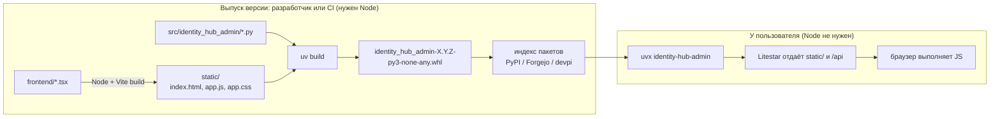

# Identity Hub Admin — стек, сборка и запуск одной командой

Статус: предложено  
Связанные документы: [`ADMIN-PAGES.md`](ADMIN-PAGES.md) (какие страницы и данные),
[`identity-hub-requirements.md`](../../identity-hub-requirements.md)

Документ фиксирует, **на чём** делается админка Identity Hub, **как** она собирается и
распространяется и **почему пользователю для запуска не нужен Node.js**, хотя фронтенд написан на
React.

---

## 1. Решение

Админка — отдельный Python-пакет `identity-hub-admin`:

- **бэкенд** — Litestar поверх read-моделей и методов библиотеки Identity Hub;
- **фронтенд** — React SPA (Vite, TypeScript, shadcn/ui, TanStack), собранный заранее;
- **собранная статика фронтенда лежит внутри Python-колеса** (`.whl`), и её раздаёт тот же
  Litestar.

Так устроены Prefect, Dagster, MLflow и Jupyter: внутри у них React, но `pip install` не требует
Node.

Стек совпадает с шаблоном админки «Пульт» (React SPA на shadcn/ui), поэтому компоненты —
таблицы, фильтры в URL, статусы фоновых задач, каналы уведомлений — переиспользуются. Разделы
«внешние аккаунты» и «прокси» шаблона по сути и есть админка Identity Hub.

---

## 2. Запуск для пользователя

Три режима из одного пакета.

**Одной командой, без установки в проект:**

```bash
uvx identity-hub-admin --database-url postgresql://... --kek-file ./kek.key
# открыть http://localhost:8765
```

`uvx` скачивает готовое колесо во временное окружение и запускает его. Внутри уже есть
Python-код, собранный фронтенд и сервер.

**Встроенно в своё Litestar-приложение** — под префиксом, с общим `IdentityHub` из Dishka:

```python
app = Litestar(
    route_handlers=[...],
    plugins=[IdentityHubAdminPlugin(hub, path="/ih-admin")],
)
```

**Docker-образ для прода:**

```bash
docker run -p 8765:8765 \
  -e IH_DATABASE_URL=postgresql://... \
  -e IH_KEK_FILE=/run/secrets/kek \
  ghcr.io/<owner>/identity-hub-admin
```

---

## 3. Стек

| Слой | Выбор | Почему |
|---|---|---|
| Бэкенд | Litestar, пакет `identity-hub-admin` | основной стек; OpenAPI из коробки; `IdentityHub` приходит через Dishka |
| Данные | только read-модели и методы библиотеки | админка не пишет в таблицы напрямую ([`ADMIN-PAGES.md`](ADMIN-PAGES.md) §6) |
| Контракт API | OpenAPI Litestar → TS-клиент генератором (`@hey-api/openapi-ts` или `orval`) | типы фронтенда не расходятся с бэкендом |
| Фронтенд | React + TypeScript + Vite | как в «Пульте» |
| UI | Tailwind CSS 4, shadcn/ui (Radix), lucide | как в «Пульте» |
| Таблицы | TanStack Table + keyset-пагинация на сервере | таблица аккаунтов на десятки тысяч строк |
| Данные на клиенте | TanStack Query | кеш, автообновление метрик 15м / 1ч |
| Формы | React Hook Form + Zod | как в «Пульте» |
| Графики | Recharts; ECharts, если понадобятся тепловые карты и много точек | страница аналитики |
| Состояние фильтров | в URL | ссылкой на отфильтрованный список можно поделиться |
| Авторизация | в пакете админки: пароль или токен из конфигурации; опционально OIDC-прокси перед ней | библиотека пользователями не владеет |

---

## 4. Почему пользователю не нужен Node

Браузер не понимает React и TypeScript в исходном виде. Команда `vite build` один раз переводит
их в обычные файлы — `index.html`, несколько `.js` и `.css`. После этого это просто статика, как
картинки: Python-сервер отдаёт файлы, браузер пользователя выполняет JavaScript.

Node нужен только тому, кто **выпускает** пакет, а не тому, кто его **ставит**. Это как
Python-пакеты с C-расширениями: компилятор есть у автора, пользователь скачивает собранное колесо.



Содержимое колеса:

```
identity_hub_admin-0.3.0-py3-none-any.whl
├── identity_hub_admin/cli.py
├── identity_hub_admin/plugin.py
├── identity_hub_admin/api/...
└── identity_hub_admin/static/
    ├── index.html
    └── assets/app-3f9c2a.js, app-3f9c2a.css
```

---

## 5. Структура репозитория

```
identity-hub-admin/
├── frontend/                     # Vite-проект; в колесо не попадает
│   ├── src/
│   ├── package.json
│   └── vite.config.ts            # build.outDir = ../src/identity_hub_admin/static; dev-прокси /api
├── src/identity_hub_admin/
│   ├── api/                      # Litestar-контроллеры поверх read-моделей Identity Hub
│   ├── static/                   # собранный фронтенд; в .gitignore, создаётся сборкой
│   ├── auth.py                   # пароль / токен, middleware
│   ├── plugin.py                 # IdentityHubAdminPlugin для встраивания
│   ├── app.py                    # create_admin_app()
│   └── cli.py                    # точка входа identity-hub-admin
├── hatch_build.py                # хук: собрать фронтенд перед упаковкой колеса
├── Dockerfile
└── pyproject.toml
```

---

## 6. Раздача SPA из Litestar

Статика плюс fallback на `index.html` для клиентских маршрутов (`/spaces/tennet/accounts/...`
обрабатывает TanStack Router):

```python
from pathlib import Path

from litestar import Litestar, Router, get
from litestar.di import Provide
from litestar.response import File

from identity_hub import IdentityHub
from identity_hub_admin.api import API_CONTROLLERS
from identity_hub_admin.auth import AdminSettings, admin_auth_middleware

STATIC_DIR = Path(__file__).parent / "static"


@get("/{path:path}", include_in_schema=False)
async def spa_fallback(path: str) -> File:
    candidate = (STATIC_DIR / path).resolve()
    if path and candidate.is_file() and STATIC_DIR in candidate.parents:
        return File(candidate)
    return File(STATIC_DIR / "index.html")


def create_admin_app(hub: IdentityHub, settings: AdminSettings) -> Litestar:
    return Litestar(
        route_handlers=[Router("/api", route_handlers=API_CONTROLLERS), spa_fallback],
        dependencies={"hub": Provide(lambda: hub, sync_to_thread=False)},
        middleware=[admin_auth_middleware(settings)],
    )
```

Проверка `STATIC_DIR in candidate.parents` не даёт выйти за пределы папки через `../`.

Файлы в `assets/` имеют хеш в имени — их можно отдавать с долгим `Cache-Control`;
`index.html` — без кеша, чтобы после обновления пакета браузер получил новую версию.

---

## 7. Сборка колеса

### 7.1. Хук сборки

Собирает фронтенд перед упаковкой, чтобы нельзя было выпустить колесо без статики:

```toml
# pyproject.toml
[build-system]
requires = ["hatchling"]
build-backend = "hatchling.build"

[project]
name = "identity-hub-admin"
dependencies = ["identity-hub>=1.0,<2", "litestar[standard]>=2"]

[project.scripts]
identity-hub-admin = "identity_hub_admin.cli:main"

[tool.hatch.build.targets.wheel]
packages = ["src/identity_hub_admin"]
artifacts = ["src/identity_hub_admin/static/**"]     # включить в колесо, хоть файлов нет в git

[tool.hatch.build.hooks.custom]
path = "hatch_build.py"
```

```python
# hatch_build.py
import shutil
import subprocess
from pathlib import Path

from hatchling.builders.hooks.plugin.interface import BuildHookInterface


class FrontendBuildHook(BuildHookInterface):
    def initialize(self, version: str, build_data: dict) -> None:
        static = Path(self.root, "src/identity_hub_admin/static")
        if (static / "index.html").exists() and not self.config.get("force"):
            return                                           # уже собрано — Node не нужен
        npm = shutil.which("npm")
        if npm is None:
            raise RuntimeError(
                "Сборка фронтенда требует Node.js. Установите пакет из готового колеса."
            )
        frontend = Path(self.root, "frontend")
        subprocess.run([npm, "ci"], cwd=frontend, check=True)
        subprocess.run([npm, "run", "build"], cwd=frontend, check=True)
```

### 7.2. CI при выпуске версии

```yaml
- uses: actions/setup-node@v4
  with:
    node-version: 22
- uses: astral-sh/setup-uv@v6
- run: uv build
- name: Статика внутри колеса
  run: unzip -l dist/*.whl | grep -q "identity_hub_admin/static/index.html"
- name: Смоук-тест колеса без Node
  run: |
    uv venv /tmp/smoke && uv pip install --python /tmp/smoke dist/*.whl
    /tmp/smoke/bin/identity-hub-admin --help
- run: uv publish --index private dist/*.whl
```

Смоук-тест ставит колесо в чистое окружение и проверяет, что команда запускается.

### 7.3. Куда публиковать

Публикуется **колесо** (`.whl`):

- PyPI — если пакет публичный;
- self-hosted: реестр пакетов Forgejo/Gitea или devpi;
- минимум — `.whl` как файл GitHub/Forgejo Release; ставится по прямой ссылке.

Тогда `uvx identity-hub-admin` и `uv add identity-hub-admin` получают готовое колесо, и Node не
нужен.

---

## 8. Когда Node всё-таки понадобится

Только при установке **из исходников**: `uv add git+https://...` или из sdist. В git нет
собранной `static/`, хук попытается собрать фронтенд и без Node упадёт с понятным сообщением.

Решения:

1. **Основной путь** — ставить из индекса пакетов или по прямой ссылке на `.whl` из Release.
2. **Если нужна установка из git** — отдельная ветка `release`, в которую CI коммитит собранную
   `static/`. Хук видит `index.html` и Node не вызывает:

   ```bash
   uv add "identity-hub-admin @ git+https://forgejo.example/ih/identity-hub-admin@release"
   ```

---

## 9. Разработка

Разработчику админки Node нужен всегда.

| Процесс | Команда | Порт |
|---|---|---|
| Бэкенд с перезагрузкой | `uv run litestar --app identity_hub_admin.dev:app run --reload` | 8765 |
| Фронтенд с HMR | `npm run dev` в `frontend/` (прокси `/api` → 8765) | 5173 |
| Оба сразу | `uv run poe dev` (через `honcho` или `concurrently`) | — |
| Генерация TS-клиента | `npm run gen:api` из `http://localhost:8765/schema/openapi.json` | — |

Сгенерированный клиент коммитится, а CI проверяет, что он совпадает с текущей схемой: изменил
контроллер — перегенерируй клиент.

---

## 10. Dockerfile

Многоэтапная сборка: Node только в первом этапе, в итоговом образе его нет.

```dockerfile
FROM node:22-alpine AS frontend
WORKDIR /src/frontend
COPY frontend/package*.json ./
RUN npm ci
COPY frontend/ ./
RUN npm run build                               # → /src/src/identity_hub_admin/static

FROM ghcr.io/astral-sh/uv:python3.12-bookworm-slim AS app
WORKDIR /app
COPY pyproject.toml hatch_build.py ./
COPY src/ ./src/
COPY --from=frontend /src/src/identity_hub_admin/static ./src/identity_hub_admin/static
RUN uv pip install --system .                   # хук видит static/ и Node не ищет
EXPOSE 8765
CMD ["identity-hub-admin", "--host", "0.0.0.0", "--port", "8765"]
```

---

## 11. Совместимость версий

- `identity-hub-admin` зависит от диапазона `identity-hub` (`>=1.0,<2`).
- При старте админка проверяет ревизию БД библиотеки (IMP-15) и версию публичной read-схемы
  (IMP-12). Несовпадение — понятная ошибка, а не падение на первом запросе.
- Версия админки показывается в интерфейсе вместе с версией библиотеки и ревизией БД.

---

## 12. Рассмотренные альтернативы

| Вариант | Плюсы | Минусы |
|---|---|---|
| **SSR: Jinja + htmx + Basecoat** (как в server-admins) | нет Node даже при сборке; одна кодовая база на Python | графики, интерактивные фильтры и живые метрики сложнее; для шаблона уже выбран SPA |
| **sqladmin / starlette-admin** | CRUD из моделей за час | заточены под CRUD по таблицам; метрики, карточка с 13 вкладками и действия через методы библиотеки ложатся плохо; писали бы в таблицы в обход правил |
| **NiceGUI / Reflex** | только Python | свой рантайм и компоненты, не переиспользуется с «Пультом»; плотные таблицы хуже |
| **Streamlit** | быстро для графиков | не для операционной админки с действиями и правами |

---

## 13. Трейд-оффы выбранного варианта

- **Два языка в репозитории** и Node в CI. Пользователям колеса Node не нужен.
- **Размер колеса** растёт на собранный бандл, обычно на 1–3 МБ.
- **Совместимость версий** админки и библиотеки — диапазон зависимостей и проверка при старте (§11).
- **Установка из git требует Node**, если не использовать ветку `release` (§8).
