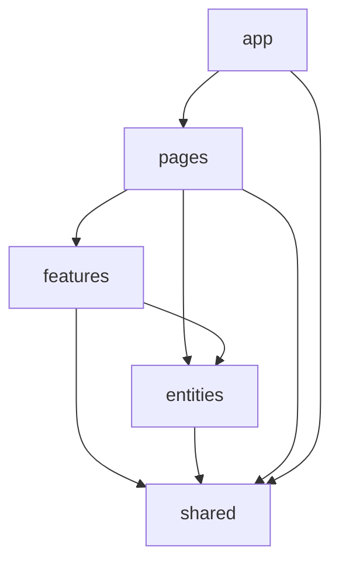

# Фронтенд админки — дизайн-система, архитектура и правила

Статус: обязательные правила для людей и нейросетей  
Область: админка Identity Hub и шаблон админки «Пульт» (React + TypeScript + Vite +
Tailwind CSS 4 + shadcn/ui)  
Связанные документы: [`ADMIN-STACK.md`](ADMIN-STACK.md), [`ADMIN-PAGES.md`](ADMIN-PAGES.md)

---

## 0. Главная идея

Проблема, которую решает документ: одинаковые по смыслу элементы выглядят по-разному — разные
радиусы, рамки, отступы, размеры шрифта, оттенки статусов. Причина всегда одна: **визуальные
решения принимаются на месте использования**. Кто-то написал `rounded-xl border-2 p-5` в
странице, потому что «так красивее».

Решение — три уровня защиты, от слабого к сильному:

1. **Правила и каталог** — этот документ и `AGENTS.md`: что использовать для какой задачи.
2. **Архитектура** — визуальные решения живут только в двух папках; страницы и фичи только
   собирают готовое.
3. **Механика** — то, что нельзя нарушить случайно:
   - в Tailwind **удалена стандартная палитра** и лишние радиусы: `bg-red-500` и `rounded-3xl`
     просто не существуют;
   - линтер запрещает произвольные значения (`w-[347px]`), `style`, `dark:`, сырые `<button>`,
     прямой импорт Radix и визуальные классы в фичах;
   - страница `/_design` и скриншот-тесты показывают все компоненты в светлой и тёмной теме.

Если правило можно проверить машиной — оно проверяется машиной. Текст правил нужен для того,
что машиной не проверить.

---

## 1. Слои и папки

```
frontend/src/
├── app/                        # сборка приложения
│   ├── providers.tsx           # QueryClient, тема, тосты, роутер
│   ├── router.tsx              # маршруты из модулей фич
│   ├── shell/                  # AppShell: сайдбар, шапка, контейнер страницы
│   └── modules.ts              # реестр модулей: какие разделы включены в этом проекте
├── pages/                      # только композиция: одна страница = один файл
│   ├── identities-list.tsx
│   ├── identity-card.tsx
│   └── ...
├── features/                   # поведение: сценарии пользователя
│   ├── identity-search/        # строка поиска, фильтры, их состояние в URL
│   ├── identity-override/      # диалог ручной правки региона
│   ├── lease-metrics/          # метрики аренд по окнам
│   └── secret-reveal/          # показ секрета с подтверждением и аудитом
├── entities/                   # доменные сущности: типы, запросы, отображение
│   ├── identity/
│   │   ├── api.ts              # хуки TanStack Query поверх сгенерированного клиента
│   │   ├── status.ts           # регионы → тон бейджа, подписи (единственное место!)
│   │   ├── columns.tsx         # колонки таблицы аккаунтов
│   │   └── ui/                 # доменные элементы: RegionBadges, EligibilityHint
│   ├── lease/
│   ├── proxy/
│   └── event/
├── shared/
│   ├── ui/                     # примитивы shadcn/ui — генерируются CLI
│   ├── components/             # композиты дизайн-системы (наши)
│   ├── lib/                    # cn(), форматирование, хуки общего назначения
│   ├── api/                    # сгенерированный OpenAPI-клиент (не редактируется руками)
│   └── config/
└── styles/
    └── globals.css             # токены — единственный источник визуальных значений
```

### 1.1. Правила зависимостей



- Импорт только **вниз** по схеме. `entities` не импортирует `features`, `shared` не
  импортирует ничего из верхних слоёв.
- Фичи не импортируют друг друга. Если двум фичам нужно общее — оно спускается в `entities` или
  `shared`.
- Проверяется `eslint-plugin-boundaries` (§6).

### 1.2. Кто принимает визуальные решения

| Папка | Визуальные решения | Что можно писать в `className` |
|---|---|---|
| `styles/globals.css` | **да** — все значения: цвета, радиусы, шрифты, тени | — |
| `shared/ui` | **да** — стиль примитивов через токены | любые классы на токенах |
| `shared/components` | **да** — композиты и их варианты через `cva` | любые классы на токенах |
| `entities/*/ui` | нет — только сборка из `shared` | только раскладка (§3.7) |
| `features` | нет | только раскладка |
| `pages` | нет | только раскладка |
| `app/shell` | один раз задаёт каркас страницы | классы на токенах |

**Раскладка** — это расположение, а не внешний вид: `flex`, `grid`, `grid-cols-*`, `gap-*`,
`col-span-*`, `items-*`, `justify-*`, `w-full`, `min-w-0`, `shrink-0`, `hidden`, `md:*`
для этих же классов. Цвет, радиус, рамка, тень, размер и начертание шрифта в фичах и страницах
запрещены.

### 1.3. Модули разделов

Шаблон переиспользуется в разных проектах, разделы включаются флагами. Каждый раздел — модуль:

```ts
// features/proxies/module.ts
import type { AdminModule } from "@/app/modules";
import { ServerIcon } from "lucide-react";

export const proxiesModule: AdminModule = {
  id: "proxies",
  nav: { label: "Прокси", icon: ServerIcon, group: "resources", order: 20 },
  routes: [
    { path: "/proxies", lazy: () => import("@/pages/proxies-list") },
    { path: "/proxies/:proxyId", lazy: () => import("@/pages/proxy-card") },
  ],
};
```

```ts
// app/modules.ts
export const ENABLED_MODULES: AdminModule[] = [identitiesModule, proxiesModule, leasesModule];
```

Сайдбар и роутер строятся из реестра. Добавить раздел — добавить модуль, а не править
сайдбар.

---

## 2. Токены (`styles/globals.css`)

Все визуальные значения задаются здесь. Компонент не содержит «своих» цветов, радиусов и
теней — только ссылки на токены.

### 2.1. Отключить всё стандартное, что не нужно

В Tailwind 4 пространство имён темы очищается через `initial`: после `--color-*: initial`
утилиты вроде `bg-red-500` перестают существовать, остаются только объявленные.

```css
@import "tailwindcss";
@import "tw-animate-css";

@custom-variant dark (&:is(.dark *));

/* 1. Убираем стандартные палитры и шкалы, которые провоцируют разнобой */
@theme {
  --color-*: initial;          /* никаких red-500, slate-200, blue-600 */
  --radius-*: initial;         /* только наши радиусы ниже */
  --shadow-*: initial;         /* только наши тени ниже */
  --text-*: initial;           /* только наша шкала шрифтов ниже */
}
```

После включения проверить, что нужные служебные классы (`bg-transparent`, `text-current`,
`bg-white`/`bg-black`, если используются) по-прежнему генерируются; недостающие добавить
явными токенами.

### 2.2. Семантические токены

Значения `--background`…`--sidebar-*` берутся из `npx shadcn init` (baseColor `neutral`) и
**не придумываются заново**. Наши добавления — только статусные тона и плотность.

```css
:root {
  --radius: 0.5rem;

  /* shadcn: background, foreground, card, popover, primary, secondary, muted, accent,
     destructive, border, input, ring, chart-1..5, sidebar-* — значения из shadcn init */

  /* В Tailwind-4-версии shadcn у destructive нет пары -foreground (используется text-white),
     а white мы удалили вместе с палитрой — добавляем пару явно */
  --destructive-foreground: oklch(0.98 0 0);

  /* Наши статусные тона — единственные цвета статусов в приложении */
  --success: oklch(0.62 0.15 150);
  --success-foreground: oklch(0.98 0 0);
  --warning: oklch(0.77 0.16 75);
  --warning-foreground: oklch(0.21 0 0);
  --info: oklch(0.62 0.14 250);
  --info-foreground: oklch(0.98 0 0);
}

.dark {
  /* те же имена, свои значения — компоненты не пишут dark: */
  --success: oklch(0.70 0.15 150);
  --warning: oklch(0.80 0.15 75);
  --info: oklch(0.70 0.13 250);
}

/* 2. Регистрируем только разрешённое */
@theme inline {
  --color-background: var(--background);
  --color-foreground: var(--foreground);
  --color-card: var(--card);
  --color-card-foreground: var(--card-foreground);
  --color-popover: var(--popover);
  --color-popover-foreground: var(--popover-foreground);
  --color-primary: var(--primary);
  --color-primary-foreground: var(--primary-foreground);
  --color-secondary: var(--secondary);
  --color-secondary-foreground: var(--secondary-foreground);
  --color-muted: var(--muted);
  --color-muted-foreground: var(--muted-foreground);
  --color-accent: var(--accent);
  --color-accent-foreground: var(--accent-foreground);
  --color-destructive: var(--destructive);
  --color-destructive-foreground: var(--destructive-foreground);
  --color-border: var(--border);
  --color-input: var(--input);
  --color-ring: var(--ring);
  --color-chart-1: var(--chart-1);
  --color-chart-2: var(--chart-2);
  --color-chart-3: var(--chart-3);
  --color-chart-4: var(--chart-4);
  --color-chart-5: var(--chart-5);
  --color-success: var(--success);
  --color-success-foreground: var(--success-foreground);
  --color-warning: var(--warning);
  --color-warning-foreground: var(--warning-foreground);
  --color-info: var(--info);
  --color-info-foreground: var(--info-foreground);
  /* sidebar-* — из shadcn init */

  /* Радиусы: ровно три, все от --radius */
  --radius-sm: calc(var(--radius) - 4px);   /* бейджи, чекбоксы */
  --radius-md: calc(var(--radius) - 2px);   /* кнопки, поля ввода */
  --radius-lg: var(--radius);               /* карточки, диалоги, поповеры */

  /* Тени: две */
  --shadow-sm: 0 1px 2px 0 oklch(0 0 0 / 0.05);         /* поповеры, выпадающие меню */
  --shadow-md: 0 4px 12px -2px oklch(0 0 0 / 0.12);     /* диалоги */

  /* Шрифты: пять размеров на всё приложение */
  --text-xs: 0.75rem;   --text-xs--line-height: 1rem;      /* бейджи, подписи, мета */
  --text-sm: 0.875rem;  --text-sm--line-height: 1.25rem;   /* основной текст, таблицы, формы */
  --text-base: 1rem;    --text-base--line-height: 1.5rem;  /* заголовок секции */
  --text-lg: 1.125rem;  --text-lg--line-height: 1.75rem;   /* заголовок диалога */
  --text-xl: 1.25rem;   --text-xl--line-height: 1.75rem;   /* заголовок страницы */
  --text-2xl: 1.5rem;   --text-2xl--line-height: 2rem;     /* число в карточке метрики */
}
```

### 2.3. Таблица токенов для людей и нейросетей

| Нужно | Токен / класс | Нельзя |
|---|---|---|
| Фон страницы | `bg-background` | `bg-white`, `bg-gray-50` |
| Поверхность блока | `Card` (сам ставит `bg-card`) | свой `div` с рамкой |
| Второстепенный текст | `text-muted-foreground` | `text-gray-500`, `opacity-60` |
| Успех / предупреждение / ошибка / инфо | `StatusBadge tone=...` | любой цвет напрямую |
| Опасное действие | `Button variant="destructive"` | `bg-red-*` |
| Рамка | `border` (цвет из `--border`) | `border-2`, `border-gray-*` |
| Радиус | задан в компоненте | `rounded-*` в фичах |
| Тень | задана в компоненте | `shadow-*` в фичах |
| Графики | `--chart-1..5`, статусы — `--success/--warning/--destructive` | свои hex |

### 2.4. Шкала отступов

Разрешены значения Tailwind: `0, 0.5, 1, 1.5, 2, 3, 4, 6, 8` (0–32 px). Остальные (`5, 7, 9,
10, 12…`) запрещены линтером.

| Где | Значение |
|---|---|
| Внутри плотных элементов (иконка + текст, бейдж) | `gap-1` / `gap-1.5` |
| Между полями формы, строками списка свойств | `gap-3` |
| Между блоками внутри карточки | `gap-4` |
| Между карточками и секциями страницы | `gap-6` |
| Внешний отступ страницы | задаёт `PageContainer`, не страница |

---

## 3. Компоненты

### 3.1. Три уровня

| Уровень | Где | Кто пишет | Правило |
|---|---|---|---|
| **Примитивы** | `shared/ui` | shadcn CLI | не переписывать; правка — только на токены, записать в `shared/ui/CHANGES.md` |
| **Композиты** | `shared/components` | мы | вся вариативность через `cva` с именованными вариантами; каждый есть на `/_design` |
| **Доменные** | `entities/*/ui` | мы | только сборка композитов; своих стилей нет |

Настройка shadcn (`components.json`): `style: "new-york"`, `cssVariables: true`,
`baseColor: "neutral"`, алиас `ui` → `@/shared/ui`, `utils` → `@/shared/lib/utils`,
`iconLibrary: "lucide"`. Компоненты добавляются только командой `npx shadcn add <name>`.

### 3.2. Примитивы shadcn/ui, которые используем

`button`, `button-group`, `input`, `input-group`, `textarea`, `select`, `checkbox`, `switch`,
`radio-group`, `field` (метки, описания и ошибки полей форм), `label`, `form`/`field` с
React Hook Form, `dialog`, `alert-dialog`, `sheet`, `popover`, `dropdown-menu`, `command`,
`tooltip`, `tabs`, `table`, `card`, `badge`, `separator`, `skeleton`, `spinner`, `empty`,
`item`, `kbd`, `sonner` (тосты), `pagination`, `breadcrumb`, `sidebar`, `scroll-area`,
`chart` (Recharts на токенах `--chart-*`), `calendar`, `hover-card`.

Если нужен примитив не из списка — сначала проверить, не решает ли задачу существующий; новый
добавляется только через CLI и вносится в этот список.

### 3.3. Каталог: задача → компонент

Нейросеть и человек **выбирают компонент по этой таблице**. Если подходящего нет — §3.6.

| Задача | Компонент | Где |
|---|---|---|
| Каркас страницы, заголовок, хлебные крошки, действия справа | `PageHeader` внутри `PageContainer` | `shared/components/layout` |
| Страница-список | шаблон `ListPage` (фильтры + таблица + пагинация) | `shared/components/templates` |
| Страница-карточка с вкладками | шаблон `DetailPage` (шапка + `Tabs` + контент) | `shared/components/templates` |
| Дашборд | шаблон `DashboardPage` (сетка метрик + секции) | `shared/components/templates` |
| Блок с заголовком | `Section` (заголовок `text-base`, действия, `Card` внутри) | `shared/components/layout` |
| Таблица с сортировкой, фильтрами, выбором | `DataTable` (TanStack Table) | `shared/components/data-table` |
| Ячейки таблицы | `IdCell`, `StatusCell`, `NumberCell`, `TimeCell`, `DurationCell`, `ActionsCell` | `shared/components/data-table/cells` |
| Пагинация keyset | `CursorPagination` | `shared/components/data-table` |
| Строка поиска с синтаксисом `key:value` | `QuerySearch` | `shared/components/filters` |
| Панель фильтров, чипы активных фильтров | `FilterBar`, `FilterChip` | `shared/components/filters` |
| Статус | `StatusBadge tone="neutral\|info\|success\|warning\|danger"` | `shared/components/status` |
| Несколько статусов аккаунта | `RegionBadges` | `entities/identity/ui` |
| Число с изменением и мини-графиком | `MetricCard` | `shared/components/metrics` |
| Переключатель окна 15м / 1ч / 6ч / 24ч | `TimeWindowTabs` | `shared/components/metrics` |
| График по времени | `TimeSeriesChart` | `shared/components/charts` |
| Тепловая таблица (пространство × статус) | `HeatTable` | `shared/components/charts` |
| Свойства «ключ — значение» | `KeyValueList` | `shared/components/data-display` |
| JSON (identity_data, data события) | `JsonView` | `shared/components/data-display` |
| Лента событий / история переходов | `Timeline` | `shared/components/data-display` |
| Id с копированием | `CopyableId` (моно, 8 символов, полный в подсказке) | `shared/components/data-display` |
| Время «5 мин назад» с точным в подсказке | `TimeAgo` | `shared/components/data-display` |
| Длительность | `Duration` | `shared/components/data-display` |
| Секрет с показом по подтверждению | `SecretField` | `features/secret-reveal` |
| Подтверждение действия | `ConfirmDialog` (опционально — поле причины) | `shared/components/dialogs` |
| Действие над выбранными строками | `BulkActionBar` | `shared/components/data-table` |
| Загрузка / пусто / ошибка | `QueryState` (Skeleton / `Empty` / `ErrorState`) | `shared/components/states` |
| Форма | `FormLayout` + `Field` + React Hook Form + Zod | `shared/components/forms` |
| Уведомление об итоге действия | `toast` (sonner) | `shared/ui` |
| Иконка | `lucide-react`, размеры `size-4` (в тексте, кнопках, таблицах) и `size-5` (заголовки) | — |

### 3.4. Пример композита: `StatusBadge`

Все статусы приложения отображаются одним компонентом с пятью тонами. Страницы не выбирают
цвет — они выбирают **тон**, а тон берётся из доменного отображения (§3.5).

```tsx
// shared/components/status/status-badge.tsx
import { cva, type VariantProps } from "class-variance-authority";
import type { ComponentProps } from "react";

import { Badge } from "@/shared/ui/badge";
import { cn } from "@/shared/lib/utils";

const statusBadgeVariants = cva("gap-1 font-medium", {
  variants: {
    tone: {
      neutral: "border-border bg-muted text-muted-foreground",
      info: "border-transparent bg-info text-info-foreground",
      success: "border-transparent bg-success text-success-foreground",
      warning: "border-transparent bg-warning text-warning-foreground",
      danger: "border-transparent bg-destructive text-destructive-foreground",
    },
  },
  defaultVariants: { tone: "neutral" },
});

export type StatusTone = NonNullable<VariantProps<typeof statusBadgeVariants>["tone"]>;

type StatusBadgeProps = Omit<ComponentProps<typeof Badge>, "variant" | "className"> & {
  tone: StatusTone;
};

export function StatusBadge({ tone, ...props }: StatusBadgeProps) {
  return <Badge variant="outline" className={cn(statusBadgeVariants({ tone }))} {...props} />;
}
```

`className` в пропсах **нет**: снаружи внешний вид не меняется. Нужен новый вид — новый
именованный вариант в `cva`.

### 3.5. Доменное отображение статусов — одно место

```ts
// entities/identity/status.ts
import type { StatusTone } from "@/shared/components/status/status-badge";
import type { AuthState, Standing } from "@/shared/api";

type StatusView = { label: string; tone: StatusTone };

export const STANDING_VIEW: Record<Standing, StatusView> = {
  good: { label: "В порядке", tone: "success" },
  limited: { label: "Ограничен", tone: "warning" },
  frozen: { label: "Заморожен", tone: "danger" },
  appealing: { label: "Апелляция", tone: "info" },
  banned: { label: "Забанен", tone: "danger" },
  deleted: { label: "Удалён", tone: "neutral" },
};

export const AUTH_VIEW: Record<AuthState, StatusView> = {
  no_session: { label: "Нет сессии", tone: "neutral" },
  logging_in: { label: "Вход", tone: "info" },
  challenge: { label: "Нужен код", tone: "warning" },
  authenticated: { label: "Авторизован", tone: "success" },
  session_invalid: { label: "Сессия слетела", tone: "danger" },
};
```

`Record<Standing, ...>` не даст забыть новое состояние: при появлении значения в OpenAPI-типах
TypeScript потребует добавить его сюда. Таблицы, карточки, графики и фильтры берут подписи и тона
только отсюда.

### 3.6. Если нужного компонента нет

Порядок строгий:

1. Найти в каталоге §3.3 и на странице `/_design`.
2. Собрать из существующих композитов **без новых стилей**.
3. Если нужен другой вид существующего — добавить **именованный вариант** в `cva` этого
   компонента (`size="compact"`, `tone="info"`), а не передавать `className`.
4. Если нужен новый композит — создать его в `shared/components/<группа>/`:
   - только классы на токенах;
   - варианты через `cva`, без `className` во внешнем API (кроме `layoutClassName` для
     раскладки, если без неё никак);
   - добавить на `/_design` во всех вариантах и состояниях;
   - добавить строку в каталог §3.3;
   - скриншот-тест в светлой и тёмной теме.
5. Никогда: скопировать компонент и «чуть поправить», стилизовать сырой `div` в странице,
   использовать произвольное значение `[…]`.

### 3.7. Что можно в `className` на страницах и в фичах

Только раскладка:

```tsx
// Можно
<div className="grid grid-cols-1 gap-6 lg:grid-cols-3">
  <Section title="Регионы" className="lg:col-span-2">…</Section>
</div>

// Нельзя
<div className="rounded-xl border-2 border-gray-200 p-5 shadow-lg">…</div>   // это Card
<span className="text-[13px] text-green-600">OK</span>                       // это StatusBadge
<Button className="h-7 rounded-full px-2">…</Button>                          // это size="sm"
```

---

## 4. Шаблоны страниц и состояния

### 4.1. Шаблоны

| Шаблон | Состав | Страницы |
|---|---|---|
| `ListPage` | `PageHeader` → `QuerySearch` + `FilterBar` → `DataTable` → `CursorPagination`; `BulkActionBar` при выборе | аккаунты, прокси, события, аренды |
| `DetailPage` | `PageHeader` с бейджами и действиями → `Tabs` → содержимое вкладки из `Section` | карточка аккаунта, прокси |
| `DashboardPage` | `PageHeader` + `TimeWindowTabs` → сетка `MetricCard` → `Section` с графиками и таблицами | обзор, пространство, аренды, аналитика |

Страница — это выбор шаблона и заполнение слотов. Своя сетка страницы допускается только внутри
слотов и только классами раскладки.

### 4.2. Плотность

Админка для 1–10 технических операторов: плотность важнее воздуха.

- Основной размер текста — `text-sm`, таблицы и формы тоже.
- Числа — `tabular-nums`, выравнивание вправо (делает `NumberCell`).
- Идентификаторы — моноширинный шрифт (делает `CopyableId`).
- Высота строки таблицы задаётся `DataTable` (`density="compact" | "default"`), не колонкой.

### 4.3. Состояния загрузки

Каждый блок с данными оборачивается в `QueryState`:

```tsx
<QueryState query={leaseMetrics} skeleton={<MetricGridSkeleton count={4} />}
            empty={{ title: "Аренд не было", description: "За выбранное окно" }}>
  {(data) => <MetricGrid metrics={data} />}
</QueryState>
```

- загрузка — `Skeleton` той же формы, что и содержимое (без прыжков вёрстки);
- пусто — `Empty` с заголовком и подсказкой, что сделать;
- ошибка — `ErrorState` с кодом ошибки API и кнопкой «повторить»;
- фоновое обновление — без скелетона, маленький `Spinner` в заголовке секции.

### 4.4. Тексты

- Язык интерфейса — русский; подписи статусов только из `entities/*/status.ts`.
- Даты и числа — только через `shared/lib/format` (одна таймзона, один формат).
- Кнопки — глагол: «Перепроверить», «Отозвать аренду», а не «ОК».

---

## 5. Правила для нейросети (`frontend/AGENTS.md`)

Этот раздел копируется в `frontend/AGENTS.md`.

```markdown
# Фронтенд: правила для агента

## Всегда
- Перед вёрсткой открой каталог компонентов (FRONTEND-DESIGN-SYSTEM.md §3.3) и выбери компонент.
- Страница = шаблон (ListPage / DetailPage / DashboardPage) + слоты.
- Статусы — только StatusBadge с тоном из entities/*/status.ts.
- Цвета, радиусы, тени, размеры шрифта — только из токенов; в pages/, features/, entities/
  в className — только раскладка (flex, grid, gap, col-span, items, justify, w-full, min-w-0).
- Данные — только через хуки entities/*/api.ts поверх сгенерированного клиента shared/api.
- Каждый блок с данными — в QueryState.
- Новый визуальный вариант — именованный вариант cva в shared/components, плюс /_design.

## Никогда
- Классы стандартной палитры (red-500, gray-200 и т.п.) — их нет в сборке.
- Произвольные значения в квадратных скобках: w-[347px], text-[13px], bg-[#fff].
- style={{…}}, dark:…, rounded-*, shadow-*, border-2, text-{размер} вне shared/.
- Сырые <button>, <input>, <select>, <table>, <textarea> вне shared/ui.
- Прямой импорт @radix-ui/* вне shared/ui; recharts вне shared/components/charts.
- Копия компонента «с небольшой правкой».
- Правка файлов в shared/ui без записи в shared/ui/CHANGES.md.
- Ручная правка shared/api (генерируется из OpenAPI).

## Перед завершением
- npm run check (типы, ESLint, форматирование) — без ошибок.
- Если менялся shared/components: страница /_design обновлена, npm run test:visual пройден.
```

---

## 6. Механика: что проверяется автоматически

### 6.1. ESLint (flat config)

Плагины: `eslint-plugin-better-tailwindcss` (корректность Tailwind-классов, включая
`no-unknown-classes`, `no-conflicting-classes`, `no-restricted-classes`),
`eslint-plugin-react` (`forbid-elements`, `forbid-dom-props`), `eslint-plugin-boundaries`
(слои), `no-restricted-imports`.

```js
// eslint.config.js — набросок; точный синтаксис опций сверить с документацией плагинов
import betterTailwind from "eslint-plugin-better-tailwindcss";
import boundaries from "eslint-plugin-boundaries";
import react from "eslint-plugin-react";

const VISUAL_IN_FEATURES = [
  { pattern: "^(bg|text|border|ring|fill|stroke|outline)-", message: "Цвет — только в shared/. Используй компонент или вариант." },
  { pattern: "^rounded", message: "Радиус задаёт компонент." },
  { pattern: "^shadow", message: "Тень задаёт компонент." },
  { pattern: "^(text-(xs|sm|base|lg|xl|2xl)|font-)", message: "Типографика — через компоненты." },
  { pattern: "^border(-\\d)?$", message: "Рамка — это Card или компонент." },
  { pattern: "^(p|px|py|pt|pr|pb|pl|m|mx|my|mt|mr|mb|ml)-", message: "Внутренние отступы задают компоненты и PageContainer." },
  { pattern: "^dark:", message: "Тёмная тема — через токены." },
];

export default [
  {
    files: ["src/**/*.{ts,tsx}"],
    plugins: { "better-tailwindcss": betterTailwind, react, boundaries },
    settings: {
      "better-tailwindcss": { entryPoint: "src/styles/globals.css" },
      "boundaries/elements": [
        { type: "app", pattern: "src/app/*" },
        { type: "pages", pattern: "src/pages/*" },
        { type: "features", pattern: "src/features/*" },
        { type: "entities", pattern: "src/entities/*" },
        { type: "shared", pattern: "src/shared/*" },
      ],
    },
    rules: {
      "better-tailwindcss/no-unknown-classes": "error",
      "better-tailwindcss/no-conflicting-classes": "error",
      "better-tailwindcss/no-duplicate-classes": "error",
      "better-tailwindcss/no-restricted-classes": ["error", {
        restrict: [
          { pattern: "\\[.*\\]", message: "Произвольные значения запрещены — нужен токен." },
          { pattern: "^(p|m|gap|space)[xytrbl]?-(5|7|9|10|11|12|14|16|20|24)$", message: "Вне шкалы отступов (§2.4)." },
        ],
      }],
      "boundaries/element-types": ["error", {
        default: "disallow",
        rules: [
          { from: "app", allow: ["pages", "features", "entities", "shared"] },
          { from: "pages", allow: ["features", "entities", "shared"] },
          { from: "features", allow: ["entities", "shared"] },
          { from: "entities", allow: ["shared"] },
          { from: "shared", allow: ["shared"] },
        ],
      }],
      "no-restricted-imports": ["error", { patterns: [
        { group: ["@radix-ui/*"], message: "Radix — только внутри shared/ui." },
        { group: ["recharts"], message: "Графики — через shared/components/charts." },
      ]}],
    },
  },
  {
    files: ["src/pages/**", "src/features/**", "src/entities/**"],
    rules: {
      "better-tailwindcss/no-restricted-classes": ["error", { restrict: VISUAL_IN_FEATURES }],
      "react/forbid-elements": ["error", { forbid: [
        { element: "button", message: "Используй Button." },
        { element: "input", message: "Используй Input / Field." },
        { element: "select", message: "Используй Select." },
        { element: "table", message: "Используй DataTable." },
        { element: "textarea", message: "Используй Textarea." },
      ]}],
      "react/forbid-dom-props": ["error", { forbid: ["style"] }],
    },
  },
  {
    files: ["src/shared/ui/**", "src/shared/components/**"],
    rules: { "no-restricted-imports": "off" },
  },
];
```

Порядок классов — `prettier-plugin-tailwindcss` (одна точка ответственности; правило порядка
в `better-tailwindcss` не включаем, чтобы не спорили два инструмента).

### 6.2. Tailwind

Стандартные палитра, радиусы, тени и шкала шрифтов удалены (§2.1): запрещённый класс не
сгенерируется, а `no-unknown-classes` покажет ошибку ещё в редакторе.

### 6.3. Страница `/_design`

Внутренний маршрут (только в dev-сборке или под флагом), где отрисованы:

- палитра токенов в светлой и тёмной теме;
- все композиты `shared/components` во всех вариантах и состояниях (загрузка, пусто, ошибка,
  выбранные строки, длинный текст, 0 и 1 000 000 в числах);
- все тоны `StatusBadge` и все значения `entities/*/status.ts`.

Это живой каталог: нейросеть может открыть его и сравнить свой результат, человек — быстро
увидеть разнобой.

### 6.4. Скриншот-тесты

Playwright делает снимки `/_design` в светлой и тёмной теме и сравнивает с эталоном. Любое
изменение композита видно в диффе снимков; эталон обновляется осознанно.

### 6.5. Команды

| Команда | Что делает |
|---|---|
| `npm run check` | `tsc --noEmit`, `eslint .`, `prettier --check .` |
| `npm run test:visual` | скриншоты `/_design`, сравнение с эталоном |
| `npm run gen:api` | генерация клиента из OpenAPI бэкенда |
| `npx shadcn add <name>` | добавить примитив (только так) |

---

## 7. Чек-лист изменения интерфейса

- [ ] Компонент выбран по каталогу §3.3; новых стилей в `pages/`, `features/`, `entities/` нет.
- [ ] Статусы — `StatusBadge` + `entities/*/status.ts`.
- [ ] Блоки с данными — в `QueryState`, есть скелетон, пустое состояние и ошибка.
- [ ] Числа — `tabular-nums` через `NumberCell`/`MetricCard`; даты — через `shared/lib/format`.
- [ ] Светлая и тёмная тема выглядят одинаково корректно (проверено на `/_design` или странице).
- [ ] `npm run check` зелёный; при изменениях в `shared/components` — `/_design` и
      `test:visual` обновлены.

---

## 8. Трейд-оффы

- **Жёсткий запрет стилей в фичах замедляет первые недели**: чаще придётся добавлять вариант в
  композит, чем «просто поправить». Это и есть цель — вариантов становится много в одном месте,
  а не по одному в каждой странице.
- **Удаление стандартной палитры** ломает копипасту примеров из интернета. Для админки это
  плюс: примеры всё равно приходится приводить к токенам.
- **Правки `shared/ui`** расходятся с upstream shadcn: обновление компонентов через CLI может
  перезаписать изменения. Поэтому правки минимальны и записаны в `shared/ui/CHANGES.md`.
- **Регулярки в `no-restricted-classes`** не понимают контекста: запрет `^(bg|text|border)-`
  заодно запрещает в фичах `text-right`, `truncate`-подобные `text-ellipsis` и `border-b`.
  Выравнивание и обрезка текста уже делают ячейки и композиты; если всё же нужно — исключение через явный `// eslint-disable-next-line` с причиной, и их число
  стоит держать близким к нулю.
