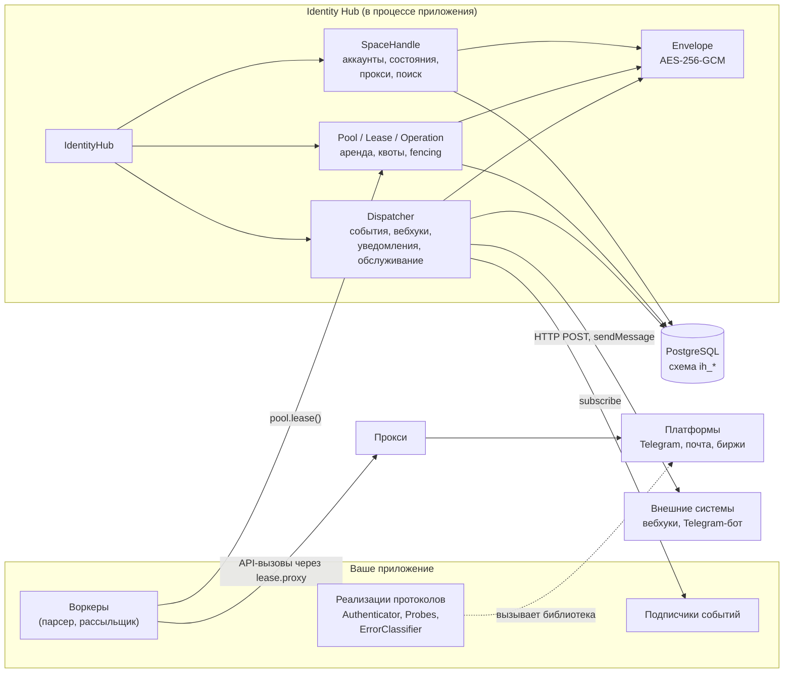
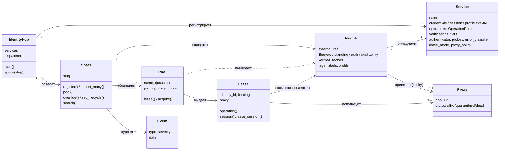
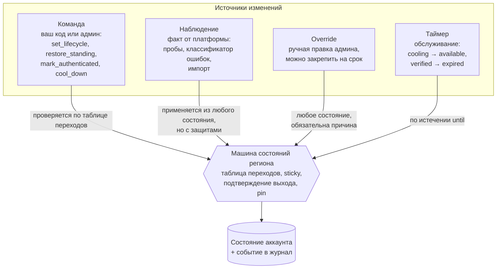
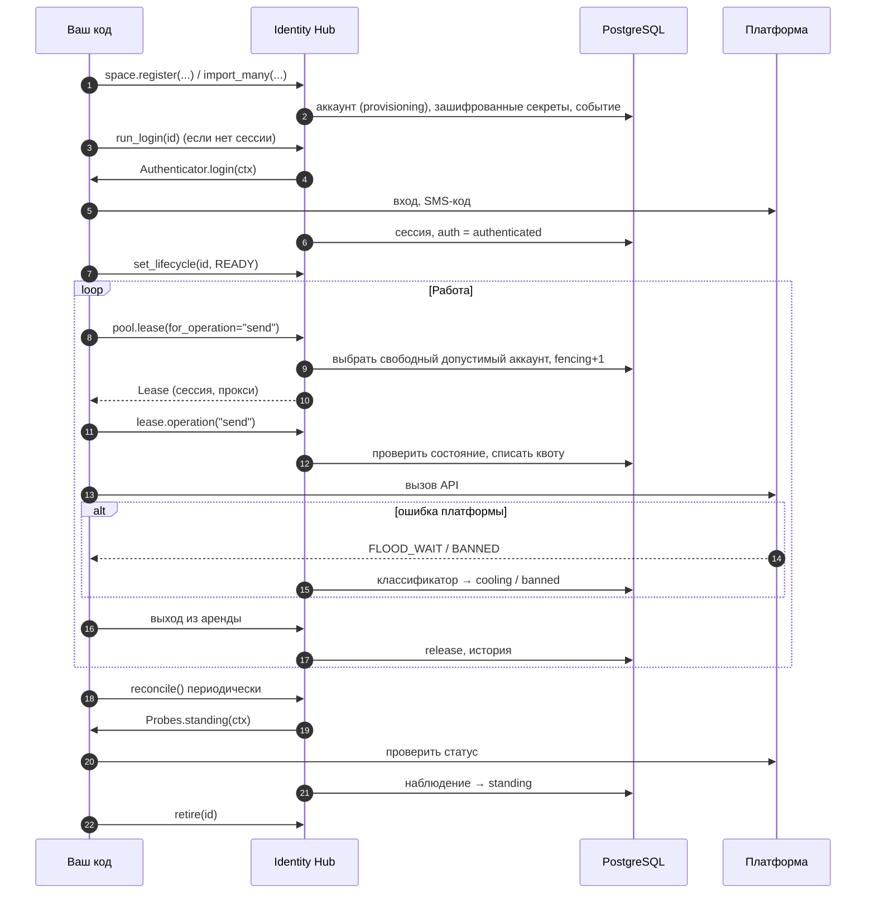

# 1. Концепции и архитектура

## Какую задачу решает библиотека

У вас есть парк аккаунтов на внешних платформах: Telegram, почта, биржи, соцсети. С ними
работают воркеры: парсят, рассылают, торгуют. Без общего учёта быстро возникают проблемы:

- два воркера одновременно используют один аккаунт, и платформа его банит;
- забаненный или разлогиненный аккаунт снова и снова выдаётся в работу;
- аккаунт превышает лимиты платформы, потому что счётчики живут в памяти одного процесса;
- сессии и пароли лежат открытым текстом в базе или в файлах;
- никто не знает, когда и почему аккаунт сменил статус.

Identity Hub — **учётная система и диспетчер доступа** для такого парка. Она хранит аккаунты
и их состояние в PostgreSQL, выдаёт аккаунт воркеру в эксклюзивную аренду, проверяет, можно
ли выполнять операцию, списывает квоты, шифрует секреты и пишет журнал событий.

## Роль библиотеки и роль вашего кода

**Identity Hub не является клиентом платформ.** Она не ходит в Telegram и не парсит почту.
Все сетевые вызовы делает ваш код; библиотека решает, *каким* аккаунтом, *когда* и *можно ли*.

| Ответственность | Identity Hub | Ваш код |
|---|---|---|
| Хранение аккаунтов, credentials, сессий, прокси | ✅ шифрует и хранит | передаёт данные |
| Схема данных аккаунта | проверяет | объявляет pydantic-моделями в `Service` |
| Выдача аккаунта воркеру, исключение гонок | ✅ аренда, heartbeat, fencing | вызывает `pool.lease()` |
| Решение «можно ли выполнить операцию» | ✅ по состояниям, верификации, квотам | объявляет правила `OperationRule` |
| Вызов API платформы | — | ✅ Telethon, IMAP, HTTP-клиент |
| Понять, что платформа забанила аккаунт | интерпретирует и применяет | ✅ сообщает через классификатор ошибок или пробу |
| Логин, ввод SMS-кода | ведёт процесс, хранит challenge | ✅ реализует `Authenticator` |
| Переходы между статусами, их допустимость | ✅ машины состояний | инициирует командами |
| Автоматические переходы по таймерам | ✅ обслуживание | запускает диспетчер |
| Журнал, вебхуки, уведомления | ✅ | подписывается |

Коротко: **библиотека — источник правды о состоянии аккаунта и арбитр доступа к нему**. Факты
о внешнем мире (бан, невалидная сессия, flood-wait) приносит ваш код, а библиотека решает, как
они меняют состояние.

## Архитектура

- **Всё работает в процессе вашего приложения.** Отдельного сервера у библиотеки нет;
  общий между процессами слой — PostgreSQL. Поэтому несколько воркеров на разных машинах
  безопасно делят один парк.
- **Dispatcher** — фоновый цикл: читает журнал событий, доставляет вебхуки и уведомления,
  запускает обслуживание (таймеры состояний, истёкшие аренды, очистка). Запускается внутри
  приложения (`async with hub.dispatcher.running()`) или отдельным процессом
  (`identity-hub dispatcher`), см. [интеграцию](../integrations.md).
- **Envelope** шифрует credentials, сессии, прокси-логины, evidence верификаций и секреты
  вебхуков. Мастер-ключ (KEK) передаёт `SecretsProvider`.

## Доменная модель

| Понятие | Что это |
|---|---|
| **Сервис** (`Service`) | Описание платформы в коде: схемы данных, виды операций и их правила, как логиниться, как проверять статус. Глобальный для всего хаба. |
| **Пространство** (`space`) | Изоляция данных: отдельный клиент, проект или окружение. Аккаунты, прокси, вебхуки, события живут внутри пространства. |
| **Аккаунт** (identity) | Учётная запись на платформе. Уникален по паре `(service, external_ref)` — например, номер телефона. |
| **Регион состояния** | Независимая ось статуса аккаунта: `lifecycle`, `standing`, `auth`, `availability`, `verification`. См. [состояния](04-states.md). |
| **Пул** (`pool`) | Именованная выборка аккаунтов одного сервиса с фильтрами (теги, метки, профиль) и политиками аренды. Живёт в памяти процесса, в БД не хранится. |
| **Аренда** (`lease`) | Право воркера на аккаунт на время работы. Эксклюзивная по умолчанию. |
| **Операция** (`lease.operation`) | Одно действие на платформе: проверка допустимости, списание квоты, учёт ошибок. |
| **Событие** | Запись журнала о каждом значимом изменении. Источник для вебхуков, уведомлений и аналитики. |

## Кто управляет состоянием аккаунта

Состояние аккаунта **хранит и меняет только библиотека** — через машины состояний с таблицей
допустимых переходов. Ваш код и администратор не пишут статус напрямую, а подают один из
четырёх видов изменений:

| Вид | Кто инициирует | Правила |
|---|---|---|
| **Команда** | ваш код, админ | Только разрешённые переходы, иначе `TransitionNotAllowed`. Некоторые требуют причину. |
| **Наблюдение** | платформа через пробы, классификатор ошибок, импорт | Не проверяется по таблице переходов — это факт. Но: устаревшие наблюдения отбрасываются, из `banned` наблюдение не выводит (sticky), выход из `banned`/`frozen` требует двух подтверждений подряд, закреплённый регион не меняется. |
| **Override** | админ | Любое состояние, обязательны причина и автор. Может закрепить регион (`pin_for`), чтобы наблюдения его не перезаписывали. |
| **Таймер** | библиотека (обслуживание в диспетчере) | Срабатывает, когда наступает `until`: снятие cooldown и pacing-паузы, `limited → good`, истечение верификаций и challenge. |

Каждое изменение пишется в журнал событием `identity.<регион>.changed` с полями `from`, `to`,
`source`, `actor`, `reason`. История статусов всегда восстанавливается по журналу.

## Жизненный цикл аккаунта целиком

Дальше: [описать платформу как сервис](02-services.md).
