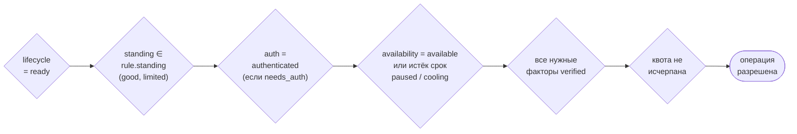
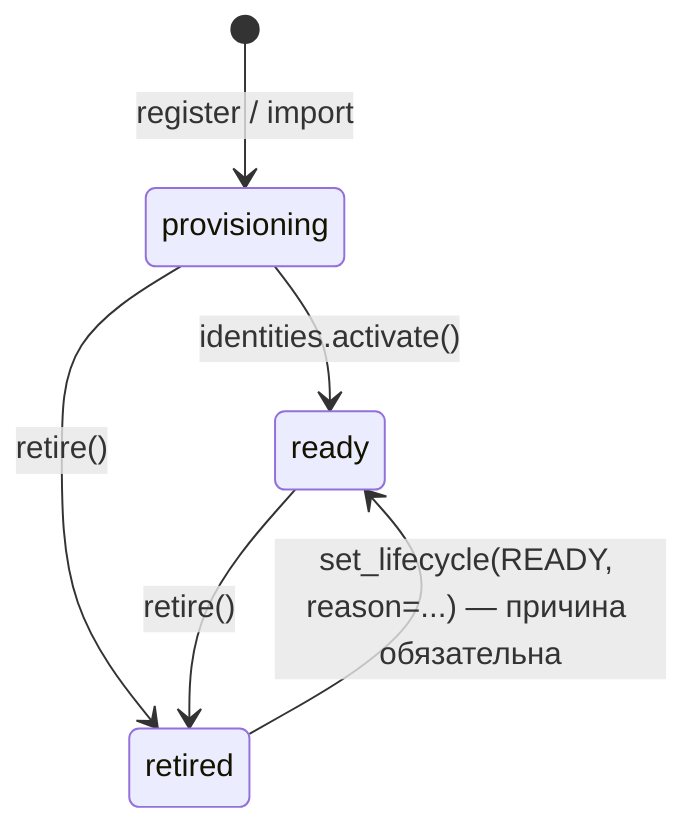
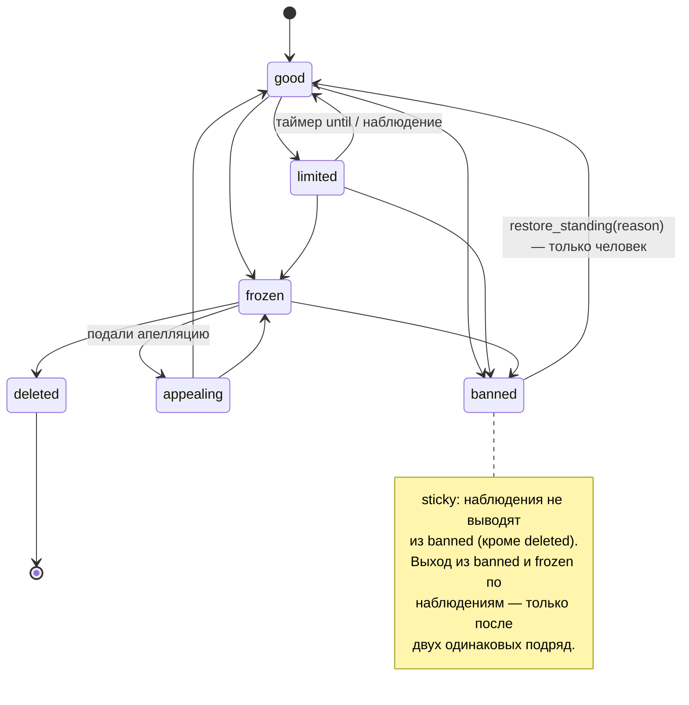
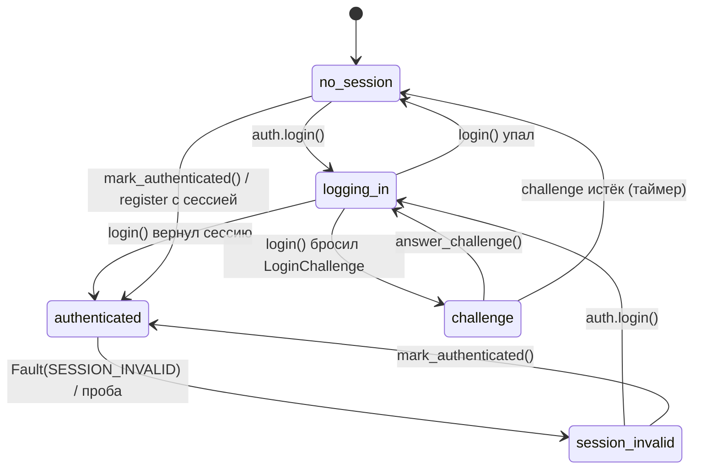
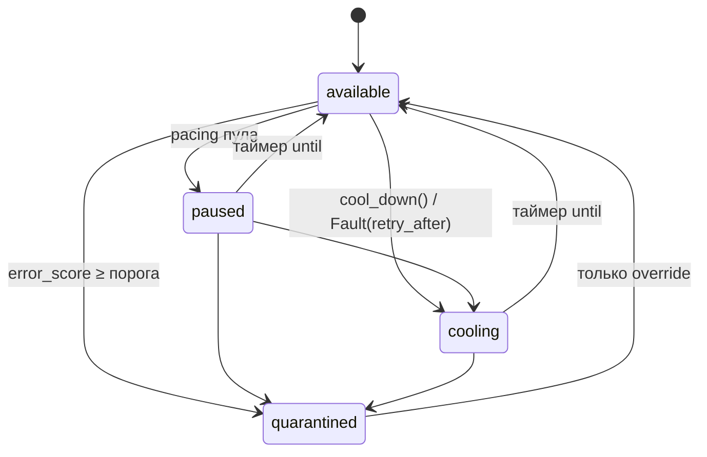
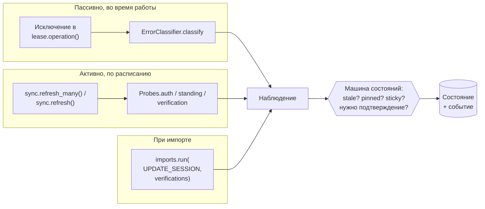

# 4. Состояния аккаунта

Статус аккаунта — не одно поле, а несколько **независимых регионов**. Аккаунт может быть
одновременно «в парке» (`lifecycle=ready`), «с ограничениями» (`standing=limited`),
«с живой сессией» (`auth=authenticated`) и «на паузе» (`availability=cooling`). Каждый регион —
своя машина состояний с таблицей переходов.

| Регион | Вопрос | Значения | Синхронизируется с платформой |
|---|---|---|---|
| `lifecycle` | Числится ли аккаунт в парке? | `provisioning`, `ready`, `retired` | нет — решает только ваш код |
| `standing` | Что о нём думает платформа? | `good`, `limited`, `frozen`, `appealing`, `banned`, `deleted` | да |
| `auth` | Есть ли рабочая сессия? | `no_session`, `logging_in`, `challenge`, `authenticated`, `session_invalid` | да |
| `availability` | Можно ли нагружать прямо сейчас? | `available`, `paused`, `cooling`, `quarantined` | нет — ведёт библиотека |
| `verification` | Подтверждены ли факторы? | по фактору: `missing` … `verified` | да, см. [верификацию](06-verification.md) |

Кто и как меняет состояние — см. [концепции](01-concepts.md#кто-управляет-состоянием-аккаунта):
команды, наблюдения, override, таймеры.

## Когда аккаунт можно взять в работу

Аккаунт выдаётся в аренду и проходит `lease.operation(...)`, только если **одновременно**:



Квота проверяется только в `operation()`, остальное — и при выдаче аренды, и повторно в
`operation()` по свежему снимку. Если условие не выполнено, `operation()` бросает
`OperationNotAllowed` со списком `blockers` (`Blocker(code, detail, until)`), а
`space.identities.card(id)` показывает `eligible` и `blockers`.

## Lifecycle — присутствие в парке



- **Управляет:** только ваш код и администратор. Платформа на lifecycle не влияет, таймеров нет.
- **`provisioning`** — заведён, но ещё не проверен или не залогинен. В аренду не выдаётся.
- **`ready`** — в работе. Единственное состояние, в котором возможны операции.
- **`retired`** — выведен: продан, списан, больше не нужен. Данные и история сохраняются.
- Вернуть `ready → provisioning` командой нельзя (`TransitionNotAllowed`); только override.

```python
await space.identities.activate(identity_id, actor="onboarding")
await space.identities.retire(identity_id, actor="ops", reason="больше не нужен")
```

## Standing — репутация на платформе



| Значение | Смысл | Работа по умолчанию |
|---|---|---|
| `good` | всё в порядке | ✅ |
| `limited` | временные ограничения: спам-блок, action block | ✅ (уберите из `rule.standing`, если не нужно) |
| `frozen` | заморожен, требуется действие | ❌ |
| `appealing` | подана апелляция | ❌ |
| `banned` | забанен | ❌ |
| `deleted` | удалён платформой, конечное | ❌ |

- **Управляет:** в основном платформа — через пробы и классификатор ошибок. Человек —
  через `restore_standing` и override.
- **Severity событий:** `limited`/`appealing` — WARNING, `frozen`/`banned`/`deleted` — CRITICAL.
  На это удобно вешать [уведомления](10-events.md).

## Auth — сессия



- **Управляет:** процесс входа библиотеки ([вход](05-login.md)), ваш код через
  `lease.mark_authenticated()`, классификатор ошибок (`session_invalid`), пробы.
- `session_invalid` — это не бан: standing не меняется, аккаунт просто нужно перелогинить.
- Регион ведётся по слотам сессий; для отбора и допуска используется слот `default`.

## Availability — нагрузка прямо сейчас



- **Управляет:** только библиотека ([лимиты](08-limits.md)) и override администратора.
- `paused` и `cooling` снимаются сами: истёкшие считаются доступными сразу, без ожидания
  обслуживания.
- `quarantined` снимается только вручную, даже если у него задан `until`: срок здесь справочный.
  Override не обнуляет `error_score`, поэтому после выхода из карантина одна новая ошибка может
  снова отправить аккаунт туда.
- Закрепление (`Override(..., pin_for=...)`) защищает регион и от таймера: `limited` с истёкшим
  `until` остаётся `limited`, пока действует закрепление.
- Таймер срабатывает только там, где у состояния есть переход по истечении: `limited → good`,
  `paused`/`cooling → available`. У `frozen` и `banned` с `until` срок тоже справочный —
  обслуживание такие аккаунты не трогает.

## Как забанить, заморозить, разбанить

**Автоматически — рекомендуемый путь.** Когда платформа отвечает «аккаунт заблокирован»,
классификатор ошибок переводит standing сам:

```python
class TgErrors:
    def classify(self, exc):
        if isinstance(exc, UserDeactivatedBanError):
            return Fault(Blame.IDENTITY_BANNED, code="USER_DEACTIVATED_BAN")
        if isinstance(exc, PeerFloodError):
            return Fault(Blame.IDENTITY_BANNED, standing=Standing.LIMITED, code="PEER_FLOOD")
        return None
```

Исключение внутри `lease.operation()` → standing меняется наблюдением `source=error` → событие
`identity.standing.changed` (CRITICAL) → аккаунт больше не выдаётся. Исключение при этом
пробрасывается дальше в ваш код.

**Вручную (бан или заморозка из вашего кода или админки)** — именованной командой:

```python
await space.identities.ban(identity_id, reason="жалоба клиента", actor="admin:ivan")
await space.identities.freeze(identity_id, reason="нужны документы", actor="admin:ivan")
```

Обе команды — тонкие обёртки над ручным override региона `standing`: `ban` ставит `banned`,
`freeze` — `frozen`. Поэтому проверки, ревизия и события (`identity.standing.changed` и
`identity.state.overridden`) совпадают с прямым `override`. Живую аренду команда сама не отзывает.

**Разбан** — только человеком, с причиной:

```python
await space.identities.restore_standing(identity_id, actor="admin:ivan", reason="ложное срабатывание")
```

`restore_standing` работает только из `banned`. Для других переходов (например,
`frozen → good`) используйте override.

**Защита решения человека от проб.** Если платформа продолжает отвечать «забанен», а вы знаете,
что это ошибка, закрепите регион — наблюдения не будут его менять:

```python
await space.identities.override(identity_id, Override(
    "standing", "", Standing.GOOD,
    reason="бан ложный, ждём ответа поддержки", actor="admin:ivan",
    pin_for=timedelta(hours=6),
))
# расхождения в это время пишутся событием identity.state.drift
await space.identities.unpin(identity_id, "standing", "", actor="admin:ivan", reason="поддержка ответила")
```

Сводка:

| Задача | Как |
|---|---|
| Забанить автоматически по ответу платформы | `ErrorClassifier` → `Fault(Blame.IDENTITY_BANNED)` |
| Узнать о бане фоном | `Probes.standing` + `sync.refresh_many()` |
| Забанить вручную | `ban(reason=..., actor=...)` |
| Ограничить временно | `Fault(IDENTITY_BANNED, standing="limited")` или проба с `until` |
| Заморозить | `freeze(reason=..., actor=...)` или проба |
| Разбанить | `restore_standing(reason=...)` |
| Запретить пробам менять статус | override с `pin_for` |
| Вывести из работы (не бан) | `retire()` |
| Снять с нагрузки на время | `identities.cool_down(until=... \| for_=..., actor=...)` или `op.cool_down(...)` |

## Синхронизация статусов с платформой

Платформа меняет статусы без вашего ведома: банит, разлогинивает, снимает ограничения.
Библиотека узнаёт об этом тремя путями:



Факт, полученный вне операции или плановой пробы, можно передать публичной точке входа. Например,
адаптер уже проверенного входящего сообщения платформы сообщает наблюдение так:

```python
from identity_hub import ChangeSource, Observation, Standing

await space.identities.observe(
    identity_id,
    Observation(
        region="standing", key="", state=Standing.LIMITED,
        raw_status="FLOOD_WAIT", code="rate_limit",
    ),
    actor="telegram-webhook-adapter",
    source=ChangeSource.WEBHOOK,
)
```

`Observation` проходит ту же машину, что факты из операций и проб: действуют отсечение устаревших
фактов, sticky-состояния, закрепление и подтверждение выхода. Если `observed_at` не задан, берётся
время хранилища. `actor` и `source` передаются отдельно, чтобы входные данные платформы не могли
подменить происхождение. Метод принимает уже проверенный факт; HTTP-сервер для входящих вебхуков
в библиотеку v1 не входит.

### Пробы

Проба — ваш код, который спрашивает платформу о статусе и возвращает `ProbeResult`:

```python
from identity_hub import ProbeContext, ProbeResult


class TgProbes:
    async def auth(self, ctx: ProbeContext):
        session = await ctx.session()
        if session is None:
            return None                                   # не проверяли
        ok = await telegram_client(session, proxy=ctx.proxy_url).is_authorized()
        return ProbeResult("authenticated" if ok else "session_invalid")

    async def standing(self, ctx: ProbeContext):
        status = await telegram_client(await ctx.session()).account_status()
        # код платформы переведётся через Service.standing_codes
        return ProbeResult(None, code=status.code, raw_status=status.raw)
```

- `ProbeResult(state, raw_status=None, code=None, until=None, observed_at=None)`.
- `state=None` + `code` → standing берётся из `Service.standing_codes`.
- `until` — срок временного состояния (`limited` до завтра) — по нему сработает таймер.
- Нераспознанное значение не меняет состояние, а пишется как `unknown_status`.
- `raw_status` и `code` попадают в события и карточку аккаунта: передавайте короткий статус
  платформы, а не текст ответа. Строка обрезается (128 и 64 символа) и очищается от URL с
  ключами и паролями.

### Запуск синхронизации

```python
# один аккаунт — например, после жалобы или из админки
result = await space.sync.refresh(identity_id, regions=("auth", "standing"))
result.outcomes  # {'auth': 'unchanged', 'standing': 'applied'}

# фоновая сверка: аккаунты, не сверявшиеся дольше not_synced_for
report = await space.sync.refresh_many(
    regions=("auth", "standing"),
    service=TELEGRAM,
    not_synced_for=timedelta(hours=6),
    limit=50,
)
report.probed, report.skipped_busy, report.skipped_unavailable, report.failed
```

**Библиотека не запускает сверку сама.** Вызывайте `sync.refresh_many()` периодически — например,
задачей раз в 10 минут:

```python
async def reconcile_loop(space):
    while True:
        await space.sync.refresh_many(regions=("auth", "standing"), limit=100)
        await asyncio.sleep(600)
```

Как это работает:

- Проба берёт аккаунт в аренду (служебный пул `identity-hub:sync`) — занятые воркерами
  аккаунты `refresh_many` пропускает, а `refresh` ждёт до 30 секунд.
- Проба выполняется как операция `probe` и тратит её квоту, если вы её объявили. Так можно
  ограничить частоту проверок: `operations={"probe": OperationRule(needs_auth=False,
  standing=frozenset(Standing), quotas=(Quota(4, timedelta(hours=1)),))}`.
- Исходы по региону: `applied`, `unchanged`, `stale`, `unknown_status`, `pinned`, `sticky`,
  `awaiting_confirmation`, `not_probed`.
- `refresh_many` сверяет только аккаунты в `lifecycle=ready`: `provisioning` и `retired` в
  очередь не попадают. Аккаунты на паузе, в охлаждении и карантине попадают в
  `report.skipped_unavailable` — проба для них не запускается и `limit` не расходуется.
- Очередь идёт по времени последней попытки: кого ещё не пробовали — первыми. Попытка
  отмечается при любом исходе, поэтому аккаунт со стабильно падающей пробой не занимает начало
  очереди и не мешает остальным.
- Один вызов пробы ограничен `Service(probe_timeout=...)` (по умолчанию 60 с). В `refresh_many`
  превышение — запись `ProbeTimeout` в `report.failed`; `refresh` пробрасывает `TimeoutError`.
- `ProbeResult.observed_at` и `until` должны быть с таймзоной; наивное время отклоняется с
  `ValidationFailed` при создании результата.

### Защиты от ложных срабатываний

| Защита | Что делает |
|---|---|
| Устаревшие наблюдения | Наблюдение старше последнего изменения отбрасывается (`stale`) |
| Sticky `banned` | Проба «всё хорошо» не разбанит аккаунт — только человек (`restore_standing`) |
| Подтверждение выхода | Выход из `banned`/`frozen` по наблюдениям требует двух одинаковых наблюдений подряд |
| Закрепление | Override с `pin_for` игнорирует наблюдения до срока, расхождение пишется `identity.state.drift` |

Вход в тяжёлое состояние (бан) применяется сразу — ошибиться в сторону осторожности дешевле.

## Override — ручная правка любого региона

```python
Override(region, key, state, reason, actor, pin_for=None, code=None, until=None)
```

| Регион | `key` | `pin_for` |
|---|---|---|
| `lifecycle` | `""` или `None` | запрещён |
| `availability` | `""` или `None` | запрещён |
| `standing` | `""` или `None` | можно |
| `auth` | имя слота; `None` или `""` — `"default"` | можно |

Override пишет событие `identity.state.overridden` (WARNING) с автором и причиной.

Дальше: [вход и сессии](05-login.md).
