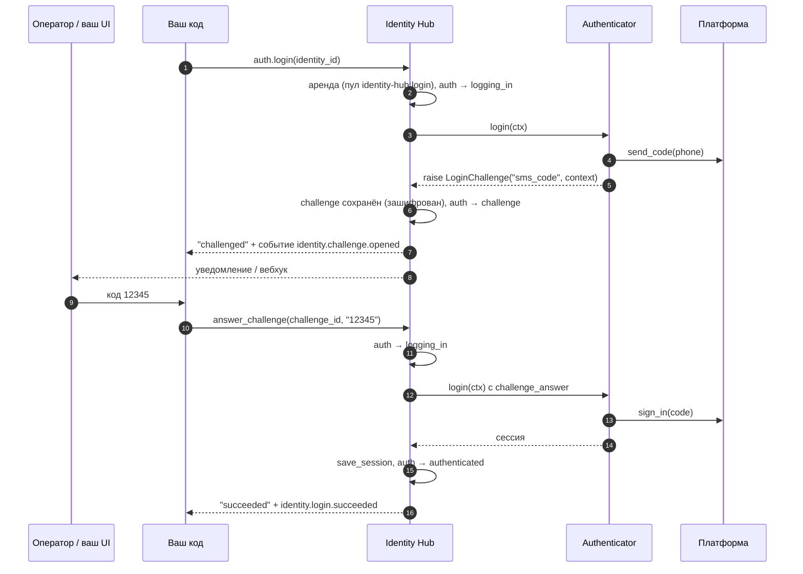

# 5. Вход и сессии

Сессия — то, что позволяет работать с платформой без повторного входа: `auth_key` Telegram,
cookie, OAuth-токен. Она хранится зашифрованной в слоте (по умолчанию `default`) по схеме
`Service.session`. Регион `auth` показывает, есть ли рабочая сессия.

Есть три способа получить сессию в систему:

| Способ | Когда |
|---|---|
| Передать при `identities.create` / `imports.run` | Сессии уже есть (куплены, перенесены) |
| `auth.login` + ваш `Authenticator` | Нужно логиниться программно, в том числе с SMS/2FA |
| `lease.save_session` + `lease.mark_authenticated` | Вы логинитесь своим кодом под арендой |

## Authenticator

Вы реализуете вход, библиотека ведёт процесс: берёт аккаунт в аренду, меняет `auth`, хранит
challenge, сохраняет сессию, пишет события.

```python
from datetime import timedelta
from identity_hub import LoginChallenge


class TgAuthenticator:
    async def login(self, ctx):
        creds = await ctx.credentials()
        client = make_client(proxy=ctx.proxy_url)

        if ctx.challenge_answer is None:
            # первый вызов: запросить код
            sent = await client.send_code(creds.phone)
            raise LoginChallenge(
                kind="sms_code",
                hint="Код из SMS",
                context={"phone_code_hash": sent.phone_code_hash},   # шифруется
                expires_in=timedelta(minutes=5),                      # по умолчанию 1 час
            )

        # повторный вызов: человек ответил
        await client.sign_in(
            creds.phone, ctx.challenge_answer,
            phone_code_hash=ctx.challenge_context["phone_code_hash"],
        )
        return TgSession(auth_key=client.export_key())     # сессия по схеме Service.session

    async def refresh(self, credentials, session):
        return None      # в 1.0.0a1 не вызывается


TELEGRAM = Service(..., authenticator=TgAuthenticator())
```

`ctx` (`LoginContext`): `identity_id`, `external_ref`, `proxy_url`, `challenge_answer`,
`challenge_context`, `await ctx.credentials()`, `await ctx.linked(role)` — связанный аккаунт
(например, почта для кода восстановления), взятый в аренду на время входа.

## Процесс входа с challenge



```python
outcome = await space.auth.login(identity_id)             # "succeeded" | "challenged" | "failed"

# где взять challenge_id:
card = await space.identities.card(identity_id)
challenge = card.open_challenge       # {"id", "kind", "hint", "expires_at"} или None
# либо из события identity.challenge.opened: event.data["challenge_id"]

outcome = await space.auth.answer_challenge(UUID(challenge["id"]), "12345", actor="operator:anna")
```

- Если платформа спросила ещё раз (неверный код, второй фактор), `login` снова бросает
  `LoginChallenge` — открывается новый challenge, исход `"challenged"`.
- Любое другое исключение в `login` → `auth = no_session`, событие `identity.login.failed`,
  исход `"failed"`.
- Неотвеченный challenge истекает по таймеру (обслуживание в диспетчере) → `no_session`.
- `auth.login` работает для аккаунтов в `no_session` или `session_invalid`, в том числе в
  `provisioning` — так новый аккаунт логинят до перевода в `ready`.

Пакетный вход всех аккаунтов без сессии:

```python
report = await space.auth.login_many(service=TELEGRAM, limit=20)
report.succeeded, report.challenged, report.failed
```

Библиотека не запускает вход сама: вызывайте `auth.login_many` по расписанию или по событию
`identity.auth.changed` → `session_invalid`.

## Работа с сессией в аренде

```python
async with pool.lease(for_operation="read_channel") as lease:
    session = await lease.session()             # расшифрованная модель или None
    client = make_client(session, proxy=lease.proxy)
    ...
    await lease.save_session(session.model_copy(update={"dc_id": client.dc_id}))
```

`save_session` проверяет fencing: если аренду уже перехватили, запись отклоняется
(`StaleFencing`), и устаревший воркер не затрёт свежую сессию.

**Сессия протухла во время работы** — верните из классификатора ошибок
`Fault(Blame.SESSION_INVALID)`: сессия будет помечена невалидной, `auth → session_invalid`,
аккаунт перестанет выдаваться до повторного входа.

## Вход своим кодом, без Authenticator

```python
# no_session-аккаунт не пройдёт обычный пул (он требует authenticated),
# поэтому берём его под служебной операцией probe (needs_auth=False)
async with pool.lease(for_operation="probe", among=[identity_id]) as lease:
    session = await my_login(await lease.credentials(), proxy=lease.proxy)
    await lease.save_session(session)
    await lease.mark_authenticated()          # auth → authenticated
```

Так можно только для аккаунтов в `ready`. Для `provisioning` используйте `Authenticator` +
`auth.login`, либо запишите сессию вне аренды и переведите `auth` вручную:

```python
await space.secrets.replace_session(identity_id, session, actor="onboarding")     # auth не меняет
await space.identities.override(identity_id, Override(
    "auth", "default", AuthState.AUTHENTICATED, reason="вход вручную", actor="onboarding",
))
```

Дальше: [верификация](06-verification.md).
