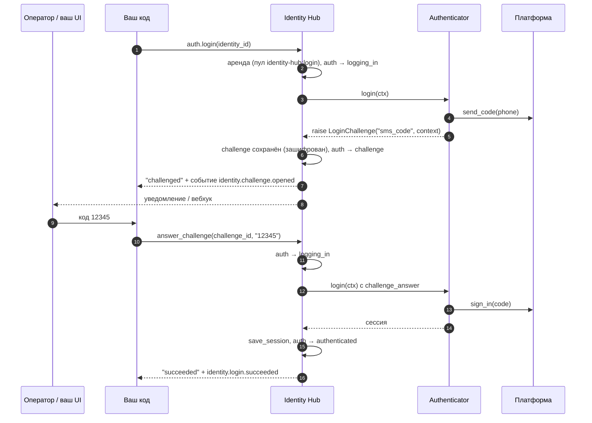

# 5. Вход и сессии

Сессия — то, что позволяет работать с платформой без повторного входа: `auth_key` Telegram,
cookie, OAuth-токен. Она хранится зашифрованной в слоте (по умолчанию `default`) по схеме
`Service.session`. Регион `auth` показывает, есть ли рабочая сессия.

`default` — канонический активный слот. Только `auth/default` определяет глобальное состояние
`Identity.auth` и допуск обычных операций. Именованные слоты (`cookie-1`, `mobile`, `api`) хранят
кандидатов и могут проверяться независимо.

Есть четыре способа получить сессию в систему:

| Способ | Когда |
|---|---|
| Передать при `identities.create` / `imports.run` | Сессии уже есть (куплены, перенесены) |
| `auth.adopt_session` | Нужно проверить именованный слот и принять его как канонический `default` |
| `auth.login` + ваш `Authenticator` | Нужно логиниться программно, в том числе с SMS/2FA |
| `lease.save_session` + `lease.mark_authenticated` | Вы логинитесь своим кодом под арендой |

## Сначала проверить сессии, затем точные credentials

Используйте `auth.adopt_session`, когда у identity есть один или несколько кандидатов сессии.
Метод вызывает `Service.probes.auth` ровно один раз для выбранного слота. При успехе Identity Hub
в одной транзакции:

1. помечает исходный слот проверенным;
2. копирует payload в `default`, не раскрывая его вызывающему коду;
3. помечает `default` проверенным и выставляет `auth=authenticated`;
4. при `activate=True` переводит `provisioning` в `ready`.

```python
from identity_hub import SessionAdoptionOutcome


async def authenticate(identity_id, session_slots, password_name):
    for slot in session_slots:
        result = await space.auth.adopt_session(
            identity_id,
            slot,
            actor="checker",
            activate=True,
        )
        if result.outcome is SessionAdoptionOutcome.ADOPTED:
            return "authenticated"
        if result.outcome is SessionAdoptionOutcome.FAILED:
            # Технический сбой не доказывает, что cookie мертва. Не переходите к паролю.
            return "unknown" if result.retryable else "failed"
        if result.outcome is SessionAdoptionOutcome.CHALLENGED:
            return "challenge"

    # Все кандидаты доказанно невалидны. Проверяем конкретную запись credentials.
    login = await space.auth.login(
        identity_id,
        credential=("password", password_name),
    )
    return str(login)
```

`auth.verify_session` выполняет ту же сетевую проверку, но не принимает слот как `default`:

```python
from identity_hub import SessionVerificationOutcome

result = await space.auth.verify_session(
    identity_id,
    "cookie-1",
    actor="operator:anna",
)
if result.outcome is SessionVerificationOutcome.VALID:
    print("cookie-1 жива, активная сессия не изменена")
```

### Исходы сетевой проверки

| Исход | Значение | Изменение состояния |
|---|---|---|
| сессия действительна | `VALID` / `ADOPTED` | `verify_session` обновляет metadata; `adopt_session` также принимает `default` и auth |
| сессия невалидна | `INVALID` | слот получает rejected metadata; для non-default глобальный auth не меняется, для `default` становится `session_invalid` |
| платформа требует человека | `CHALLENGED` | сессия не принимается; приложение выбирает UI/политику challenge |
| timeout или техническая ошибка | `FAILED` | `retryable=True`, session/auth/lifecycle не меняются |

Локально отсутствующий, отозванный или истёкший слот возвращает `INVALID` без сетевого вызова.
Сервис без `probes.auth` даёт `ValidationFailed`. Занятый identity даёт `LeaseUnavailable`.
`retired` даёт `OperationNotAllowed` и не восстанавливается автоматически.

Сеть выполняется без открытой DB-транзакции. Перед финальной записью Identity Hub повторно
проверяет lease fence, provider claim, aggregate `expected_revision` и revision исходного слота.
Если слот заменили во время запроса, метод бросает `ConcurrentModification`; поздний ответ ничего
не меняет. Повтор adoption той же сессии не создаёт новую запись истории `default`.

`space.secrets.verify_session` и `reject_session` — другие операции. Они вручную меняют только
metadata без обращения к платформе. Используйте их, только если verdict уже получен доверенным
внешним процессом.

## Перепроверка аккаунта: `auth.revalidate`

Когда оператор просит проверить конкретный аккаунт заново, не нужно предварительно снимать бан,
активировать `retired` или помечать credential проверенным: такие обходы утверждают больше, чем
нужно, и при техническом сбое стирают последнее достоверное состояние. `auth.revalidate` проверяет
аккаунт из любого допустимого состояния и ничего не меняет до ответа провайдера.

```python
result = await space.auth.revalidate(
    identity_id,
    actor="checker",
    reason="operator requested recheck",
    request_id=f"checker:{run_id}:{identity_id}",
    credential=("default", "default"),  # необязательно: резервная проверка точной записи
)
```

Порядок: допуск по `Service.diagnostics` → проверка сессии `default` (один вызов `probes.auth`) →
если сессии нет или она невалидна и указан `credential` — вызов `Authenticator` с этой записью.
Состояние `auth` не переводится в `logging_in`, `lifecycle`, `availability` и `standing` командой не
меняются: `retired` остаётся `retired`, `banned` остаётся `banned`.

| Поле результата | Смысл |
|---|---|
| `status` | `completed`; `blocked` (допуск или credential не позволяют, провайдер не вызывался); `in_progress` (аккаунт или операция заняты); `failed` (технический сбой, состояние не менялось, `retryable=True`) |
| `session_verdict` | `valid`, `invalid`, `missing` (пригодной сессии нет, провайдер не вызывался), `challenge`, `failed` |
| `credential_verdict` | `valid`, `rejected` (отказ именно этой записи), `challenge`, `blocked`, `inconclusive` (отказ не из-за credential, например бан), `failed` |
| `applied` | исход машины состояний по региону: `applied`, `unchanged`, `sticky`, `pinned`, … |
| `blockers` | типизированные причины: `lifecycle`, `availability`, `standing`, `credential_*`, `busy`, `not_found` |
| `operation_ids`, `challenge_id`, `code`, `retryable` | операции провайдера, активный challenge, безопасный код, повторяемость |

Что важно читать в `applied`: вердикт провайдера применяется как наблюдение, поэтому библиотека может
его **не применить**. `applied["standing"] == "sticky"` значит «провайдер сообщил `good`, но `banned`
сохранён»: разбан по наблюдению ручной. `applied["auth"] == "sticky"` значит, что у аккаунта идёт
интерактивный вход (`challenge`/`logging_in`) и проверка его не затёрла и не закрыла.

**Допуск.** По умолчанию диагностика разрешена для `provisioning`, `ready`, `retired`, для `available`,
`paused`, `cooling` и любого `standing`, кроме `deleted`. Карантин и `deleted` сервис разрешает явно:

```python
from identity_hub import Availability, DiagnosticPolicy, Service, Standing

service = Service(
    "my_platform",
    "My platform",
    diagnostics=DiagnosticPolicy(availability=frozenset(Availability), standing=frozenset(Standing)),
)
```

Политика действует только на `auth.revalidate` и не меняет ни обычные операции, ни `sync.refresh`, ни
`refresh_many`: фоновая сверка `retired`-аккаунты по-прежнему не трогает.

**Credential.** Перепроверяется активная запись, в том числе ранее отвергнутая. `disabled`, `revoked`,
истёкшая или отсутствующая запись дают `status=blocked` без вызова провайдера; автоматически их не
включают. Активный `challenge` возвращается в `challenge_id` и не перезапускается.

**Повтор.** `request_id` — ключ логической проверки. Повтор завершённого запроса возвращает сохранённый
результат без вызова провайдера (пока операции не очищены по сроку хранения), живая операция даёт
`status=in_progress`, тот же `request_id` с другим `credential` — `IdempotencyConflict`, технический сбой
и `claim_expired` повтор с тем же `request_id` не блокируют. Это не exactly-once у провайдера: после
падения между ответом и коммитом исход неизвестен (`result.outcome = unknown`), поэтому запускайте
`workers.provider_operations.run_once()` раз в минуту.

Итоговые статусы приложения (`alive`, `dead`, `bad_credentials`) считает само приложение по этому
результату; библиотека их не знает.

## Authenticator

Вы реализуете вход, библиотека ведёт процесс: берёт аккаунт в аренду, меняет `auth`, хранит
challenge, сохраняет сессию, пишет события.

```python
from datetime import timedelta
from identity_hub import LoginChallenge, LoginContext, LoginFailure


class TgAuthenticator:
    async def login(self, ctx: LoginContext[TgCredentials, TgSession]) -> TgSession:
        candidate = await ctx.active_credential()
        if candidate is None:
            raise LoginFailure("credentials_missing", retryable=False)
        creds = candidate.value
        client = make_client(proxy=ctx.proxy_url)

        if ctx.challenge_answer is None:
            # первый вызов: запросить код
            sent = await client.send_code(creds.phone)
            raise LoginChallenge(
                kind="sms_code",
                hint="Код из SMS",
                context={"phone_code_hash": sent.phone_code_hash},   # шифруется
                expires_in=timedelta(minutes=5),                      # по умолчанию 1 час
            )

        # повторный вызов: человек ответил
        try:
            await client.sign_in(
                creds.phone, ctx.challenge_answer,
                phone_code_hash=ctx.challenge_context["phone_code_hash"],
            )
        except PlatformPasswordRejected:
            raise LoginFailure(
                "credentials_rejected", retryable=False, credential=candidate.key,
            ) from None
        return TgSession(auth_key=client.export_key())     # сессия по схеме Service.session


TELEGRAM = Service(..., authenticator=TgAuthenticator())  # или authenticator=login — сама функция
```

`ctx` (`LoginContext`): `identity_id`, `external_ref`, `proxy_url`, `challenge_answer`,
`challenge_context`, `await ctx.active_credential()`, `await ctx.credentials()`,
`await ctx.linked(role)` — связанный аккаунт
(например, почта для кода восстановления), взятый в аренду на время входа.

## Процесс входа с challenge



```python
outcome = await space.auth.login(identity_id)             # "succeeded" | "challenged" | "failed"

# где взять challenge_id:
card = await space.identities.card(identity_id)
challenge = card.open_challenge       # {"id", "kind", "hint", "expires_at"} или None
# либо из события identity.challenge.opened: event.data["challenge_id"]

outcome = await space.auth.answer_challenge(UUID(challenge["id"]), "12345", actor="operator:anna")
```

В `card.regions` строка региона `auth` содержит `retryable`: `True` означает временный отказ,
`False` — окончательный, `None` — повторяемость для текущего состояния не задана. Поле доступно
и в разделе состояния admin API; интерфейс показывает `Да`, `Нет` или `—` соответственно.

- Если платформа спросила ещё раз (неверный код, второй фактор), `login` снова бросает
  `LoginChallenge` — открывается новый challenge, исход `"challenged"`.
- Любое другое исключение в `login` → `auth = no_session`, событие `identity.login.failed`,
  исход `"failed"`.
- Неотвеченный challenge истекает по таймеру (обслуживание в диспетчере) → `no_session`.
- **Долгий вход.** Аренда на время входа продлевается heartbeat'ом, как в `pool.lease()`: вход
  с ожиданием SMS-кода может длиться дольше 40 с, сессия сохранится. Один вызов
  `Authenticator.login` ограничен `Service(login_timeout=...)` (по умолчанию 120 с); по
  истечении — исход `"failed"`, `auth = no_session`, ошибка `LoginTimeout`.
- **Прерванный вход.** Если вход оборвался не по вине аутентификатора — сессия не прошла
  проверку схемой, запись не удалась, задачу отменили (`asyncio.wait_for`, остановка воркера) —
  `auth` возвращается в состояние до входа, пишется `identity.login.failed` с именем причины
  (`ValidationFailed`, `CancelledError`), аренда освобождается. Повторный `login` доступен сразу.
- **Упавший процесс.** `logging_in` без живой аренды дольше `login_timeout` плюс минута
  обслуживание возвращает в `no_session` (ошибка `LoginAbandoned`, автор `timer`).
- **Сброс входа оператором.** Override или команда, переводящие `auth` из `challenge` или
  `logging_in`, закрывают открытый challenge: следующий `login` задаст вопрос заново, ответ на
  старый challenge отклоняется.
- **Ответ на challenge** (SMS-код, пароль 2FA) хранится зашифрованным только пока challenge
  открыт; при закрытии шифртекст стирается.
- **Занятый аккаунт.** `login` аккаунта, который уже входит или арендован, сразу бросает
  `LeaseUnavailable`. `ctx.linked(role)` ждёт занятый связанный аккаунт не дольше остатка
  основной аренды.
- `auth.login` работает для аккаунтов в `no_session` или `session_invalid`, в том числе в
  `provisioning` — так новый аккаунт логинят до перевода в `ready`.

Пакетный вход всех аккаунтов без сессии:

```python
report = await space.auth.login_many(service=TELEGRAM, limit=20)
report.succeeded, report.challenged, report.failed
```

Библиотека не запускает вход сама: вызывайте `auth.login_many` по расписанию или по событию
`identity.auth.changed` → `session_invalid`.

### Попытка входа — операция в очереди

Каждая попытка входа — операция `login` в `ih_provider_operations` (`D-222`). Её claim
коммитится до вызова `Authenticator.login`, а итог (сессия, challenge или отказ) пишется одной
транзакцией, которая проверяет claim и fence аренды. Если воркер завис, а операцию тем временем
восстановили и отдали другому, его поздний ответ ничего не запишет. `ctx.attempt_id` — id этой
попытки: передайте его платформе как ключ идемпотентности, если она его принимает, — после сбоя
процесса тот же вход может быть повторён (гарантия at-least-once, см.
[интеграции](../integrations.md#очередь-операций-провайдера)). `LoginReport.operations` называет
операцию каждой попытки `login_many`; незавершённые видны в `space.admin.provider_operations()`.

### Неудачный вход

Адаптер сообщает ожидаемый отказ структурированным `LoginFailure`, а не текстом исключения:

```python
from identity_hub import Blame, Fault, LoginFailure, LoginFailureCode

if response.status == "PASSWORD_INVALID":
    raise LoginFailure(LoginFailureCode.CREDENTIALS_REJECTED, retryable=False)
if response.status == "USER_BANNED":
    raise LoginFailure(
        LoginFailureCode.IDENTITY_BANNED,
        retryable=False,
        fault=Fault(Blame.IDENTITY_BANNED, code="user_banned"),
    )
```

`code` — стабильная машинная строка `[a-z][a-z0-9_.-]{0,63}`. Рекомендуемые значения:
`credentials_rejected`, `transient`, `session_invalid`, `identity_limited`, `identity_banned`;
свои коды разрешены. Код сохраняется в регионе `auth` карточки, событии
`identity.login.failed` и операции `login`; текст исключения, credentials и ответ платформы туда
не попадают. Новый вход (`auth → logging_in`) очищает старый код.

`LoginFailure.fault` атомарно применяет последствия вместе с итогом входа: временное охлаждение,
`session_invalid` или standing `limited`/`banned`. Обычное исключение адаптера сохраняет прежнее
поведение (`auth → no_session`, код — имя класса). `login_many` по-прежнему пробует такой аккаунт;
если постоянные ошибки нужно исключить, фильтруйте их в приложении по коду карточки.

## Работа с сессией в аренде

```python
async with pool.lease(for_operation="read_channel") as lease:
    session = await lease.session()             # расшифрованная модель или None
    client = make_client(session, proxy=lease.proxy.reveal() if lease.proxy else None)
    ...
    await lease.save_session(session.model_copy(update={"dc_id": client.dc_id}))
```

`save_session` проверяет fencing: если аренду уже перехватили, запись отклоняется
(`StaleFencing`), и устаревший воркер не затрёт свежую сессию.

**Сессия протухла во время работы** — верните из классификатора ошибок
`Fault(Blame.SESSION_INVALID)`: сессия будет помечена невалидной, `auth → session_invalid`,
аккаунт перестанет выдаваться до повторного входа.

## Вход своим кодом, без Authenticator

```python
# no_session-аккаунт не пройдёт обычный пул (он требует authenticated),
# поэтому берём его под служебной операцией probe (needs_auth=False)
async with pool.lease(for_operation="probe", among=[identity_id]) as lease:
    session = await my_login(await lease.credentials(), proxy=lease.proxy.reveal() if lease.proxy else None)
    await lease.save_session(session)
    await lease.mark_authenticated()          # auth → authenticated
```

Служебная операция `probe` разрешена для `provisioning` и `ready`, но не для `retired`. Если
готовая сессия уже лежит в именованном слоте, предпочитайте `auth.adopt_session`: он проверяет,
копирует в `default`, меняет auth и при необходимости активирует identity атомарно. Ручной путь:

```python
await space.secrets.replace_session(identity_id, session, actor="onboarding")     # auth не меняет
await space.identities.override(identity_id, Override(
    "auth", "default", AuthState.AUTHENTICATED, reason="вход вручную", actor="onboarding",
))
```

Дальше: [верификация](06-verification.md).
