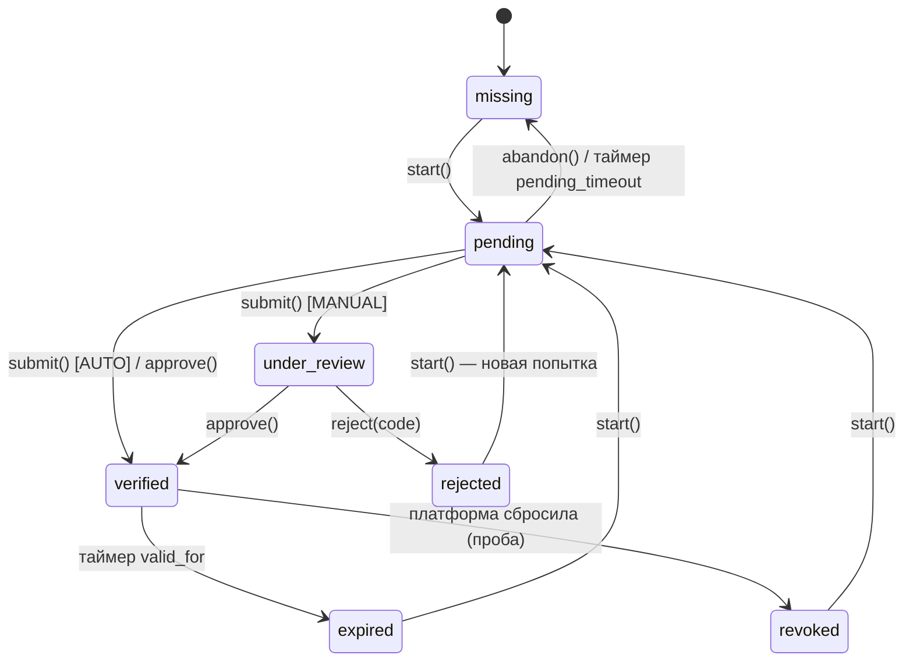
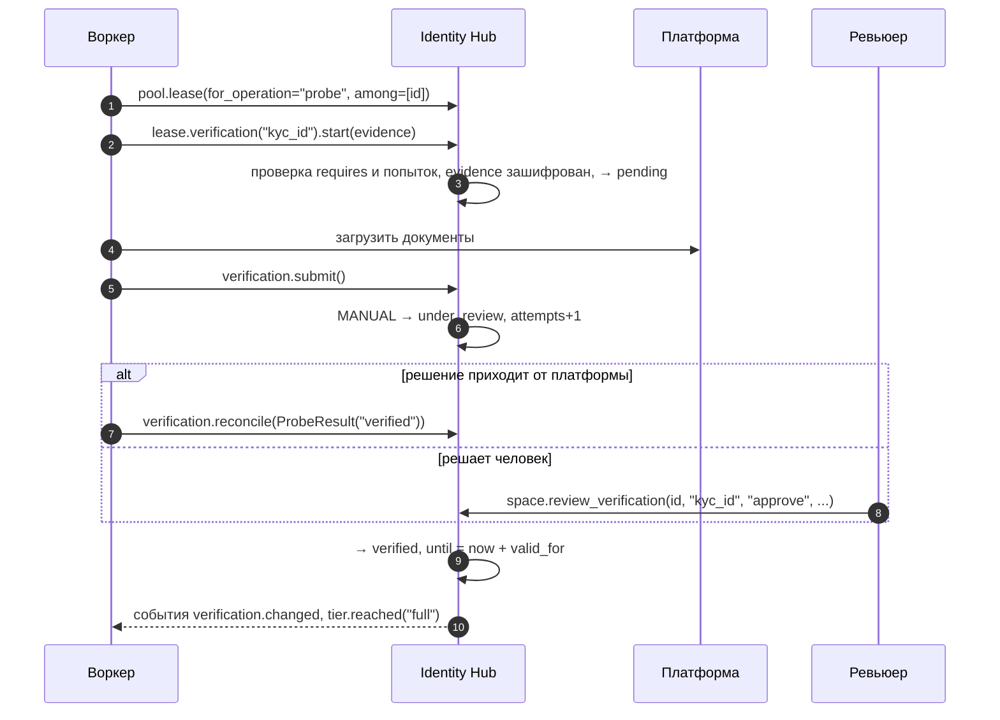

# 6. Верификация

Верификация — подтверждение факторов аккаунта на платформе: email, телефон, документы (KYC),
селфи. Операции можно разрешать только аккаунтам с нужными факторами — например, вывод средств
только после полного KYC.

## Объявление факторов и уровней

```python
from datetime import timedelta
from pydantic import BaseModel
from identity_hub import OperationRule, Quota, Service, VerificationMode, VerificationSpec, VerificationTier


class KycEvidence(BaseModel):          # доказательства шифруются
    document_number: str
    document_scan_url: str


EXCHANGE = Service(
    name="exchange",
    title="Биржа",
    credentials=ExchangeCredentials,
    session=ExchangeSession,
    verifications=(
        VerificationSpec("email", mode=VerificationMode.AUTO),
        VerificationSpec("phone", mode=VerificationMode.AUTO),
        VerificationSpec(
            "kyc_id",
            requires=frozenset({"email", "phone"}),     # начать можно только после них
            mode=VerificationMode.MANUAL,              # решение принимает платформа/человек
            valid_for=timedelta(days=365),             # потом verified → expired
            max_attempts=3,
            reject_codes=frozenset({"blurry", "expired_document"}),
            evidence=KycEvidence,
            pending_timeout=timedelta(days=7),         # брошенный процесс → missing
        ),
    ),
    tiers=(
        VerificationTier("basic", frozenset({"email", "phone"})),
        VerificationTier("full", frozenset({"email", "phone", "kyc_id"})),
    ),
    operations={
        "trade": OperationRule(tiers=frozenset({"basic"})),
        "withdraw": OperationRule(tiers=frozenset({"full"}), quotas=(Quota(3, timedelta(days=1)),)),
    },
)
```

| Параметр `VerificationSpec` | Смысл |
|---|---|
| `requires` | Факторы, которые должны быть `verified` до старта |
| `mode` | `AUTO` — `submit` сразу даёт `verified`; `MANUAL` — `submit` ведёт в `under_review` |
| `valid_for` | Срок действия подтверждения |
| `max_attempts` | Лимит отправок (`submit`), дальше `AttemptsExhausted` |
| `reject_codes` | Допустимые коды отказа |
| `evidence` | Схема доказательств; хранится зашифрованной |
| `pending_timeout` | Через сколько брошенный процесс вернётся в `missing` |

Уровень (`tier`) — именованный набор факторов. Он не хранится, а вычисляется; при достижении и
потере пишутся события `identity.tier.reached` / `identity.tier.lost`.

## Машина состояний фактора



Фактор засчитывается, только пока он `verified`. Переход в `expired`, `revoked` или `rejected`
сразу убирает его из `verified_factors`, и операции, которые его требуют, перестают быть
доступны.

## Как верифицировать аккаунт

Процесс идёт под арендой — воркер общается с платформой, библиотека ведёт статус:



```python
async with pool.lease(for_operation="probe", among=[identity_id]) as lease:
    kyc = lease.verification("kyc_id")
    status = await kyc.start(KycEvidence(document_number="AB123", document_scan_url="s3://..."))
    await exchange_client.upload_kyc(await kyc.evidence())
    status = await kyc.submit()           # MANUAL → under_review
    status.state, status.attempts
```

Решение без аренды — из админки или вашего бэк-офиса:

```python
await space.review_verification(identity_id, "kyc_id", "approve", actor="admin:ivan", reason="документы в порядке")
await space.review_verification(identity_id, "kyc_id", "reject", actor="admin:ivan", reason="нечитаемо", code="blurry")
await space.review_verification(identity_id, "kyc_id", "abandon", actor="admin:ivan", reason="клиент передумал")

status = await space.verification_status(identity_id, "kyc_id")
status.state, status.attempts, status.expires_at
```

Остальные способы изменить фактор:

| Источник | Как |
|---|---|
| Проба платформы | `Probes.verification(ctx, factor)` + `resync(id, ["verification"])` или `["verification:kyc_id"]` |
| Под арендой | `await lease.verification("email").reconcile("verified")` |
| Импорт | `ImportRecord(verifications={"email": "verified"})` |
| Таймер | `valid_for`, `pending_timeout` — обслуживание в диспетчере |

Ошибки: `VerificationRequirementsNotMet` (не выполнены `requires`), `AttemptsExhausted`,
`TransitionNotAllowed` (например, `submit` не из `pending`), `ValidationFailed` (код отказа не
из `reject_codes`, неизвестный фактор).

Дальше: [аренда](07-leases.md).
