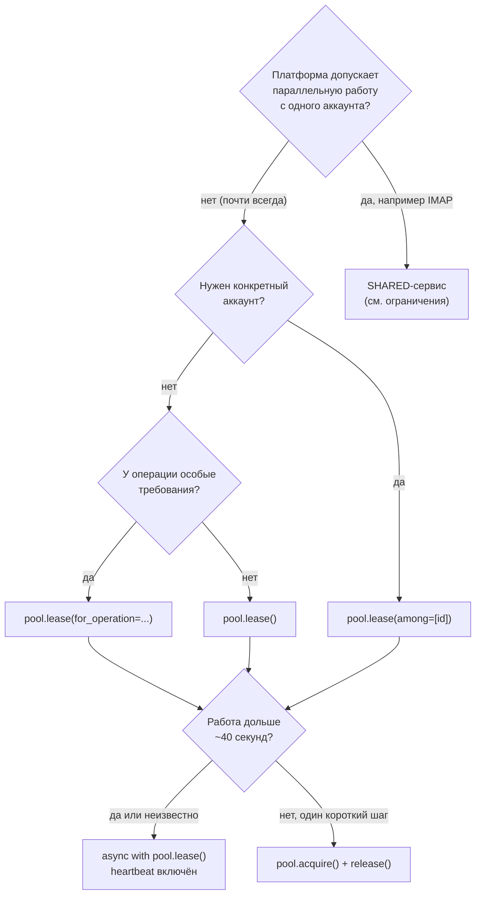
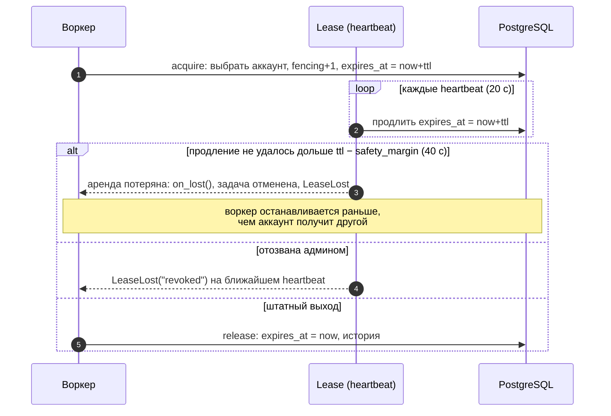

# 7. Аренда

Аренда — право воркера пользоваться аккаунтом. Пока аренда жива, другой воркер этот аккаунт
не получит (в эксклюзивном режиме). Аренда защищает от главной причины банов в парке —
одновременной работы с одного аккаунта из разных мест.

## Пул

Пул — выборка аккаунтов одного сервиса под конкретную задачу. Он описывается в коде и не
хранится в БД; имя пула попадает в историю аренд, события и метрики.

```python
parsers = space.pool(
    "parsers",
    service=TELEGRAM,
    tags=["parser"],                 # нужны все теги
    labels={"farm": "eu-1"},         # совпадение меток
    profile={"country": "DE"},       # только поля filterable_profile
    pacing=None,                     # см. лимиты
    proxy_policy=None,               # по умолчанию — политика сервиса
    ttl=timedelta(seconds=60),       # срок аренды без продления
    heartbeat=timedelta(seconds=20), # период продления, ≤ ttl/3
    holder="parser-worker-1",        # кто держит; по умолчанию hostname:pid
    capacity_low=10,                 # порог события pool.capacity.low
)
```

**Какой аккаунт выдаётся.** Самый давно не использовавшийся: сначала никогда не
арендованные, затем по времени последней аренды. Нагрузка распределяется по парку равномерно.
Конкурирующие воркеры не ждут друг друга (`SKIP LOCKED`).

## Виды аренды и когда какую брать

| Вид | Как получить | Когда использовать |
|---|---|---|
| **Эксклюзивная управляемая** | `async with pool.lease(...)` | **Почти всегда.** Любая работа воркера: парсинг, рассылка, торговля |
| **Под операцию** | `pool.lease(for_operation="send")` | Когда у операции свои требования (standing, верификация) — получите только подходящий аккаунт |
| **Конкретного аккаунта** | `pool.lease(among=[identity_id])` | Досыл по конкретному аккаунту, ручные действия, верификация |
| **С ожиданием** | `pool.lease(wait=30)` | Свободных аккаунтов может не быть прямо сейчас — подождать, а не упасть |
| **Идемпотентная** | `pool.lease(idempotency_key="job:42")` | Задача может перезапуститься (ретрай очереди) и должна получить тот же аккаунт |
| **Ручная** | `lease = await pool.acquire(...)` / `await lease.release()` | Аренда на короткий шаг вне `async with`. Без heartbeat — не дольше ~40 с |
| **Разделяемая** | `Service(lease_mode=LeaseMode.SHARED)` | Платформа допускает параллельные подключения (IMAP-почта). В 1.0.0a1 с ограничениями — см. ниже |



Все параметры `pool.lease()` / `pool.acquire()`:

| Параметр | Смысл |
|---|---|
| `for_operation` | Отобрать аккаунты, допустимые для операции (standing, auth, факторы) |
| `tags`, `labels`, `profile` | Дополнительные фильтры к фильтрам пула |
| `among` | Выбирать только из этих id (список или SQLAlchemy-подзапрос) |
| `exclude` | Не выбирать эти id |
| `wait` | Сколько ждать свободный аккаунт (секунды или `timedelta`); `None` — сразу `LeaseUnavailable` |
| `idempotency_key` | Повторный вызов с тем же ключом, пока аренда жива, вернёт ту же аренду |
| `on_lost` (только `lease`) | Колбэк при потере аренды — например, закрыть соединение с платформой |

Квоты при выборе аккаунта **не учитываются** — аккаунт с исчерпанной квотой может быть выдан,
а `QuotaExhausted` бросит `operation()`. См. [лимиты](08-limits.md).

## Типичный цикл воркера

```python
from identity_hub import LeaseLost, LeaseUnavailable, OperationNotAllowed, QuotaExhausted

async def worker(space):
    pool = space.pool("senders", service=TELEGRAM, tags=["sender"])
    while True:
        job = await queue.get()
        try:
            async with pool.lease(for_operation="send_message", wait=30, on_lost=client.disconnect) as lease:
                session = await lease.session()
                client = make_client(session, proxy=lease.proxy)
                async with lease.operation("send_message", key=f"send:{job.id}") as op:
                    if not op.duplicate:
                        await client.send(job.chat, job.text)
                await lease.save_session(client.session())
        except LeaseUnavailable:
            await queue.retry_later(job)            # весь пул занят или недоступен
        except QuotaExhausted as e:
            await queue.retry_at(job, e.retry_at)   # у этого аккаунта кончилась квота
        except OperationNotAllowed as e:
            log.warning("аккаунт стал недоступен: %s", e.blockers)
        except LeaseLost:
            await queue.retry_later(job)            # аренду отобрали — работу прекратить
```

## Время жизни аренды



| Как закончился блок `async with` | Причина в истории | Что получит ваш код |
|---|---|---|
| Штатно | `released` | — |
| Исключение внутри | `failed` | исходное исключение |
| Heartbeat не продлился | `lost` | `LeaseLost(lease_id, "heartbeat")` |
| Отзыв администратором | `revoked` | `LeaseLost(lease_id, "revoked")` |
| Процесс упал | `expired` (через ttl) | — (аккаунт вернётся в пул через 60 с) |

Отзыв аренды из вашего кода или админки:

```python
await space.revoke_lease(identity_id, reason="зависший воркер", actor="admin:ivan")
```

## Fencing — защита от «зомби»-воркеров

Каждый захват увеличивает номер fencing аккаунта. Все записи от имени аренды (`operation`,
`save_session`, `mark_authenticated`, верификация) сверяют номер. Если воркер завис, аренда
истекла и аккаунт уже у другого, запоздалые записи старого воркера отклоняются `StaleFencing` —
он не затрёт свежую сессию и не спишет чужую квоту.

Для участков кода без `await` (долгие вычисления) проверяйте аренду вручную: `lease.check()`
бросит `LeaseLost`, если аренда потеряна.

## Что доступно в аренде

| Член | Что это |
|---|---|
| `lease.identity_id`, `lease.identity` | id и снимок аккаунта без секретов |
| `await lease.credentials()`, `await lease.session(slot)` | расшифрованные секреты |
| `await lease.save_session(...)`, `await lease.mark_authenticated()` | запись с проверкой fencing |
| `lease.proxy` | URL прокси **с логином и паролем** — не логируйте |
| `lease.operation(kind, key=...)` | операция на платформе, см. [лимиты](08-limits.md) |
| `lease.verification(factor)` | процесс верификации |
| `lease.lost`, `lease.check()` | состояние аренды |
| `lease.context` | контекст для логов (`lease_id`, `identity_id`, `pool`) |

В логах поля аренды подставляются автоматически: `LeaseContextFilter` для `logging` и
`structlog_processor` для structlog.

## Разделяемый режим (SHARED)

`Service(lease_mode=LeaseMode.SHARED)` — аренда не блокирует аккаунт, несколько воркеров
работают с ним одновременно; история аренд всё равно пишется. **В 1.0.0a1 режим работает
некорректно для параллельных аренд:** каждый захват увеличивает fencing, поэтому у более ранней
из параллельных аренд `operation()` и `save_session()` падают с `StaleFencing`. Кроме того,
`idempotency_key` в этом режиме не работает, и все захваты выдают один и тот же аккаунт. Пока
используйте эксклюзивный режим. См. [ограничения](limitations.md).

## История и мониторинг

```python
await space.lease_history(identity_id, limit=50)       # аренды аккаунта: кто, сколько, чем кончилась
await space.lease_stats(identity_id, since=...)        # число, длительность, загрузка
await space.lease_dashboard(group_by="pool")           # сводка по пулам: p95, доля потерь, живые аренды
await pool.check_capacity()                            # сколько свободных аккаунтов
```

Дальше: [лимиты](08-limits.md).
