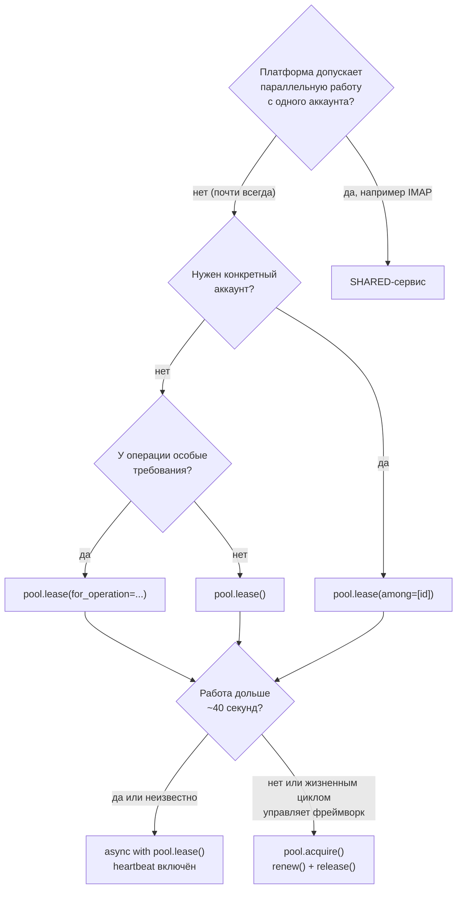
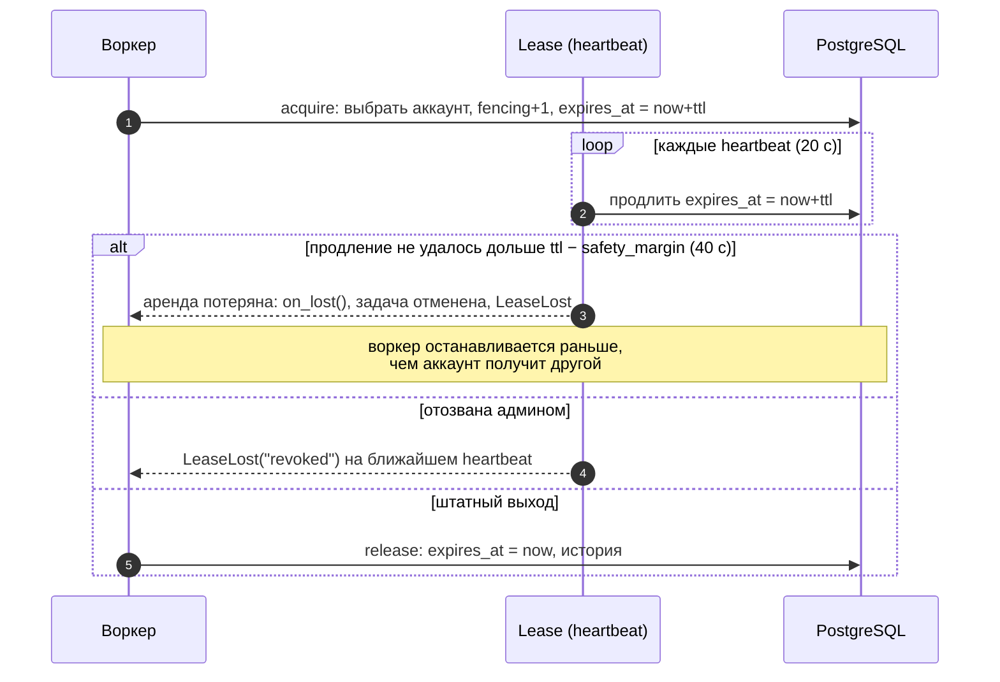

# 7. Аренда

Аренда — право воркера пользоваться аккаунтом. Пока аренда жива, другой воркер этот аккаунт
не получит (в эксклюзивном режиме). Аренда защищает от главной причины банов в парке —
одновременной работы с одного аккаунта из разных мест.

## Пул

Пул — выборка аккаунтов одного сервиса под конкретную задачу. Он описывается в коде и не
хранится в БД; имя пула попадает в историю аренд, события и метрики.

```python
parsers = space.pools.define(
    "parsers",
    service=TELEGRAM,
    tags=["parser"],                 # нужны все теги
    labels={"farm": "eu-1"},         # совпадение меток
    profile={"country": "DE"},       # только поля filterable_profile
    pacing=None,                     # см. лимиты
    proxy_policy=None,               # по умолчанию — политика сервиса
    ttl=timedelta(seconds=60),       # срок аренды без продления
    heartbeat=timedelta(seconds=20), # период продления, ≤ ttl/3
    holder="parser-worker-1",        # кто держит; по умолчанию hostname:pid
    capacity_low=10,                 # порог события pool.capacity.low
)
```

**Какой аккаунт выдаётся.** Самый давно не использовавшийся: сначала никогда не
арендованные, затем по времени последней аренды. Нагрузка распределяется по парку равномерно.
Конкурирующие воркеры не ждут друг друга (`SKIP LOCKED`). Время последней аренды хранится в
самом аккаунте и ставится при захвате, в том числе разделяемом (`D-209`): кандидат берётся
одним запросом по индексу, занятые аккаунты уходят в конец очереди и не перебираются, даже
когда заняты почти все.

## Виды аренды и когда какую брать

| Вид | Как получить | Когда использовать |
|---|---|---|
| **Эксклюзивная управляемая** | `async with pool.lease(...)` | **Почти всегда.** Любая работа воркера: парсинг, рассылка, торговля |
| **Под операцию** | `pool.lease(for_operation="send")` | Когда у операции свои требования (standing, верификация) — получите только подходящий аккаунт |
| **Конкретного аккаунта** | `pool.lease(among=[identity_id])` | Досыл по конкретному аккаунту, ручные действия, верификация |
| **С ожиданием** | `pool.lease(wait=30)` | Свободных аккаунтов может не быть прямо сейчас — подождать, а не упасть |
| **Идемпотентная** | `pool.lease(idempotency_key="job:42")` | Задача может перезапуститься (ретрай очереди) и должна получить тот же аккаунт |
| **Ручная** | `pool.acquire()` / `lease.renew()` / `lease.release()` | Фреймворк сам управляет жизненным циклом и может периодически вызывать `renew()` |
| **Разделяемая** | `Service(lease_mode=LeaseMode.SHARED)` | Платформа допускает параллельные подключения (IMAP-почта) |



Ручная аренда не запускает фоновую задачу. Для долгой работы вызывайте `renew()` чаще, чем
`ttl − safety_margin`, и обязательно освобождайте аренду:

```python
lease = await pool.acquire()
try:
    while await has_more_work():
        await process_next_item(lease)
        expires_at = await lease.renew()
finally:
    await lease.release()
```

`renew()` возвращает новый `expires_at`, обновляет тот же heartbeat и при наступлении
`stats_flush` переносит накопленные счётчики операций в историю. Если аренду отозвали, её срок
вышел или достигнут `max_hold`, метод бросает `LeaseLost` с точной причиной (`LeaseRevoked` и
`LeaseExpired` остаются специализированными подклассами). Вызов допустим и внутри
`async with pool.lease()` как внеочередной heartbeat.

Все параметры `pool.lease()` / `pool.acquire()`:

| Параметр | Смысл |
|---|---|
| `for_operation` | Отобрать аккаунты, допустимые для операции (standing, auth, факторы) |
| `tags`, `labels`, `profile` | Дополнительные фильтры к фильтрам пула |
| `among` | Выбирать только из этих id (список или SQLAlchemy-подзапрос) |
| `exclude` | Не выбирать эти id |
| `wait` | Сколько ждать свободный аккаунт (секунды или `timedelta`); `None` — сразу `LeaseUnavailable` |
| `idempotency_key` | Повторный вызов с тем же ключом, пока аренда жива, вернёт ту же аренду — тому же пулу, сервису и `holder`. Другой пул или `holder` с этим ключом получит `IdempotencyConflict`. Ключ действует в пределах пространства |
| `on_lost` (только `lease`) | Колбэк при потере аренды — например, закрыть соединение с платформой |
| `purpose` | Метка вида работы: 1–64 символа из `a-z`, `0-9`, `_ . : -`. По умолчанию — `purpose` пула |
| `ref` | Ссылка на задачу держателя, до 256 символов; учётные данные из URL вырезаются |
| `require_quota` | Вместе с `for_operation`: не выдавать аккаунты с исчерпанной квотой операции ([подробнее](08-limits.md)) |
| `keep_free` | Оставить N свободных identity; переопределяет `reserve` пула для этого захвата |
| `priority` | Приоритет эксклюзивной аренды; большее значение может запросить уступку у менее приоритетного держателя |
| `max_hold` | Потолок удержания (`timedelta`): позже аренда не продлевается. По умолчанию — `max_hold` пула, а если и он не задан — потолка нет |

**Чем занят аккаунт.** `purpose` и `ref` отвечают на вопрос, зачем взята аренда, без угадывания
по имени пула и без шифрования задачи в `holder`:

```python
pool = space.pools.define("downloads", service=SVC, purpose="download")

async with pool.lease(ref="job:42") as lease:   # purpose="download" из пула
    ...

await space.admin.lease_dashboard(group_by="purpose")   # сводка по видам работы
```

Оба значения доступны как `lease.purpose` и `lease.ref`, попадают в строку живой аренды, в
историю, в события `lease.*` и в read-схему (`hub.read.leases`, `hub.read.lease_history`).
`purpose` — для группировки, поэтому набор символов узкий; `ref` — свободная ссылка, по ней не
группируют. Повтор захвата с тем же `idempotency_key` возвращает исходные значения. Неверный
формат — `ValidationFailed` до захвата.

**Потолок удержания.** Пока heartbeat идёт, аренда живёт сколько угодно: задача, зависшая на
сетевом вызове при живом event loop, держала бы аккаунт до ручного `pools.revoke`. `max_hold`
ставит предел:

```python
pool = space.pools.define("downloads", service=SVC, max_hold=timedelta(minutes=10))

async with pool.lease() as lease:
    lease.hold_deadline          # момент, позже которого аренда не продлится
    ...
```

- Продление никогда не ставит срок аренды позже `hold_deadline` — ни одиночное, ни пакетное.
- Держатель получает `LeaseLost(lease_id, "max_hold")` за `safety_margin` до дедлайна, то есть
  раньше, чем аккаунт сможет взять другой. Поэтому `max_hold` обязан быть больше
  `safety_margin`, иначе `ValidationFailed`.
- В истории причина `max_hold`, событие — `lease.expired` с `reason: "max_hold"`. Так же
  закрывается брошенная аренда, чей срок вышел на дедлайне.
- Дедлайн виден в списке живых аренд (`lease_dashboard().live`) и в read-схеме.
- Для аренды из `pool.acquire()` потолок работает так же: `lease.check()` бросит
  `LeaseLost("max_hold")`.

`LeaseUnavailable.reason` говорит, почему аккаунт не выдан:

| `reason` | Что это значит | Что делать |
|---|---|---|
| `busy` | Допустимые аккаунты есть, но все в аренде | Подождать (`wait=`) или повторить позже |
| `no_candidates` | Допустимых нет: пул пуст, аккаунты не в том состоянии или не прошли фильтр | Ожидание не поможет — проверить парк и фильтры |
| `no_proxy` | Аккаунт есть, но в пуле прокси нет свободного живого прокси | Добавить прокси или дождаться перепроверки |
| `quota` | Свободные аккаунты есть, но у всех исчерпана квота операции (`require_quota`) | Повторить через `retry_after` секунд |
| `reserve` | Свободные identity удерживаются резервом пула | Использовать приоритетный пул/вызов или дождаться роста ёмкости |
| `None` | Причину определить не удалось | Обработать как временный отказ |

Без `require_quota=True` квоты при выборе аккаунта **не учитываются** — аккаунт с исчерпанной
квотой может быть выдан, а `QuotaExhausted` бросит `operation()`. См. [лимиты](08-limits.md).

### Резерв свободной ёмкости

```python
pool = space.pools.define(
    "background",
    service=TELEGRAM,
    reserve=5,
    reserve_strict=False,
)

detail = await pool.capacity_detail()
detail.free, detail.reserved, detail.available

async with pool.lease(keep_free=10) as lease:  # резерв только для этого захвата
    ...
```

При положительном резерве хранилище одним запросом блокирует `N + 1` кандидатов и выдаёт первый
только когда вся пачка найдена. Поэтому параллельный захват может получить безопасный ложный
`LeaseUnavailable(reason="reserve")`, но не заберёт зарезервированную ёмкость. В нестрогом режиме
резерв отключается, если всех допустимых identity не больше N; `reserve_strict=True` всегда
оставляет N. Резерв не поддерживается для `SHARED`-сервисов.

### Приоритет и кооперативная уступка

`pools.define(priority=N)` задаёт приоритет пула, а `pool.lease(priority=N)` переопределяет его
для одного захвата. Если свободного аккаунта нет, более приоритетный запрос помечает одну самую
низкоприоритетную аренду. Держатель увидит `lease.yield_requested` после ближайшего heartbeat
(или после ручного `lease.renew()`) и может штатно закончить текущую единицу работы. Равный
приоритет никого не вытесняет. Для `SHARED` приоритет не поддерживается.

```python
async with urgent.lease(
    wait=30,
    on_yield_requested=lambda: worker.stop_after_current_item(),
) as lease:
    ...
```

Штатное освобождение после такого запроса получает в истории причину `yielded`. По умолчанию
запрос остаётся только кооперативным. `pools.define(yield_grace=timedelta(...))` разрешает
ожидающему срочному пулу отозвать аренду после grace-периода; фоновой задачи нет, проверка идёт
на очередном опросе ожидания. Освободившийся аккаунт кратко бронируется за приоритетом
запросившего, поэтому другой фоновый ожидающий его не перехватит. Задержка доставки внешнему
держателю — до одного интервала heartbeat.

## Типичный цикл воркера

```python
from identity_hub import LeaseLost, LeaseUnavailable, OperationNotAllowed, QuotaExhausted

async def worker(space):
    pool = space.pools.define("senders", service=TELEGRAM, tags=["sender"])
    while True:
        job = await queue.get()
        try:
            async with pool.lease(for_operation="send_message", wait=30, on_lost=client.disconnect) as lease:
                session = await lease.session()
                client = make_client(session, proxy=lease.proxy.reveal() if lease.proxy else None)
                async with lease.operation("send_message", key=f"send:{job.id}") as op:
                    if not op.duplicate:
                        await client.send(job.chat, job.text)
                await lease.save_session(client.session())
        except LeaseUnavailable:
            await queue.retry_later(job)            # весь пул занят или недоступен
        except QuotaExhausted as e:
            await queue.retry_at(job, e.retry_at)   # у этого аккаунта кончилась квота
        except OperationNotAllowed as e:
            log.warning("аккаунт стал недоступен: %s", e.blockers)
        except LeaseLost:
            await queue.retry_later(job)            # аренду отобрали — работу прекратить
```

## Время жизни аренды



| Как закончился блок `async with` | Причина в истории | Что получит ваш код |
|---|---|---|
| Штатно | `released` | — |
| Исключение внутри | `failed` | исходное исключение |
| Heartbeat не продлился | `lost` | `LeaseLost(lease_id, "heartbeat")` |
| Отзыв администратором | `revoked` | `LeaseRevoked(lease_id, "revoked")` |
| Срок вышел раньше, чем дошёл heartbeat (аккаунт могли уже выдать другому) | `expired` | `LeaseExpired(lease_id, "expired")` |
| Процесс упал | `expired` (через ttl) | — (аккаунт вернётся в пул через 60 с) |
| Достигнут потолок удержания | `max_hold` | `LeaseLost(lease_id, "max_hold")` |
| Тело завершилось, но аренду потеряли по пути | `lost` | `LeaseLost(..., body_completed=True)` |

**Тело завершилось, аренда потеряна** (`R1-16`). Если аренду потеряли (heartbeat не прошёл,
админ отозвал), а тело блока уже дошло до конца, выход всё равно бросает `LeaseLost` — с
`body_completed=True`. Работа сделана, но подтвердить её от имени аренды нельзя: если результат
записывался не через `lease.operation(..., key=...)`, повтор может выполнить её ещё раз. Делайте
такую работу идемпотентной и по признаку решайте, повторять ли её.

**Renew, release и revoke** (`D-213`):

| Команда | Что происходит |
|---|---|
| heartbeat | `expires_at = max(текущий, now + ttl)`: срок никогда не укорачивается |
| `renew()` | тот же путь вне очереди heartbeat; возвращает новый `expires_at`, при потере бросает `LeaseLost` с причиной |
| `release()` своей живой аренды | аренда и история закрываются, событие `lease.released`/`lease.failed`/`lease.lost` |
| повторный `release()` | ничего, без ошибки |
| `release()` после истечения, аккаунт никто не взял | история закрывается как `expired`, событие `lease.expired`, без ошибки |
| `release()` после истечения, аккаунт уже у другого | ничего, без ошибки; чужую аренду не трогает |
| `release()` отозванной аренды | `LeaseRevoked` (один раз): воркер узнаёт, что его сняли |
| `pools.revoke()` | история закрывается как `revoked`, fencing растёт — старые записи отклоняются; аренда в этом же процессе узнаёт об отзыве сразу. Повторный отзыв — `False` |

**Что пишут heartbeat и `renew()`.** Каждое продление обновляет только строку живой аренды: на ней нет
индексов по сроку, поэтому PostgreSQL обновляет её на месте (HOT), таблица не раздувается. Время
heartbeat и счётчики операций попадают в историю аренды раз в `stats_flush` (по умолчанию 5 мин,
`pools.define(..., stats_flush=...)`) и при освобождении. Если процесс упал, теряются счётчики
операций не более чем за этот интервал; список живых аренд в админке берёт время heartbeat из
строки аренды и остаётся свежим (`D-210`). Разделяемая аренда своей строки не имеет и пишет
историю на каждом heartbeat.

**Heartbeat пачкой.** Аренды одного процесса продлеваются по своему расписанию, но сам запрос
общий: всё, что пришло одновременно, уходит одним `UPDATE` (до 500 аренд, `D-211`). Если аренду
отозвали или её срок вышел, `LeaseLost` получает только её владелец; сбой запроса каждая аренда
пачки повторяет по своему расписанию. Координатор живёт, пока есть что продлевать, и отдельного
запуска не требует.

**Сбой heartbeat.** Неудачное продление повторяется быстро — через 0,5 с, затем 1 с, 2 с и так
далее, не реже обычного интервала, — пока не наступит дедлайн `ttl − safety_margin`. Короткий
сбой БД аренду не отменяет; `LeaseLost("heartbeat")` приходит, только если до дедлайна не
прошла ни одна попытка.

**Освобождение.** Запись об освобождении защищена от отмены: если задачу отменяют во время
выхода из `async with` (в том числе повторно), библиотека дожидается записи (не дольше 10 с) и
только затем пробрасывает `CancelledError`. Если запись всё же не удалась, в лог пишется
предупреждение, аккаунт вернётся в пул по истечении TTL, а `await lease.release()` можно
вызвать ещё раз. `release(reason=...)` принимает `LeaseEndReason` или его строковое значение
(`"released"`, `"failed"`, `"lost"`); другая строка — `ValidationFailed`, аренда при этом
остаётся рабочей. После вызова `release()` `lease.check()` бросает `LeaseLost`.

Отзыв аренды из вашего кода или админки:

```python
await space.pools.revoke(identity_id, reason="зависший воркер", actor="admin:ivan")
```

## Fencing — защита от «зомби»-воркеров

Каждый захват увеличивает номер fencing аккаунта. Все записи от имени аренды (`operation`,
`save_session`, `mark_authenticated`, верификация, вход и challenge) и чтение `credentials()` /
`session()` сверяют полный fence аренды — `lease.fence`: `lease_id`, `token`, номер fencing
(точное равенство) и то, что аренда жива (`expires_at` в будущем). Проверка идёт в транзакции
записи под блокировкой строки аккаунта (`D-212`). Если воркер завис и аренда истекла — даже
если аккаунт ещё никто не взял, — отозвана или перешла другому, запись отклоняется
`LeaseOwnershipLost`. Он наследует и `LeaseLost`, и `StaleFencing`, так что прежние обработчики
продолжают работать. Старый воркер не затрёт свежую сессию и не спишет чужую квоту.

Для участков кода без `await` (долгие вычисления) проверяйте аренду вручную: `lease.check()`
бросит `LeaseLost`, если аренда потеряна.

## Что доступно в аренде

| Член | Что это |
|---|---|
| `lease.identity_id`, `lease.identity` | id и снимок аккаунта без секретов |
| `await lease.credentials()`, `await lease.session(slot)` | расшифрованные секреты (`credentials()` — запись `default`) |
| `await lease.save_session(session, slot, mode="in_place"\|"replace")` | записать сессию: обновить текущую запись слота или создать новую, отозвав прежнюю (`D-219`) |
| `await lease.credential(kind, name)`, `await lease.active_credential(kind)`, `await lease.active_credentials()` | точечная запись; первая пригодная по имени; все пригодные записи `(kind, name) → модель` (`D-216`, `D-321`) |
| `await lease.save_session(...)`, `await lease.mark_authenticated()` | запись с проверкой fencing |
| `lease.proxy` | `SecretValue` с URL прокси; строка **с логином и паролем** — `lease.proxy.reveal()`, не логируйте |
| `lease.operation(kind, key=...)` | операция на платформе, см. [лимиты](08-limits.md) |
| `lease.verification(factor)` | процесс верификации |
| `lease.lost`, `lease.check()` | состояние аренды; `check()` бросает `LeaseLost` и после освобождения |
| `lease.context` | контекст для логов (`lease_id`, `identity_id`, `pool`) |

В логах поля аренды подставляются автоматически: `LeaseContextFilter` для `logging` и
`structlog_processor` для structlog.

Если подключён `hub.lease_log_sink`, записи уровня `WARNING` и выше сохраняются в
`ih_lease_logs`. Сообщение и поля `extra` очищаются так же, как данные событий, а размер
ограничен (`LeaseLogPolicy.max_field_chars`, `max_entry_bytes`). Всё равно не логируйте
`lease.proxy.reveal()` и секреты: обычные обработчики логов их не вырезают.

## Разделяемый режим (SHARED)

`Service(lease_mode=LeaseMode.SHARED)` — аренда не блокирует аккаунт: несколько воркеров
работают с ним одновременно, у всех работают `operation()`, `save_session()`, квоты и
классификатор ошибок. История аренд пишется для каждого захвата, heartbeat и `on_lost`
работают как обычно.

Отличия от эксклюзивного режима:

- shared-захват не увеличивает fencing — параллельные арендаторы не вытесняют друг друга;
- аккаунты выдаются по давности последнего захвата, так что нагрузка распределяется по парку;
- живые shared-аренды не хранятся, поэтому `idempotency_key` не поддерживается
  (`ValidationFailed`), а `pools.revoke` на них не действует;
- квоты общие на аккаунт: параллельные воркеры расходуют одну и ту же квоту.

```python
MAIL = Service(name="mail", title="Почта", credentials=MailCredentials, lease_mode=LeaseMode.SHARED)

async with space.pools.define("inbox", service=MAIL).lease(among=[mailbox_id]) as lease:
    await read_inbox(await lease.credentials())
```

## История и мониторинг

```python
await space.admin.lease_history(identity_id, limit=50)       # аренды аккаунта: кто, сколько, чем кончилась
await space.admin.lease_stats(identity_id, since=...)        # число, длительность, загрузка
await space.admin.lease_dashboard(group_by="pool")           # сводка по пулам: p95, доля потерь, живые аренды
await pool.capacity()                            # доступно после резерва (значение ограничено threshold + 1)
await pool.capacity_detail()                     # PoolCapacity(free, reserved, available), точные значения
```

Дальше: [лимиты](08-limits.md).
