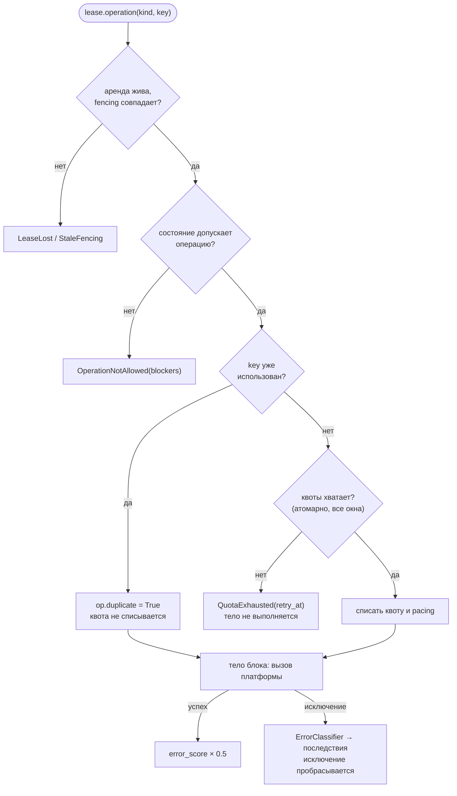

# 8. Лимиты и реакция на ошибки

Платформы банят за слишком частые действия. Identity Hub ограничивает нагрузку на каждый
аккаунт четырьмя механизмами:

| Механизм | Где задаётся | Что делает | Состояние аккаунта |
|---|---|---|---|
| **Квота** | `OperationRule.quotas` в сервисе | Не больше N операций вида за окно | не меняется; `operation()` бросает `QuotaExhausted` |
| **Pacing** | `space.pool(..., pacing=)` | После N операций — отдых на случайное время | `availability = paused` |
| **Cooldown** | `op.cool_down()` или `Fault(retry_after=)` | Пауза по требованию платформы (flood-wait) | `availability = cooling` |
| **Карантин** | `Service.quarantine_threshold` | Слишком много ошибок по вине аккаунта | `availability = quarantined` |

Все лимиты считаются **на аккаунт**. Квот на пул, прокси или сервис целиком нет.

## Операция

Каждое действие на платформе оборачивайте в `lease.operation`:

```python
async with lease.operation("send_message", key=f"send:{job.id}") as op:
    await client.send(...)
```



- Квота списывается **до** вызова платформы и в отдельной транзакции: откат вашей транзакции
  её не вернёт. Так гарантируется, что лимит не будет превышен даже при сбоях.
- **Ключ `key`** делает списание идемпотентным: повтор задачи с тем же ключом не спишет квоту
  второй раз. **Тело блока при этом выполняется** — проверяйте `op.duplicate` сами. Ключ
  уникален во всей базе, поэтому включайте в него вид операции или id задачи
  (`"send:job-42"`). Ключи хранятся 7 дней.
- Исключение внутри блока не глушится — оно пробрасывается, а аренда закрывается как `failed`,
  если вы его не поймали.

## Квоты

```python
from datetime import datetime, timedelta, timezone
from identity_hub import OperationRule, Quota

MSK = timezone(timedelta(hours=3))

operations = {
    "send_message": OperationRule(quotas=(
        Quota(20, timedelta(hours=1)),                                        # 20 в час
        Quota(100, timedelta(days=1), origin=datetime(2000, 1, 3, tzinfo=MSK)),  # 100 в сутки, сутки с полуночи МСК
    )),
}
```

- **Окна фиксированные**, не скользящие: час — с начала часа, сутки — с полуночи по `origin`
  (по умолчанию UTC), неделя — с понедельника.
- Все окна операции списываются **атомарно**: если одно исчерпано, остальные не тронуты.
- `QuotaExhausted.retry_at` — когда откроется окно. Сбросить квоту вручную нельзя.
- При расходе последней единицы пишется событие `identity.quota.exhausted`.
- Текущий расход: `(await space.identity_card(id)).quotas`.

**Важно:** квоты не учитываются при выборе аккаунта в `pool.lease(for_operation=...)`. Аккаунт с
исчерпанной квотой может быть выдан — ловите `QuotaExhausted` и берите следующий аккаунт:

```python
for _ in range(5):
    try:
        async with pool.lease(for_operation="send_message", wait=10) as lease:
            async with lease.operation("send_message", key=key):
                await send(...)
        break
    except QuotaExhausted:
        continue
```

## Pacing — имитация живого человека

Живые пользователи не работают без перерыва. Pacing отправляет аккаунт отдыхать после серии
операций:

```python
from identity_hub import Pacing, Quota

senders = space.pool(
    "senders", service=TELEGRAM,
    pacing=Pacing(work=Quota(15, timedelta(hours=1)), pause=(20, 45)),   # после 15 операций — 20–45 минут отдыха
)

async with senders.lease() as lease:
    async with lease.operation("send_message") as op:
        await send(...)
    if op.paused_until:
        log.info("аккаунт ушёл отдыхать до %s", op.paused_until)
```

- Pacing — свойство **пула**: одни и те же аккаунты могут работать размеренно в пуле рассылки
  и без пауз в пуле парсинга.
- Счётчик общий для всех видов операций аккаунта в этом пуле.
- Операция, исчерпавшая серию, выполняется; отдыхает аккаунт после неё (`availability=paused`),
  затем возвращается сам.

## Cooldown — flood-wait от платформы

```python
async with lease.operation("send_message") as op:
    try:
        await client.send(...)
    except FloodWaitError as e:
        await op.cool_down(e.seconds)        # availability = cooling на e.seconds
        raise
```

Срок только удлиняется: повторный `cool_down` с меньшим сроком не сократит паузу. То же
делается автоматически через классификатор ошибок (`Fault(retry_after=...)`).

## Классификатор ошибок

Классификатор — главный способ сообщить библиотеке, что случилось на платформе. Он получает
исключение из тела операции и возвращает `Fault` — чья это вина:

```python
from datetime import timedelta
from identity_hub import Blame, Fault, Standing


class TgErrors:
    def classify(self, exc):
        match exc:
            case FloodWaitError():
                return Fault(Blame.IDENTITY, retry_after=timedelta(seconds=exc.seconds), code="FLOOD_WAIT")
            case AuthKeyUnregisteredError():
                return Fault(Blame.SESSION_INVALID, code="AUTH_KEY_UNREGISTERED")
            case UserDeactivatedBanError():
                return Fault(Blame.IDENTITY_BANNED, code="USER_DEACTIVATED_BAN")
            case PeerFloodError():
                return Fault(Blame.IDENTITY_BANNED, standing=Standing.LIMITED, code="PEER_FLOOD")
            case ProxyConnectionError():
                return Fault(Blame.PROXY, weight=1.0)
            case _:
                return None                     # ошибка запроса, аккаунт не виноват


TELEGRAM = Service(..., error_classifier=TgErrors())
```

| `Blame` | Смысл | Последствие |
|---|---|---|
| `IDENTITY` | Аккаунт перегружен или ведёт себя подозрительно | `error_score += weight`; с `retry_after` → `cooling`; при `error_score ≥ quarantine_threshold` → `quarantined` |
| `SESSION_INVALID` | Сессия больше не работает | сессия помечается невалидной, `auth → session_invalid` |
| `IDENTITY_BANNED` | Платформа ограничила аккаунт | `standing → fault.standing` (по умолчанию `banned`) |
| `PROXY` | Виноват прокси | `error_score` прокси растёт, см. [прокси](09-proxies.md) |
| `REQUEST` или `None` | Ошибка запроса, данных, сети | состояние не меняется |

`Fault(blame, retry_after=None, standing=None, code=None, raw_status=None, weight=1.0)`.

**Карантин.** `error_score` растёт на ошибках `IDENTITY` и уменьшается вдвое при каждой успешной
операции. Если он достиг `Service.quarantine_threshold` (по умолчанию 5), аккаунт уходит в
`quarantined` и не выдаётся, пока администратор не снимет карантин override-ом. Если ваш код
падал из-за собственной ошибки, а не аккаунта, — вернуть аккаунт можно так:

```python
await space.override(identity_id, Override("availability", "", "available", reason="баг в воркере", actor="admin"))
```

Дальше: [прокси](09-proxies.md).
