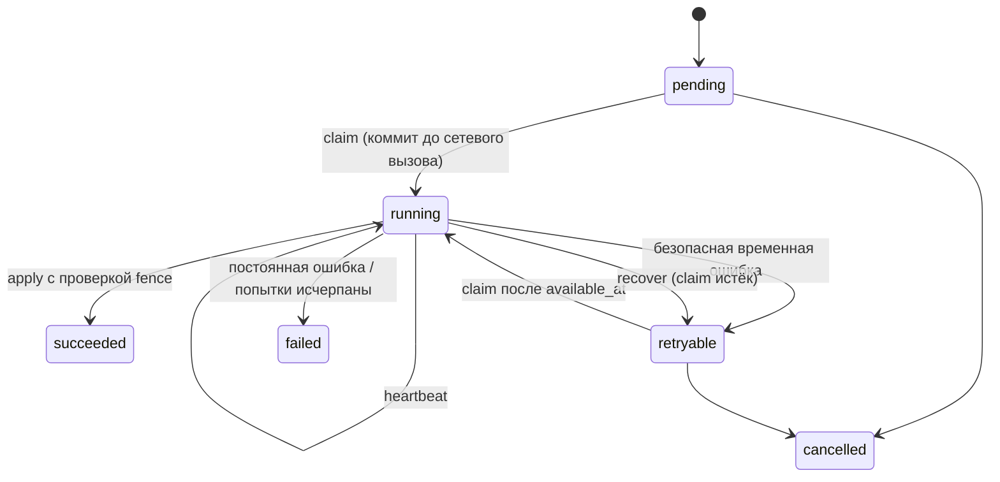

# Identity Hub — улучшения из AccountPlane и нагрузочного замера

Статус: предложено, ждёт решения владельца  
Источник: разбор `AccountPlane` (v1 + v2, отчёты нагрузки на 500k аккаунтов, 2026-08-17) и замер
Identity Hub на PostgreSQL 16 (2026-09-26)  
Связанные документы: [`identity-hub-requirements.md`](../../identity-hub-requirements.md),
[`PLAN.md`](PLAN.md), [`DECISIONS.md`](DECISIONS.md)

Каждое улучшение — отдельная запись `IMP-NN`: что взять, откуда, что меняется в схеме, API и
документе, какие задачи плана затрагивает и какими тестами подтверждается. Принятое улучшение
переносится в `DECISIONS.md` записью `D-NNN` и в соответствующие разделы ТЗ.

## Сводка

| ID | Улучшение | Приоритет | Схема | Задачи плана |
|---|---|---|---|---|
| IMP-01 | LRU-выборка аренды по `last_leased_at` | **до P3.1** | да | P0.2, P3.1, P3.2 |
| IMP-02 | HOT-обновления heartbeat: без индекса на `expires_at`, `fillfactor=70` | **до P3.3** | да | P0.2, P3.3 |
| IMP-03 | Идемпотентность с fingerprint команды и конфликтом | **до P2.1** | да | P1.1, P2.1, P4.1 |
| IMP-04 | HMAC-тег для команд с секретами, отдельный ключ | **до P1.7** | да | P1.7, P2.4 |
| IMP-05 | Полный fence: равенство кортежа, а не «номер ≥» | **до P3.3** | нет | P3.3, P3.4 |
| IMP-06 | Семантика `renew` / `release` / `revoke` | **до P3.3** | нет | P3.3, P3.4 |
| IMP-07 | `revision` + `expected_revision` на изменяемых агрегатах | **до P2.3** | да | P1.1, P2.3, P2.5 |
| IMP-08 | Нормализация идентификатора сервисом | **до P2.4** | да | P1.4, P2.4, P5.7 |
| IMP-09 | Несколько credentials на аккаунт с lifecycle | **до P3.4** | да | P0.2, P3.4, P5.3, P5.6 |
| IMP-10 | Два режима обновления сессии | P1 | да | P3.4, P5.3 |
| IMP-11 | Внешние вызовы как долговечные операции (claim → call → apply) | P1 | да | P5.3, P5.5 |
| IMP-12 | Публичная read-схема на SQLAlchemy Core | P1 | нет | P6.1, P6.2 |
| IMP-13 | Модель ошибок: стабильные коды, HTTP, коды выхода CLI | **P1.1** | нет | P1.1, P9.2 |
| IMP-14 | Порядок блокировок в документе | **до P2.1** | нет | P2.1 и все записи |
| IMP-15 | Проверка схемы при старте без миграции | P1 | нет | P0.4, P2.1 |
| IMP-16 | Лимиты полезной нагрузки и версия envelope | **P1.7** | да | P1.7, P2.5 |
| IMP-17 | Harness нагрузки с проверкой инвариантов | P1 | нет | P10.3 |
| IMP-18 | Детерминированные race-тесты на barrier'ах | **P3.2** | нет | P3.2–P3.4, P4.1 |
| IMP-19 | Import-linter и архитектурные тесты | P2 | нет | P0.1 |
| IMP-20 | `run_once(limit)` как ядро фоновых работ | P1 | нет | P8.1, P9.1 |
| IMP-21 | Опциональный порядок outbox внутри потока аккаунта | P2 | нет | P8.1, P8.3 |
| IMP-23 | Публичное API: ресурсные неймспейсы и единая конвенция глаголов | **до I1.1** | нет | фаза I8 |

Приоритеты: **жирным** — нужно до указанной задачи, иначе её придётся переделывать; P1 — в v1;
P2 — в v1, если хватит времени; v1.1 — после релиза.

---

## A. Производительность выборки и heartbeat

### IMP-01. LRU-выборка аренды по `last_leased_at`

**Проблема.** Выборка в порядке первичного ключа (так в AccountPlane:
`ORDER BY accounts.id` + outer join на leases + до 16 повторов) пробегает мимо всех занятых
аккаунтов. Замер Identity Hub на 100 000 аккаунтов:

| Занято | По PK, p50 | По LRU, p50 |
|---|---|---|
| 0% | 0,9 мс | 0,7 мс |
| 50% | 75,8 мс | 0,7 мс |
| 90% | 135,7 мс | 0,9 мс |
| 99% | 151,4 мс | 0,6 мс |

AccountPlane на 500k и 8 ядрах упирался в **~70 аренд/с**. Identity Hub с LRU на 2 ядрах (клиент и
сервер на одной машине) — ~700 аренд/с.

**Изменение.**
- Колонка `ih_identities.last_leased_at timestamptz NULL`.
- Частичный индекс выборки
  `(space_id, service, last_leased_at ASC NULLS FIRST) WHERE lifecycle='ready' AND auth_state='authenticated' AND standing IN ('good','limited') AND availability='available'`.
- `acquire` одним запросом: CTE с `ORDER BY last_leased_at NULLS FIRST LIMIT 1 FOR UPDATE OF i SKIP LOCKED`
  и `UPDATE ... SET fencing_seq = fencing_seq + 1, last_leased_at = clock_timestamp()`. Без цикла
  повторов на стороне Python: занятые строки уезжают в хвост индекса.
- Побочная польза — равномерная ротация аккаунтов.

**Трейд-офф.** `availability` в предикате индекса: аккаунт с истёкшим кулдауном попадает в выборку
после фоновой нормализации (до минуты). Альтернатива — убрать `availability` из предиката и
фильтровать `availability_until < now()` в запросе; дороже при большом числе аккаунтов в кулдауне.

**Заменяет** D-007 («ORDER BY availability_until NULLS FIRST, updated_at»).

**Проверка.** EXPLAIN использует `ix_ih_identities_pick`; бенчмарк заполнения 0/50/90/99% на
100k — p95 выборки ≤ 5 мс на всех уровнях.

### IMP-02. HOT-обновления heartbeat

**Проблема.** Индекс на `ih_leases.expires_at` делает каждый heartbeat не-HOT обновлением:
раздуваются таблица и индексы. Замер: 3000 аренд × 10 кругов — HOT **0%** с индексом, **94%** без
него (при `fillfactor = 70`).

**Изменение.**
- Удалить `ix_ih_leases_expires_at`; чистильщик сканирует `ih_leases` целиком (в таблице только
  живые и истёкшие аренды — она маленькая).
- `ih_leases WITH (fillfactor = 70)`.
- `ih_lease_history.last_heartbeat_at` и счётчики обновлять раз в `stats_flush_interval`
  (по умолчанию 5 мин) и при закрытии, а не на каждый heartbeat. Удалить
  `ix_ih_lease_history_open`; незакрытые записи чистильщик находит через истёкшие строки
  `ih_leases` по `token`.
- Heartbeat пачкой: один `UPDATE ... WHERE token = ANY($1)` на процесс-воркер. Замер: ~1 800
  продлений/с поштучно против ~15 000–17 500/с пачками по 100–500.

**Проверка.** `n_tup_hot_upd / n_tup_upd ≥ 0.9` по `ih_leases` после 10 кругов heartbeat.

> Схема в `AccountLibrarry/src/identity_hub/postgres/migrations/versions/0001_initial_schema_v1.py`
> не содержит IMP-01 и IMP-02. Релиза ещё не было — предлагается исправить `0001` напрямую и
> записать исключение к D-012: «до первого релиза `0001` изменяема».

---

## B. Идемпотентность и гарантии аренды

### IMP-03. Идемпотентность с fingerprint команды

**Проблема.** Сейчас ключ идемпотентности только возвращает прошлый результат. Если клиент по
ошибке переиспользовал ключ с другой командой, он молча получит чужой результат.

**Как в AccountPlane** (`docs/specs/transactions-leasing.md`, ADR-0003, ADR-V2-0003):
1. `INSERT ... ON CONFLICT DO NOTHING RETURNING` записи идемпотентности.
2. Вставка ждёт незакоммиченного победителя; снаружи статуса `PENDING` нет.
3. Победитель выполняет изменение, события и сохраняет сериализованный результат в той же
   транзакции.
4. Проигравший читает закоммиченную запись: совпал fingerprint — replay, не совпал —
   `IdempotencyConflict`.
5. Откат победителя удаляет запись, ожидающий становится владельцем.

**Изменение схемы `ih_operation_keys`** (и общая таблица для register/lease/import):

| Колонка | Назначение |
|---|---|
| `namespace`, `key` | PK; оба NOT NULL |
| `operation` | имя команды |
| `fingerprint_version`, `fingerprint` | версия канонизации и хеш нормализованной команды |
| `fingerprint_key_id` | id ключа HMAC (IMP-04), если в команде были секреты |
| `result_type`, `result_version`, `result` | сохранённый безопасный результат |
| `identity_id` | владелец для каскадной очистки |
| `expires_at` | срок хранения fingerprint и результата вместе |

**Канонизация:** нормализованные идентификаторы, отсортированные ключи, UUID и UTC в каноническом
виде, различие «поле пропущено» и «явный null», без секретов.

**Проверка.** Race-тест двух соединений с одним ключом: один выполнил, второй получил replay;
тот же ключ с другим телом — `IdempotencyConflict`; откат победителя — второй выполняет сам.

### IMP-04. HMAC-тег для команд с секретами

Fingerprint не может содержать секрет, но должен различать команды с разными паролями. AccountPlane
использует HMAC-SHA-256 **отдельным ключом**, не ключом шифрования
(`_infrastructure/security/envelope.py`, `equivalence_tag`).

**Изменение.**
- `SecretsProvider` отдаёт два кольца ключей: шифрования и fingerprint.
- `fingerprint_key_id` в записи идемпотентности; ротация — добавить новый текущий ключ, старые
  хранить для проверки, пока не истекут записи.
- Отсутствующий ключ для живой записи — ошибка конфигурации, а не «промах идемпотентности».

### IMP-05. Полный fence

**Правило.** Запись от имени аренды принимается только при совпадении всего кортежа:
`lease_id`, `token`, `identity_id`, `ih_identities.fencing_seq == fencing` (равенство),
аренда существует и `expires_at > now()`. Номер больше текущего ничего не даёт.

```python
@dataclass(frozen=True)
class LeaseFence:
    identity_id: UUID
    lease_id: UUID
    token: UUID
    fencing: int


class LeaseOwnershipLost(IdentityHubError):
    code = "lease_ownership_lost"


class LeaseGuard:
    def __init__(self, session: AsyncSession) -> None:
        self._session = session

    async def check(self, fence: LeaseFence) -> None:
        ok = await self._session.scalar(
            select(literal(True))
            .select_from(IdentityRecord)
            .join(LeaseRecord, LeaseRecord.identity_id == IdentityRecord.id)
            .where(
                IdentityRecord.id == fence.identity_id,
                IdentityRecord.fencing_seq == fence.fencing,
                LeaseRecord.lease_id == fence.lease_id,
                LeaseRecord.token == fence.token,
                LeaseRecord.expires_at > func.now(),
            )
            .with_for_update(of=IdentityRecord)
        )
        if not ok:
            raise LeaseOwnershipLost(fence.identity_id)
```

**Где применяется:** `save_session`, `operation` (результат), `verification.submit`,
закрытие истории аренды, `cool_down` от имени воркера.

**ТЗ:** уточнить G-1.4.

### IMP-06. Семантика `renew` / `release` / `revoke`

| Команда | Поведение |
|---|---|
| `renew` | `expires_at = max(old_expires_at, now() + ttl)` — срок никогда не укорачивается |
| `release` своей живой аренды | закрывает аренду и историю |
| повторный `release` / `release` истёкшей | no-op, успех |
| `release` отозванной аренды | `LeaseRevoked` — воркер должен узнать, что его сняли |
| `revoke` | закрывает аренду с причиной, `fencing_seq += 1` — старый fence недействителен сразу |

**ТЗ:** FR-6.9, G-1.x. Сейчас в документе «чужой токен — no-op» без различия причины.

### IMP-07. `revision` + `expected_revision`

**Проблема.** Два оператора админки одновременно правят labels, profile или делают override —
последний молча перезаписывает первого. `version` сейчас есть только в `ih_region_states`.

**Изменение.**
- `ih_identities.revision BIGINT NOT NULL DEFAULT 1`, растёт на каждое изменение агрегата.
- Команды изменения из админки и `using(session)` принимают `expected_revision`; несовпадение —
  `RevisionConflict`.
- В событии — новая `revision`; `(identity_id, revision)` даёт локальный порядок истории.
- Воркерские изменения (под арендой) используют fence (IMP-05), а не `expected_revision`.

---

## C. Модель данных аккаунта

### IMP-08. Нормализация идентификатора

**Проблема.** Уникальность `(service, external_ref)` сравнивает сырую строку:
`+380 (50) 123-45-67` и `380501234567`, `User@Mail.com` и `user@mail.com` — разные аккаунты.

**Изменение.**
- `Service.normalize_ref: Callable[[str], str]` (по умолчанию `str.strip`), плюс
  `normalize_ref_version` — смена нормализации требует явной миграции данных.
- Колонки `external_ref` (как ввели) и `normalized_ref`; уникальность — `(service, normalized_ref)`.
- Нормализация выполняется до поиска, fingerprint и вставки; `import_many` сообщает о дублях после
  нормализации.

```python
def normalize_phone(raw: str) -> str:
    digits = "".join(ch for ch in raw if ch.isdigit())
    if not 10 <= len(digits) <= 15:
        raise ValueError(f"invalid phone: {raw!r}")
    return "+" + digits


TELEGRAM = Service(name="telegram", normalize_ref=normalize_phone, normalize_ref_version=1, ...)
```

### IMP-09. Несколько credentials на аккаунт

**Проблема.** Один зашифрованный blob на аккаунт. Для бирж и почты нужны независимые секреты:
пароль, TOTP, API-ключ, recovery-коды, пароль приложения — каждый со своей ротацией и сроком.

**Изменение `ih_credentials`:**

| Колонка | Назначение |
|---|---|
| `id` | PK (UUIDv7) |
| `identity_id`, `space_id` | владелец |
| `kind` | `password`, `totp`, `api_key`, `recovery_codes`, `app_password` — объявляет сервис |
| `name` | различает несколько одного вида (`api_key:trading`, `api_key:readonly`) |
| `public_value` | открытая часть: логин, id ключа |
| envelope | секрет |
| `lifecycle` | `active` → `disabled` ↔ `active`, `revoked` терминальный |
| `expires_at` | истечение считается по времени, не переходом |
| `revision` | IMP-07 |

Уникальность — `(identity_id, kind, name)`. Схема секрета — Pydantic-модель по `kind` в `Service`.
API: `lease.credential("totp")`, `lease.credentials()` (все активные).

### IMP-10. Два режима обновления сессии

- **На месте**: активный слот обновляется, `revision + 1`, событие `session.refreshed`.
- **Замена**: создаётся новая сессия в слоте, старая атомарно получает `revoked` (история
  сохраняется). Нужно, когда платформа выдаёт новый auth key, а старый ещё жив и должен быть
  отозван явно.

Режим выбирает вызывающий код и фиксируется в событии. Жизненный цикл сессии:
`created → active → invalidated → revoked`, `revoked` терминальный.

---

## D. Внешние вызовы

### IMP-11. Долговечные операции для входа и проб

**Проблема.** `run_logins` и `reconcile` в ТЗ вызывают `Authenticator` и `Probes` без записи о
попытке. Если процесс упал посреди входа, неизвестно, был ли отправлен SMS-код; поздний ответ
старого воркера может перезаписать свежий результат.

**Модель AccountPlane** (ADR-V2-0004, `docs/v2/reference/operations-workers.md`):



**Изменение.**
- Таблица `ih_provider_operations`: `kind` (`login`, `refresh`, `probe:<region>`), `identity_id`,
  `state`, `attempt`, `claim_id`, `claim_token`, `claimed_by`, `claim_expires_at`, `available_at`,
  `deadline_at`, безопасный `result`, `error_code`.
- Claim коммитится **до** вызова адаптера; `attempt_id` передаётся адаптеру как ключ
  идемпотентности, если платформа его поддерживает.
- Применение результата — вторая транзакция с проверкой `claim_id`, `claim_token`, состояния
  `running` и неистёкшего claim; поздний ответ отклоняется.
- Восстановление истёкшего `running` сначала коммитит `retryable` или `failed`; новая попытка —
  только обычным claim.
- Гарантия — at-least-once попытка, никакого exactly-once внешнего эффекта.

**Задачи:** P5.3 (вход, challenge), P5.5 (пробы, resync, reconcile) строятся поверх одной
очереди операций.

---

## E. Контракты и эксплуатация

### IMP-12. Публичная read-схема на SQLAlchemy Core

**Заменяет** в ТЗ §5.5 «ORM-классы библиотеки экспортируются как контракт только для чтения».

- `hub.read.identities`, `hub.read.leases`, `hub.read.lease_history`, `hub.read.region_states`,
  `hub.read.events`, `hub.read.proxies` — стабильные Core-selectable без секретных колонок,
  ключей, fingerprint и служебных полей блокировок.
- Их можно join-ить с доменными таблицами и передавать в `among=`.
- Версия read-схемы отдельна от версии БД; физические таблицы приватны и могут меняться.

```python
stmt = (
    select(FarmAccount.identity_id)
    .join(hub.read.identities, hub.read.identities.c.id == FarmAccount.identity_id)
    .where(hub.read.identities.c.standing == "good", FarmAccount.energy >= 500)
)
async with farmers.lease(among=stmt) as lease:
    ...
```

### IMP-13. Модель ошибок

Новый раздел ТЗ. Базовый класс `IdentityHubError` с полями `code` и безопасным `context`;
сообщения без секретов, SQL-параметров и сырых ответов платформ.

| Код | Когда | HTTP (админка) | CLI exit |
|---|---|---|---|
| `validation_error` | схема, поле, нормализация | 422 | 2 |
| `not_found` | нет ресурса | 404 | 2 |
| `no_resource_available` | некого выдать в аренду | 404 | — |
| `revision_conflict` | IMP-07 | 409 | — |
| `invalid_transition` | таблица переходов региона | 409 | — |
| `idempotency_conflict` | IMP-03 | 409 | — |
| `lease_ownership_lost`, `lease_revoked`, `lease_expired` | IMP-05, IMP-06 | 409 | — |
| `pinned_by_override`, `stale_observation` | синхронизация регионов | 409 | — |
| `quota_exceeded`, `identity_unavailable` | квоты, availability | 429 | — |
| `database_busy` | lock timeout | 503 | 4 |
| `schema_incompatible` | IMP-15 | 503 | 3 |
| `secret_configuration_error` | ключи | 500 | 5 |

### IMP-14. Порядок блокировок

Новый пункт в ТЗ §8.6. Все операции берут блокировки строго в порядке:

1. `ih_identities` (при нескольких — по возрастанию `id`);
2. связанный аккаунт из `ih_identity_links` (зависимый раньше связанного);
3. `ih_region_states`, `ih_verifications`, `ih_credentials`, `ih_sessions`;
4. `ih_proxies`, затем `ih_bindings`;
5. `ih_leases`, `ih_lease_history`;
6. `ih_provider_operations`;
7. `ih_events`, `ih_webhook_deliveries`, `ih_notifications`.

Диспетчер блокирует только строки своих очередей и никогда не блокирует аккаунт.

### IMP-15. Проверка схемы при старте

- `IdentityHub` при создании проверяет, что ревизия Alembic библиотеки равна ожидаемой; иначе
  `SchemaIncompatible` с понятным сообщением. Автомиграции на старте нет.
- `identity-hub migrate` берёт advisory lock на время миграции (единственное допустимое место
  advisory lock в библиотеке).
- Неизвестная более новая или старая ревизия — fail fast.

### IMP-16. Лимиты полезной нагрузки и версия envelope

- JSON (`labels`, `profile`, `attributes`, `identity_data`, `data` событий): не больше 64 KiB в
  закодированном виде и 16 уровней вложенности; `labels` — плоские (уже в ТЗ).
- Секрет в plaintext — не больше 512 KiB, envelope — не больше 1 MiB.
- В associated data AES-GCM добавить версию схемы полезной нагрузки:
  `identity-hub:v1:<table>:<id>:<slot|kind>:<schema_version>`.
- `SecretValue` — тип с редактированным `repr`/`str` и без JSON-сериализации; раскрытие только
  через аренду или явную capability админки.

### IMP-17. Harness нагрузки с проверкой инвариантов

По образцу `AccountPlane/benchmarks/`:

- `benchmarks/seed.py` — COPY на N аккаунтов, отдельно от измерения;
- `benchmarks/run.py` — ступени параллелизма 1/4/8/16/32/64, прогрев, p50/p95/p99, пустые выборки,
  неожиданные ошибки;
- после прогона — проверка инвариантов: нет двух живых аренд на аккаунт, `fencing` всех живых
  аренд равен `fencing_seq`, нет утечки соединений, нет deadlock;
- правило насыщения: прирост throughput < 10% при росте p95 > 25% относительно предыдущей ступени;
- отчёт в `docs/load-results/<дата>.md` с окружением (CPU, PostgreSQL, пул, commit).

Именно такой прогон нашёл в AccountPlane гонку на 584 `LeaseOwnershipLost`: после блокировки
аккаунта не перечитывалась доступность аренды.

### IMP-18. Детерминированные race-тесты

Отдельные соединения и `asyncio.Barrier` (или advisory lock как барьер в тесте), а не `sleep`.
Обязательные сценарии:

- два `acquire` за последний свободный аккаунт — один победитель;
- повторный `acquire` против `release`/`renew` той же аренды (сценарий бага AccountPlane);
- гонка за последнюю единицу квоты;
- истечение аренды и запись зомби-воркера (IMP-05);
- два одинаковых ключа идемпотентности; откат победителя (IMP-03);
- `override` против `observe` на одном регионе;
- `revoke` против `renew`;
- удаление аккаунта против `acquire`.

### IMP-19. Import-linter и архитектурные тесты

- Правила: `identity_hub.core` не импортирует `sqlalchemy`, `alembic`, `httpx`, `aiogram`;
  интеграции не импортируют приватный `postgres.store`.
- Тест публичного API: корень пакета экспортирует только объявленные символы.

### IMP-20. `run_once(limit)` как ядро фоновых работ

Диспетчер, maintenance, reconcile и восстановление операций (IMP-11) — публичные методы вида
`await hub.workers.dispatch.run_once(limit=100)`, возвращающие безопасные счётчики. Библиотека не
запускает потоков и задач при импорте или создании hub. `hub.dispatcher.run()` из D-005 остаётся
удобной обёрткой — цикл поверх `run_once` с `LISTEN/NOTIFY` и опросом.

### IMP-21. Опциональный порядок outbox внутри потока аккаунта

AccountPlane не забирает событие с более поздней ревизией ресурса, пока предыдущее для того же
получателя не доставлено. Сильнее текущего «порядок не гарантируется, отбрасывай по
`sequence`», но даёт head-of-line блокировку на аккаунт. Предложение: флаг endpoint'а
`ordered=True`, по умолчанию выключен.

### IMP-22. RuntimeProfile (v1.1)

Отдельная сущность для браузерного профиля: отпечаток, userDataDir/внешний id, версия конфигурации,
lifecycle `created → ready ↔ disabled`, `broken`. Сессии могут ссылаться на профиль, привязка
прокси к профилю важнее привязки к аккаунту. Пригодится для ARMGS и cloakbrowser; в v1 хватает
`attributes`.

### IMP-23. Публичное API: ресурсные неймспейсы и единая конвенция глаголов

Источник: ревью `docs/guide` и публичной поверхности `1.0.0a1` (2026-09-30), перепроверенное
вторым независимым ревью. Решение о принятии — `D-141`.

**Проблема.**

1. `SpaceHandle` — 89 публичных атрибутов в одном плоском пространстве имён. Доменные команды
   (`register`, `retire`) лежат рядом с read-моделями админки (`account_search`,
   `delivery_center`, `human_queue`, `analytics_*`), аудитом админки (`record_admin_*`) и
   операциями обслуживания (`expire_challenges`, `expire_verifications`, `recheck_proxies`).
2. Нет лёгкого «получить identity»: руководство отсылает к тяжёлой `identity_card`.
   Две поисковые read-модели `search` и `account_search` конкурируют; техническая
   `account_selection_snapshot` (замороженный набор id+revision для bulk) выглядит как третий
   поиск. `identity_card` (состояние, квоты, аренда, blockers) и `access_card` (метаданные
   credentials/sessions без секретов) — разные срезы, но по именам разницу не понять.
3. `register` читается как «зарегистрировать аккаунт на платформе» и по-разному с
   `hub.register_service` (добавление декларации в конфигурацию хаба); по поведению это
   get-or-create без обновления.
4. Одиночное (`register`, kwargs) и массовое (`import_many`, `ImportRecord`) создание имеют
   разные входные контракты; `lifecycle=READY` есть только у одиночного.
5. Форма пакетных методов и результатов разная: `import_many` / `add_proxies` / `run_logins`;
   `RegisterResult` / `tuple[UUID, bool]` / строка `"succeeded"`.
6. `update_*` означает то слияние (`update_profile`), то замену (`update_credentials`);
   `set_labels(merge=True)` противоречит имени.
7. «pool» означает два понятия: неперсистентный объект правил отбора и аренды (`space.pool()`)
   и сохранённую группу прокси (`add_proxy(pool=...)`, `ProxyPolicy.pool`).
8. Разницу `resync` / `reconcile` по именам не угадать; `space.delete(id)` читается как удаление
   пространства; `pool.lease(**kwargs: Any)` не даёт автодополнения; `reveal_secret(id,
   "session:<slot>")` строково-типизирован; у `retire` нет пары «вернуть в работу».
9. Терминология смешана: `identity_*` в коде, `account_*` в админских методах.

**Конвенция глаголов** (для самостоятельных ресурсов; `add`/`remove` — только для членства:
теги, связи, прокси-привязка):

| Метод | Семантика |
|---|---|
| `get(id)` | объект или `NotFound` |
| `find(...)` | объект или `None` |
| `list(filter)` | структурированный фильтр → `Page[T]` |
| `search(query)` | строковый запрос → `Page[T]` |
| `create(spec)` | создать; конфликт → `AlreadyExists` |
| `ensure(spec)` | вернуть существующий без изменений или создать → `(obj, created)` |
| `create_many(specs, on_conflict=)` | массовый `create`: атомарно, `fail` \| `skip` |
| `update(id, ...)` | частичное изменение (слияние) |
| `replace_<part>(id, ...)` | полная замена части |
| `delete(id)` | физическое удаление |
| `imports.run(...)` | импорт внешних данных: частичный успех, пачки, `on_existing`, отчёт |

**Термин.** Публичные имена используют только `identity` (`Identity`, `IdentityCreate`,
`space.identities`). В русской документации один раз: «identity, или аккаунт, — учётная запись
во внешнем сервисе». Имена `account_*` из публичной поверхности уходят.

**Целевая поверхность.**

```python
space.identities   # get, find, get_by_ref, card, search, list, count,
                   # create, ensure, create_many, update, replace_profile, replace_attributes,
                   # add_tags, remove_tags, set_tags, set_note, delete,
                   # activate, retire, restore_standing, override, unpin
space.imports      # run, run_files, stage, get, cancel
space.secrets      # describe (бывш. access_card), reveal(id, SecretRef), replace_credentials,
                   # replace_session
space.proxies      # get, find, list, create, ensure, create_many, report_failure,
                   # report_success, recheck(id, checker), recheck_due(checker), override, rebind
space.pools        # define(...) -> Pool; revoke(identity_id)
space.auth         # login -> LoginOutcome, login_many, answer_challenge
space.sync         # refresh (бывш. resync), refresh_many (бывш. reconcile)
space.links        # add, remove, of, impact
space.data         # load, save
space.verifications  # status, review, requirements.add / resolve
space.webhooks, space.notifications   # без изменений
space.analytics    # series, funnel, time_to, cohorts, ban_rate, utilization, proxy_quality
space.admin        # read-модели UI, selection_snapshot, record_* (аудит)
space.maintenance  # expire_challenges, expire_verifications, reindex_search
```

**Контракты.**

- `IdentityCreate` — frozen dataclass (секреты не попадают в `repr`): `service`, `external_ref`, `id`, `credentials`, `sessions`,
  `profile`, `attributes`, `tags`, `labels`, `note`, `links: Mapping[str, UUID]`, `lifecycle`,
  `auth_state`. Общая для `create`, `ensure`, `create_many`.
- `ImportRecord` — отдельный тип (`D-144`), общие поля совпадают с `IdentityCreate`; добавляет ссылки по строковому
  ref (в том числе внутри пачки), `proxy`, начальные `verifications`. Импорт сохраняет
  `on_existing`, `verify_sessions`, `on_batch_committed`, `run_id` и `ImportReport`
  (`created`/`updated`/`skipped`/`failed`).
- `create_many` — одна транзакция, до 1000 записей. Вся пачка валидируется до транзакции,
  ошибки собираются в один `ValidationFailed`. `on_conflict="fail"` → `AlreadyExists` со
  списком ref, ничего не создано; `"skip"` → существующие в `skipped`. Результат
  `CreateManyResult(created: list[Identity], skipped: list[IdentityRef])` — без
  `updated`/`failed`.
- `Identity` — лёгкий secret-free DTO: id, service, external_ref, регионы, tags, labels, note,
  profile (кроме шифрованных полей), revision, created_at/updated_at.
- Прокси: `group` вместо `pool` в публичном API (`ProxySpec.group`, `ProxyPolicy.group`,
  `space.proxies.list(group=)`). Колонка БД `pool` не переименовывается (миграция не нужна).
  `ProxyPolicy(pool=...)` принимается с `DeprecationWarning`.
- `pool.lease()` / `pool.acquire()` принимают явные параметры (`for_operation`, `wait`, `holder`,
  `on_lost` и т.д.) вместо `**kwargs: Any`.
- `LoginOutcome` — `StrEnum` (значения совпадают со старыми строками).
- `SecretRef.CREDENTIALS`, `SecretRef.session(slot)`, `SecretRef.PROFILE`,
  `SecretRef.evidence(factor)` — строки в `reveal` принимаются, пока действуют алиасы.
- `hub.register_service` сохраняет имя: после ухода `register` конфликт имён исчезает.

**Совместимость.** Старые методы `SpaceHandle` остаются тонкими алиасами поверх новых фасадов
с `DeprecationWarning` и указанием замены до выпуска `1.0.0b1`. В задаче I8.9 алиасы удаляются
до финального аудита. Таблица «старое → новое» ведётся в `docs/api-migration.md` с первой
задачи фазы. Поверхность `SpaceHandle` защищена тестом-allowlist, чтобы новые методы
появлялись только в неймспейсах.

**Тесты.** Allowlist публичных атрибутов `SpaceHandle` и каждого фасада; conformance
MemoryStore/PgStore для `get`/`find`/`create_many` (атомарность, `fail`/`skip`);
алиас → новый метод даёт тот же результат и одно предупреждение; `pool.lease` отвергает
неизвестный параметр `TypeError`; примеры руководства исполняются.

---

## Что сознательно не берём из AccountPlane

| Решение AccountPlane | Причина |
|---|---|
| Один `AccountLifecycle` (`VERIFYING`, `CHALLENGED`, `SUSPENDED`, `BANNED`, `DISABLED`) | Смешивает регионы; у нас ортогональные lifecycle / standing / auth / availability / verification |
| Выборка `ORDER BY id` с циклом до 16 повторов | Деградирует с заполненностью (IMP-01) |
| Паритет SQLite и PostgreSQL | Удваивает реализацию и тесты; для тестов — `MemoryStore` |
| Отдельная таблица событий на каждый тип ресурса | Одна `ih_events` проще для диспетчера и админки |
| Hard delete, стирающий историю событий | Журнал без FK должен переживать удаление |
| Отдельные аренды Session / Profile / Proxy, прокси с capacity = 1 | Арендуем аккаунт вместе с его прокси; несколько аккаунтов на прокси |
| Не хранить URL и секреты вебхуков в БД | Противоречит решению редактировать правила из админки; храним зашифрованно, без тел ответов в журнале |
| SQL-текст кандидата в fingerprint | Меняется между версиями SQLAlchemy |
| FastAPI-роутер | Litestar; админка — отдельный пакет |
| Регрессионный манифест на ~1000 строк, P0/P1-ревью на каждом чекпоинте | Дорого для одного разработчика; хватает ADR, conformance- и race-тестов |

## Предлагаемый порядок внедрения

1. **Сейчас, до P1.1:** IMP-01, IMP-02 (правка `0001`), IMP-03, IMP-07, IMP-08, IMP-09 (схема);
   IMP-13, IMP-14 (ТЗ).
2. **Фаза 1:** IMP-04, IMP-16 в P1.7; модель ошибок IMP-13 в P1.1; `normalize_ref` в P1.4.
3. **Фаза 3:** IMP-05, IMP-06, IMP-18 вместе с захватом и жизненным циклом аренды.
4. **Фаза 5:** IMP-10, IMP-11 — вход, challenge, пробы поверх очереди операций.
5. **Фазы 6, 8–10:** IMP-12, IMP-15, IMP-17, IMP-19, IMP-20, IMP-21.
6. **После v1:** IMP-22.
7. **Сразу после I0.1:** IMP-23 (фаза I8) — чтобы I1–I7 расширяли уже новые неймспейсы,
   а не 89-методный `SpaceHandle`.
