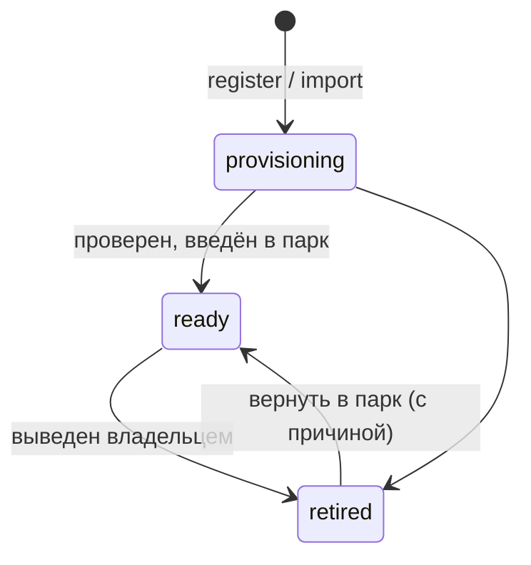
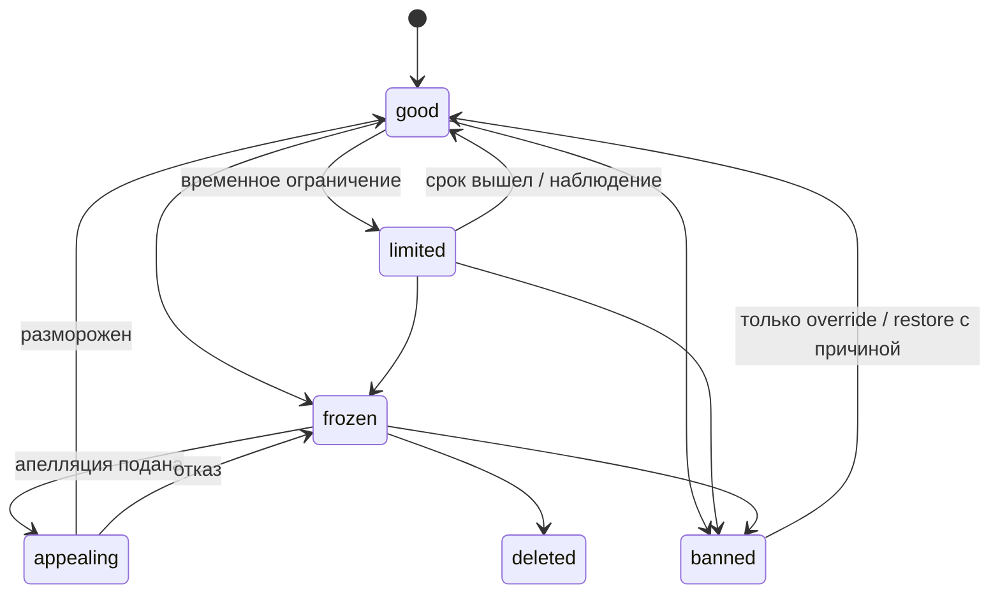
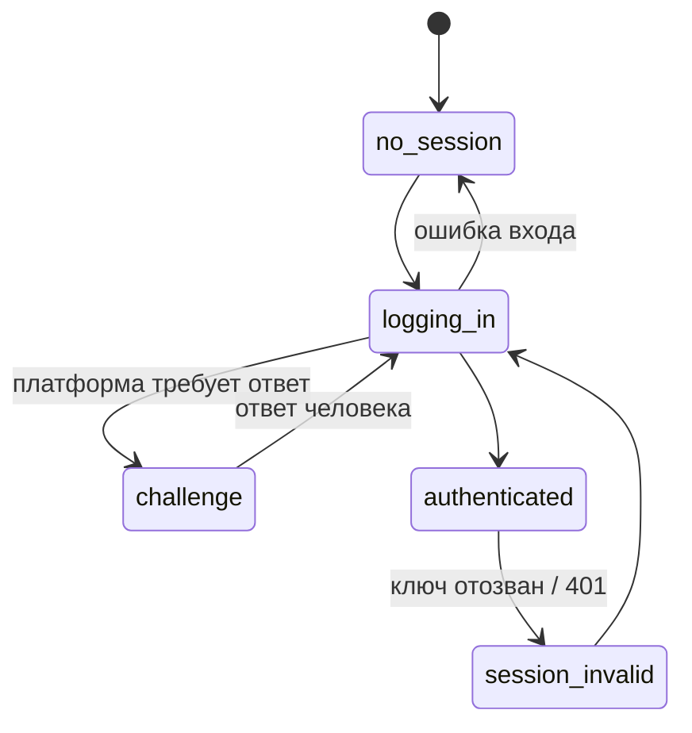
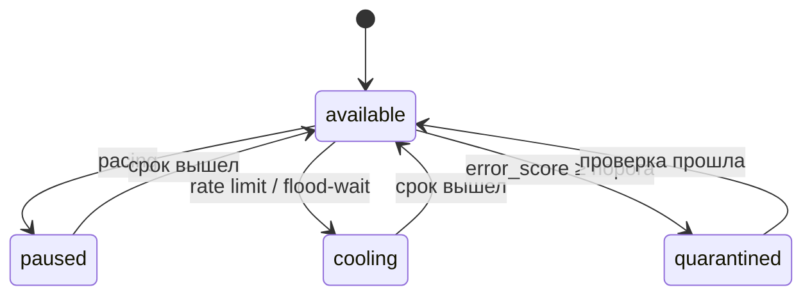
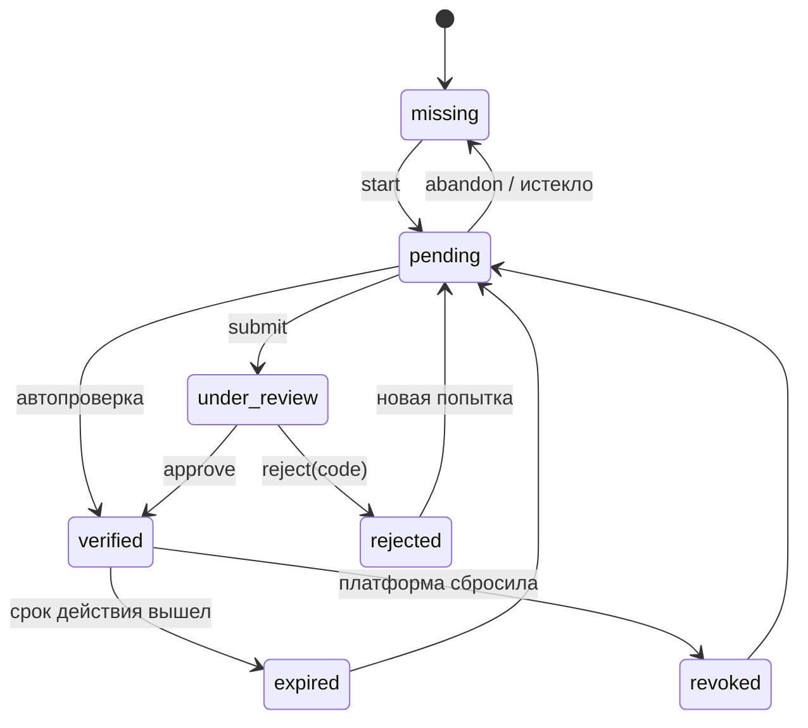
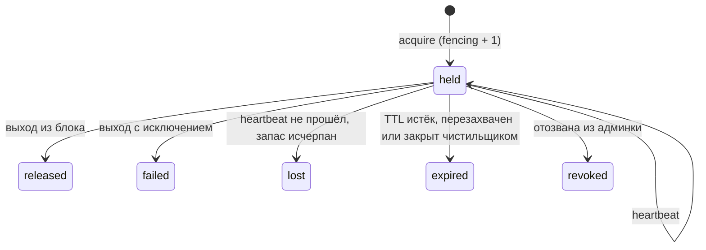
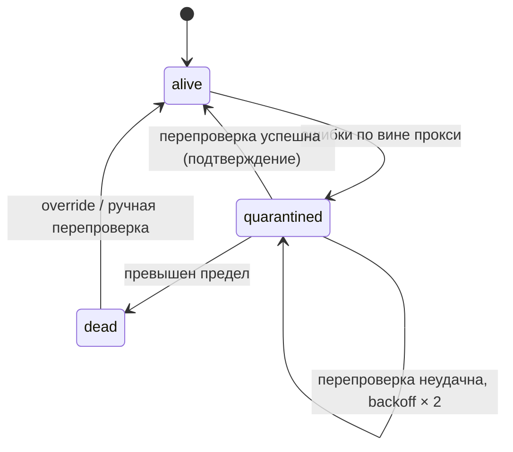
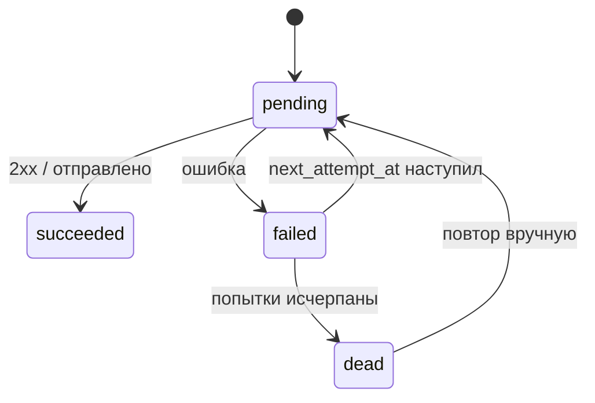
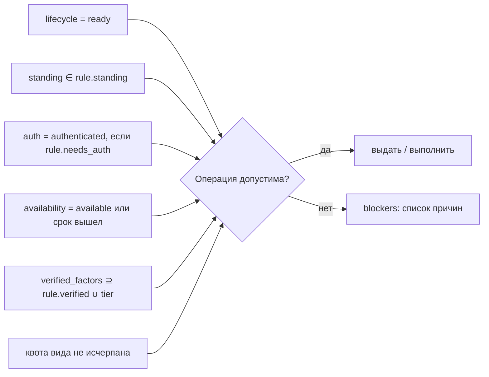

# Identity Hub — требования к библиотеке (v1)

Рабочее название: **Identity Hub**. Python-библиотека для управления парком аккаунтов (Telegram, почта, биржи, соцсети, браузерные профили): жизненный цикл, эксклюзивная аренда воркерами, лимиты, прокси, секреты и сессии, верификации, синхронизация состояния с платформами, события, вебхуки и уведомления.

Основное хранилище — PostgreSQL. Схема данных v1 — файл `identity_hub_models.py` (24 таблицы, проверено на PostgreSQL 16).

---

## Содержание

1. [Назначение и границы](#1-назначение-и-границы)
2. [Глоссарий](#2-глоссарий)
3. [Машины состояний](#3-машины-состояний)
4. [Функциональные требования](#4-функциональные-требования)
5. [Архитектура](#5-архитектура)
6. [Гарантии](#6-гарантии)
7. [Транзакции](#7-транзакции)
8. [PostgreSQL](#8-postgresql)
9. [Безопасность](#9-безопасность)
10. [Нефункциональные требования](#10-нефункциональные-требования)
11. [Публичный API (эскиз)](#11-публичный-api-эскиз)
12. [Вне скоупа v1](#12-вне-скоупа-v1)
13. [Открытые вопросы](#13-открытые-вопросы)

---

## 1. Назначение и границы

### 1.1. Проблема

В каждом проекте, работающем с множеством аккаунтов, заново пишутся одни и те же вещи: выбор свободного аккаунта, защита от одновременной работы двух воркеров с одной сессией, учёт лимитов платформы, кулдауны, привязка прокси, хранение сессий и паролей, реакция на баны. Эти реализации расходятся между проектами и содержат одни и те же ошибки конкурентности.

### 1.2. Правило разделения ответственности

Задачу берёт библиотека, если выполняются **оба** условия:

1. она касается самих аккаунтов и доступа к ним: состояния, аренды, секретов, входа;
2. она одинакова в любом проекте и для любого сервиса.

Иначе задача остаётся в домене пользователя.

| Библиотека | Домен пользователя |
|---|---|
| Состояния аккаунта (регионы), их синхронизация и ручные правки | Что аккаунт делает и зачем взят |
| Эксклюзивная аренда, fencing, история аренд | Бизнес-метрики и результаты работы |
| Квоты, pacing, кулдауны, здоровье | Закупка, стоимость, владелец внутри команды |
| Credentials, сессии, challenge, вход через аутентификатор сервиса | Регистрация новых аккаунтов, прогрев |
| Прокси, их здоровье и привязка к аккаунтам | Частое игровое/доменное состояние, отчёты |
| Связи аккаунт → аккаунт для входа и рекавери | Произвольные бизнес-группы (кроме тегов и меток) |
| Профиль персоны, технические атрибуты, метки, небольшие данные пользователя | Шлюзы к API платформ (библиотека вызывает только пробы и аутентификатор) |
| Журнал событий, исходящие вебхуки, уведомления в Telegram | Пользователи, роли и права админки |

### 1.3. Что библиотека не делает

- не ходит в API платформ сама — только через объекты, которые передал пользователь (`Authenticator`, `Probes`, `ErrorClassifier`);
- не управляет пользователями, ролями и правами; изоляция обеспечивается пространствами (`space`);
- не запускает браузеры и не держит живые процессы клиентов;
- не зависит от брокера задач.

---

## 2. Глоссарий

| Термин | Значение |
|---|---|
| **Hub** | Точка входа: хранилище, шифрование, реестр сервисов. Один на приложение. |
| **Space** (пространство) | Граница изоляции: проект или человек. Все данные принадлежат ровно одному пространству. |
| **Service** | Описание платформы в коде: схемы данных, операции и их лимиты, верификации, состояния платформы, аутентификатор, пробы, классификатор ошибок. |
| **Identity** (аккаунт) | Учётная запись на платформе. |
| **Pool** | Выборка аккаунтов сервиса в пространстве по тегам и политикам (pacing, прокси) для конкретного применения. |
| **Region** (регион) | Одно из независимых измерений состояния аккаунта: lifecycle, standing, auth, availability, verification. |
| **Lease** (аренда) | Эксклюзивное право воркера работать с аккаунтом. Публичный `lease_id`, приватный `token`, монотонный `fencing`. |
| **Operation** | Одно действие на платформе под арендой; списывает квоту. |
| **Quota** | Лимит операций вида за фиксированное окно. |
| **Pacing** | Превентивный отдых аккаунта после N операций. |
| **Observation** | Факт о внешнем мире (проба, ошибка, вебхук платформы), применяемый к региону. |
| **Override** | Ручная правка состояния человеком, с обязательной причиной. |
| **Fencing token** | Монотонный номер аренды; запись с устаревшим номером отклоняется. |
| **Credentials / Session** | Как войти (пароль, телефон, TOTP) / результат входа (auth key, cookies, токены). |
| **Challenge** | Вопрос платформы при входе, требующий ответа человека. |

---

## 3. Машины состояний

Состояние аккаунта — **не одна машина, а несколько ортогональных регионов** (statecharts, parallel regions). Одна машина со всеми комбинациями даёт взрыв состояний; независимые регионы растут линейно. Допустимость действий **вычисляется** из регионов, а не хранится.

### 3.1. Lifecycle — решения владельца (не синхронизируется)



### 3.2. Standing — положение у платформы (синхронизируется)



`standing_code` хранит код платформы (`spam_restricted`, `checkpoint`, `action_blocked`). Набор кодов и их отображение на состояния объявляет сервис.

### 3.3. Auth — вход (синхронизируется)



`session_invalid` — **не бан**: аккаунт возвращается ко входу, standing не меняется.

### 3.4. Availability — внутреннее планирование (не синхронизируется)



Временные состояния снимаются лениво: выборка считает `availability_until < now()` доступным; фоновая задача нормализует строку.

### 3.5. Verification — отдельная машина на каждый фактор (синхронизируется)



Состояния фиксированы библиотекой. Набор факторов, их зависимости, уровни (tiers), коды отказов и сроки действия объявляет сервис. Детали платформы — в `code`.

### 3.6. Lease — аренда



### 3.7. Proxy health (синхронизируется)



### 3.8. Доставка вебхука / уведомления



### 3.9. Вычисляемая допустимость операции



---

## 4. Функциональные требования

Нумерация `FR-<раздел>.<n>` для трассировки в задачи и тесты.

### 4.1. Пространства и сервисы

- **FR-1.1.** Все данные принадлежат ровно одному пространству. Любая операция библиотеки выполняется в рамках одного пространства; API «по всем пространствам» нет.
- **FR-1.2.** Сервис описывается в коде объектом `Service`: имя, заголовок, Pydantic-схемы `attributes`, `profile`, `credentials`, `session`; поля профиля для поиска и фильтров; операции и их квоты; правила операций (`OperationRule`); коды standing и их отображение; спецификации верификаций и уровни; нормализация наблюдений; опционально `Authenticator`, `Probes`, `ErrorClassifier`, режим аренды (`exclusive` / `shared`), политика привязки прокси.
- **FR-1.3.** Реестр сервисов синхронизируется в `ih_services` при старте (для админки). Источник правды — код.

### 4.2. Регистрация и импорт

- **FR-2.1.** `register` создаёт аккаунт с данными, секретами, метками, тегами, связями и начальным состоянием. Поддерживает свой `id` (любой корректный UUID; по умолчанию генерируется UUIDv7 в Python).
- **FR-2.2.** Пара `(service, external_ref)` уникальна **глобально**, а не в пространстве: один аккаунт платформы не может жить в двух пространствах.
- **FR-2.3.** `register` идемпотентен по `id` и по `(service, external_ref)`: повтор возвращает «уже существует» без изменений.
- **FR-2.4.** `import_many` принимает поток записей, валидирует их схемами сервиса **до** обращения к БД, пишет пачками в отдельных транзакциях (по умолчанию 500), возвращает отчёт `created / skipped / failed` с причинами. Поддерживает `on_existing = skip | update_session | fail`, связи по `external_ref` (в том числе внутри пачки), прокси с дедупликацией, начальные верификации.
- **FR-2.5.** Начальное состояние при импорте: есть сессия → `auth = authenticated` (или `no_session` при `verify_sessions=True`); нет → `no_session`. `lifecycle = provisioning`.
- **FR-2.6.** Сервис может предоставлять импортёры файлов (`.session`, `tdata`, JSON с cookies), превращающие файл в `ImportRecord`.
- **FR-2.7.** Хук `on_batch_committed(session, created_ids)` для добавления доменных строк после каждой пачки.

### 4.3. Данные аккаунта

- **FR-3.1.** `attributes` — технические параметры (устройство, user-agent), валидируются схемой сервиса.
- **FR-3.2.** `profile` — данные персоны (имя, дата рождения, страна), валидируются схемой сервиса; поля, объявленные сервисом как `filterable`, доступны для фильтра аренды и поиска. Опция `profile_encrypted` — хранить всё, кроме фильтруемых полей, в зашифрованном виде.
- **FR-3.3.** `labels` — плоские пары `ключ → строка | число | bool` для фильтров; вложенные структуры запрещены.
- **FR-3.4.** `tags` — множество флагов для выборки аренды.
- **FR-3.5.** `note` — свободная заметка из админки.
- **FR-3.6.** `identity_data` — данные пользователя по неймспейсам (`farm.notcoin`) со своей Pydantic-схемой, версией схемы и оптимистической блокировкой. Библиотека не интерпретирует содержимое.

### 4.4. Связи аккаунтов

- **FR-4.1.** Направленная связь `аккаунт → аккаунт` с ролью (`recovery_email`, `registered_phone`). Одна связь на пару `(аккаунт, роль)`.
- **FR-4.2.** Связанный аккаунт — из того же пространства; удалить аккаунт, на который есть ссылки, нельзя; связь с самим собой запрещена.
- **FR-4.3.** Аутентификатор получает связанные аккаунты через `LoginContext.linked(role)`; библиотека берёт их в аренду в порядке «зависимый → связанный».
- **FR-4.4.** Read-модели: `links_of(id)` (обе стороны), `link_summary(ids)` (одним запросом для страницы списка), `impact_of(id, max_depth)` (транзитивный анализ последствий).

### 4.5. Секреты, сессии, вход

- **FR-5.1.** `credentials` (как войти), `sessions` (результат входа, несколько слотов на аккаунт) и контекст challenge хранятся зашифрованными.
- **FR-5.2.** Расшифровка — **только через аренду** (`lease.credentials()`, `lease.session()`). Листинги, поиск и read-модели секретов не содержат. Отдельный метод раскрытия для админки пишет событие `identity.secret.revealed`.
- **FR-5.3.** `save_session` проверяет fencing: запись от устаревшей аренды отклоняется.
- **FR-5.4.** Если сервис объявил `Authenticator`, библиотека оркестрирует вход в явных точках: `run_logins(limit)` и `answer_challenge(id, answer)`. Внутри обычной аренды вход не выполняется.
- **FR-5.5.** `LoginChallenge` переводит `auth` в `challenge`, сохраняет вопрос и зашифрованный контекст; одновременно открыт не более одного challenge на аккаунт.
- **FR-5.6.** Без аутентификатора пользователь выполняет вход сам и вызывает `save_session` и `mark_authenticated`.

### 4.6. Аренда

- **FR-6.1.** `pool.lease(...)` выдаёт аккаунт эксклюзивно; фильтры: теги, метки, профиль, `for_operation` (компилирует правило операции в выборку), `among` (список id или подзапрос домена), `wait`.
- **FR-6.2.** Аренда держится записью с TTL и heartbeat, а не открытой транзакцией или advisory lock.
- **FR-6.3.** Самоограждение: воркер считает аренду потерянной раньше TTL (запас `safety_margin`), вызывает `on_lost` и поднимает `LeaseLost` внутри блока. Время — по `time.monotonic()`.
- **FR-6.4.** У аренды публичный `lease_id` (UUIDv7) и приватный `token`. `token` никогда не попадает в логи, события и API админки.
- **FR-6.5.** Идемпотентность аренды по `idempotency_key`: повтор с тем же ключом, пока аренда жива, возвращает ту же аренду.
- **FR-6.6.** Режим `shared` для сервисов, допускающих параллельный доступ (почта по IMAP): аренда видна, но не блокирует.
- **FR-6.7.** История: одна строка на аренду в `ih_lease_history` — кто, пул, прокси, начало, конец, длительность (generated column), причина окончания (`released / failed / lost / expired / revoked`), счётчики операций, последняя ошибка. Счётчики сбрасываются вместе с heartbeat.
- **FR-6.8.** Незакрытая аренда с истёкшим heartbeat закрывается как `expired` временем `expires_at`, а не временем обнаружения.
- **FR-6.9.** Отзыв аренды из админки (`revoke`) с причиной.

### 4.7. Операции, квоты, pacing, здоровье

- **FR-7.1.** `lease.operation(kind)` проверяет допустимость (раздел 3.9), списывает квоту по всем правилам вида и pacing-счётчик **в своей транзакции до вызова платформы**.
- **FR-7.2.** Квоты — фиксированные окна (`date_bin`, начало окна настраивается под таймзону платформы); несколько правил на вид (в час и в сутки).
- **FR-7.3.** Выход из `operation` без исключения — успех (снижает `error_score`), с исключением — классификатор сервиса определяет вину: `identity`, `proxy`, `request`, `session_invalid`, `identity_banned` — и порождает наблюдение для соответствующего региона.
- **FR-7.4.** `op.cool_down(retry_after)` → availability `cooling` с `until`; кулдаун только удлиняется.
- **FR-7.5.** Идемпотентность операции по ключу (`ih_operation_keys`): повтор не списывает квоту дважды.
- **FR-7.6.** Сброс квот вручную не поддерживается.

### 4.8. Прокси

- **FR-8.1.** Пулы прокси в пространстве; хост и порт открыты, логин и пароль зашифрованы; дедупликация по fingerprint.
- **FR-8.2.** Привязка `sticky`: при первой аренде аккаунт получает наименее загруженный прокси (не более `max_identities`) и дальше работает только через него.
- **FR-8.3.** Прокси в карантине: `on_proxy_down = wait` (аккаунт недоступен) или `rebind` (перепривязка).
- **FR-8.4.** Здоровье прокси: счёт ошибок, карантин с экспоненциальным backoff перепроверки, подтверждение выхода из `dead`.

### 4.9. Регионы и синхронизация

- **FR-9.1.** Три вида изменений синхронизируемого региона:
  - **команда** — наше намерение, проходит таблицу переходов и guard-ы;
  - **наблюдение** — факт от платформы (`probe`, `error`, `webhook`), применяется из любого состояния;
  - **override** — ручная правка, обязательны причина и автор.
- **FR-9.2.** Наблюдение старше последнего изменения записи отбрасывается (`observed_at < changed_at`).
- **FR-9.3.** `pin_for` у override: в течение срока сверка фиксирует `synced_at` и `raw_status`, но не меняет состояние; расхождение порождает событие `identity.state.drift`.
- **FR-9.4.** `confirm_leaving`: выход из тяжёлых состояний (`banned`, `frozen`, `quarantined`, прокси `dead`) — только по двум наблюдениям подряд. Вход — с первого наблюдения.
- **FR-9.5.** Нормализация наблюдений по региону (например, `verified → missing` ⇒ `revoked`).
- **FR-9.6.** Неизвестный статус платформы не меняет состояние; пишется предупреждение с `raw_status`.
- **FR-9.7.** `resync(id, regions)` — внеочередная проба; `reconcile(regions, not_synced_for, limit)` — фоновая сверка под арендой с `wait=False`. Пробы тратят квоту вида `probe`.
- **FR-9.8.** Для каждого изменения сохраняются источник, автор, причина, время сверки, `raw_status`.

### 4.10. Верификации

- **FR-10.1.** Сервис объявляет `VerificationSpec`: имя, зависимости (`requires`), режим проверки (`auto` / `manual`), срок действия, лимит попыток, коды отказов, схема секретных доказательств (`evidence`).
- **FR-10.2.** Уровни (`VerificationTier`) вычисляются из факторов и не хранятся.
- **FR-10.3.** `start` проверяет `requires` и лимит попыток; повторный `start` из `pending` — возобновление; счётчик попыток растёт на `submit`.
- **FR-10.4.** `evidence` сохраняется при `start`, до вызова платформы.
- **FR-10.5.** `verified_factors` на аккаунте поддерживается в той же транзакции, что и переход; используется выборкой аренды.
- **FR-10.6.** Факторы, удалённые из кода сервиса, не удаляются из БД и игнорируются правилами.

### 4.11. Поиск и read-модели

- **FR-11.1.** Строка поиска: `service:instagram status:active country:UA farm:3 olena`; полный UUID — точный поиск по id.
- **FR-11.2.** Точные фильтры по `labels` и `profile` — через `@>` по GIN (`jsonb_path_ops`).
- **FR-11.3.** Подстрочный поиск по `search_text` (`external_ref`, короткий id, searchable-поля профиля, метки, заметка) — через `pg_trgm`. Слова короче 3 символов игнорируются.
- **FR-11.4.** Keyset-пагинация `(created_at, id)`; ограниченный счётчик (до 1000, дальше «1000+»).
- **FR-11.5.** `identity_card(id)`: аккаунт без секретов, все регионы с источниками и временем сверки, связи, текущая аренда, прокси, квоты текущего окна, неймспейсы `identity_data`.
- **FR-11.6.** Сводка пула: число аккаунтов по сервису и значениям регионов.
- **FR-11.7.** `lease_history(id)` и `lease_stats(id, since)`: число аренд, суммарное, среднее и максимальное время, загрузка, разбивка по причинам окончания, операции.
- **FR-11.8.** `reindex_search(service)` после изменения searchable-полей.

### 4.12. Логи

- **FR-12.1.** Внутри `lease()` в `contextvars` доступен `LeaseContext` (`lease_id`, `identity_id`, `service`, `pool`, `holder`); библиотека поставляет процессор structlog и фильтр stdlib `logging`, добавляющие их в каждую запись.
- **FR-12.2.** Опциональный sink в `ih_lease_logs`: минимальный уровень, лимит строк на аренду, запись пачками на heartbeat и release, срок хранения. Ошибка записи sink'а не влияет на работу аренды.

### 4.13. События

- **FR-13.1.** Каждое изменение пишет событие в `ih_events` в той же транзакции (transactional outbox).
- **FR-13.2.** Формат: `event_id` (UUIDv7), `type`, `severity`, `occurred_at`, `space`, `service`, `identity_id`, `proxy_id`, `lease_id`, `sequence` (номер события аккаунта), `actor`, `data` без секретов.
- **FR-13.3.** Каталог (v1):

| Группа | Типы |
|---|---|
| Аккаунт | `identity.registered`, `identity.imported` (на пачку), `identity.updated`, `identity.lifecycle.changed`, `identity.deleted` |
| Регионы | `identity.standing.changed`, `identity.auth.changed`, `identity.verification.changed`, `identity.requirement.added`, `identity.requirement.resolved`, `identity.availability.changed`, `identity.state.overridden`, `identity.state.drift` |
| Вход | `identity.login.succeeded`, `identity.login.failed`, `identity.challenge.opened`, `identity.challenge.answered`, `identity.challenge.expired` |
| Секреты и связи | `identity.credentials.updated`, `identity.secret.revealed`, `identity.linked`, `identity.unlinked` |
| Прокси | `proxy.status.changed`, `proxy.binding.changed`, `proxy.pool.exhausted` |
| Пул и квоты | `pool.capacity.low`, `pool.capacity.empty`, `identity.quota.exhausted` (раз за окно), `worker.leases_lost` (агрегат) |
| Доставка | `webhook.endpoint.disabled` |
| Только журнал (`external = false`) | `lease.*`, `operation.*`, `session.saved` |

- **FR-13.4.** Severity задаётся спецификацией региона по целевому состоянию (например, standing: `limited` — warning; `frozen`, `banned`, `deleted` — critical).
- **FR-13.5.** Встроенный диспетчер читает журнал по курсору и раздаёт события потребителям: исходящим вебхукам, уведомлениям и Python-колбэкам. Запускается командой `identity-hub dispatcher` или встраивается в процесс приложения. Адаптеров к брокерам в v1 нет.
- **FR-13.6.** Диспетчер будится `LISTEN/NOTIFY`; при недоступности — опрос с интервалом (по умолчанию 2 с).

### 4.14. Исходящие вебхуки

- **FR-14.1.** Endpoint: URL, типы событий с масками (`pool.capacity.*`), фильтр (сервис, метки), минимальная severity, описание.
- **FR-14.2.** Подпись `X-Identity-Hub-Signature: t=<unix>,v1=<hex hmac-sha256(secret, "<t>.<body>")>`; секрет хранится зашифрованным; ротация секрета с периодом действия двух секретов.
- **FR-14.3.** Доставка at-least-once; ретраи с экспоненциальной задержкой и джиттером до 24 часов; после N неудач подряд endpoint отключается с событием `webhook.endpoint.disabled`.
- **FR-14.4.** Журнал доставок: попытка, код ответа, время ответа, ошибка; повтор вручную из админки.
- **FR-14.5.** Таймаут запроса (по умолчанию 10 с), редиректы не выполняются, только `https` (кроме явно разрешённых хостов для разработки).

### 4.15. Уведомления (Telegram)

- **FR-15.1.** В v1 из коробки только канал Telegram-бота (через aiogram). Токен бота хранится зашифрованным, `chat_id` и `thread_id` — в конфигурации канала.
- **FR-15.2.** Каналы и правила хранятся в БД и редактируются из админки.
- **FR-15.3.** Правило: типы событий, минимальная severity, декларативный фильтр (`service`, поля `data`, метки аккаунта), окно дайджеста или немедленная отправка, шаблон.
- **FR-15.4.** Дайджест: события копятся в одном открытом уведомлении на правило до конца окна и отправляются одним сообщением со сводкой.
- **FR-15.5.** Шаблоны по умолчанию на каждый тип события; в сообщении — ссылка на карточку аккаунта в админке (базовый URL в настройках hub).
- **FR-15.6.** Ошибки отправки — ретраи по той же политике, что у вебхуков; соблюдение лимитов Telegram Bot API (`retry_after` в ответе 429).
- **FR-15.7.** Уведомления никогда не содержат секретов.

---

## 5. Архитектура

### 5.1. Слои

```
IdentityHub                 точка входа: хранилище, шифрование, реестр сервисов, диспетчер
  └─ SpaceHandle            пространство; .using(session) — общая транзакция пользователя
       ├─ Pool              выборка + политики (pacing, прокси, аренда)
       │    └─ Lease        эксклюзивная аренда, heartbeat, fencing, контекст логов
       │         └─ Operation   одна операция: проверка правил, квота, результат
       ├─ Search / Readers  read-модели для админки
       ├─ Webhooks          управление endpoint'ами
       └─ Notifications     каналы и правила
```

### 5.2. Пакеты

| Пакет | Содержимое | Зависимости |
|---|---|---|
| `identity_hub` (ядро) | доменные модели, машины регионов, правила, API | `pydantic`, `sqlalchemy[asyncio]`, `cryptography` |
| `identity_hub.postgres` | хранилище, миграции, SQL-функции, диспетчер | `asyncpg` или `psycopg` |
| `identity_hub.telegram_notify` (extra) | канал уведомлений Telegram | `aiogram` |
| `identity_hub.logging` | процессор structlog, фильтр logging | — (structlog опционально) |
| `identity_hub.alembic` | `exclude_identity_hub` для env.py пользователя | `alembic` |
| `identity_hub.testing` | in-memory хранилище, фабрики, conformance-набор | `pytest` |

### 5.3. Точки расширения (пишет пользователь)

| Интерфейс | Назначение |
|---|---|
| `Service` | декларация платформы (FR-1.2) |
| `Authenticator` | `login(ctx) -> Session`, `refresh(creds, session) -> Session | None`; может бросать `LoginChallenge` |
| `Probes` | активные наблюдения по регионам: `auth`, `standing`, `verification(factor)` |
| `ErrorClassifier` | исключение → вина + наблюдение |
| `SecretsProvider` | источник мастер-ключей (по умолчанию из конфигурации) |
| колбэк-потребитель событий | Python-функция, получающая события после коммита |

Протоколы используются только на публичных границах библиотеки; внутри — конкретные классы.

### 5.4. Модель: rich и анемичные сущности

| Сущность | Тип | Причина |
|---|---|---|
| `RegionMachine`, `VerificationFlow` | rich, без доступа к БД | переходы и guard-ы, тестируются юнитами |
| Аренда | rich (`lease`, `release`, `cool_down`) | инварианты токена и fencing |
| Прокси | лёгкая rich | жизненный цикл здоровья |
| Квоты, история аренд, события, логи | анемичные, атомарный SQL | счётчики и журналы; конкурентная запись |
| `identity_data`, `labels`, `profile` | данные | валидируются схемами, без поведения |

### 5.5. Интеграция с приложением

- Hub создаётся один раз (Dishka `Scope.APP`) и получает `async_sessionmaker` приложения — общий engine и пул соединений.
- Доменные таблицы ссылаются на `ih_identities.id` (общий первичный ключ 1:1). ORM-классы библиотеки экспортируются как стабильный контракт **только для чтения** (`relationship(viewonly=True)`); запись — только через API.
- Доменная выборка передаётся в аренду через `among=` (список id или подзапрос).

---

## 6. Гарантии

### 6.1. Эксклюзивность аренды

- **G-1.1.** В любой момент у аккаунта не более одной живой аренды (первичный ключ `ih_leases.identity_id`, выборка `FOR UPDATE SKIP LOCKED` с немедленным коммитом).
- **G-1.2.** Два воркера никогда не работают с аккаунтом одновременно при условии: `heartbeat ≤ TTL/3`, `safety_margin ≥ heartbeat`, монотонные часы на воркере. Воркер прекращает работу через `TTL − safety_margin` после последнего успешного продления; другой может взять аккаунт только через `TTL`.
- **G-1.3.** Цена: после падения воркера аккаунт простаивает до TTL (по умолчанию 60 с).
- **G-1.4.** Fencing: любая запись от имени аренды (сессия, результат операции, история) проверяет номер; запись с устаревшим номером отклоняется. Защищает от зомби-воркера после истечения аренды.
- **G-1.5.** Session-level advisory locks не используются (держат соединение, несовместимы с PgBouncer в transaction mode, ложно освобождаются при обрыве сети).

### 6.2. Квоты

- **G-2.1.** Квота никогда не недосчитывается: списание фиксируется до вызова платформы и не откатывается транзакцией пользователя.
- **G-2.2.** Списание по всем правилам вида атомарно (savepoint): либо проходят все окна, либо ни одно.
- **G-2.3.** Допустимое завышение: если воркер упал после списания и до вызова, единица квоты сгорает. Это безопасная сторона ошибки.
- **G-2.4.** Фиксированное окно допускает до 2× лимита на стыке окон; скользящее окно — вне v1.

### 6.3. Идемпотентность

| Операция | Ключ | Поведение при повторе |
|---|---|---|
| `register` | `id`, `(service, external_ref)` | «уже существует», без изменений |
| `import_many` | те же | запись в `skipped` |
| `lease` | `idempotency_key` | та же живая аренда |
| `operation` | ключ операции | квота не списывается повторно |
| `release` | `token` | повтор — no-op; чужой токен — no-op |
| переходы регионов | `version` + `observed_at` | устаревшее наблюдение отбрасывается |
| верификация: `start` из `pending` | состояние | возобновление, попытка не тратится |
| событие | `event_id` | получатель дедуплицирует |
| доставка вебхука | `(endpoint_id, event_id)` | одна строка доставки на пару |
| дайджест | открытое окно на правило | события добавляются в то же уведомление |

### 6.4. Атомарность

- **G-4.1.** Изменение состояния, событие в `ih_events` и денормализованные поля (`standing`, `auth_state`, `verified_factors`, `search_text`, `event_seq`) пишутся одной транзакцией.
- **G-4.2.** Аренда и строка истории аренды создаются и закрываются одной транзакцией.
- **G-4.3.** `register` (аккаунт, credentials, сессия, связи, прокси, событие) — одна транзакция; внутри общей транзакции пользователя — savepoint.
- **G-4.4.** Пачка импорта — одна транзакция; пачки независимы.

### 6.5. Доставка событий

- **G-5.1.** Событие появляется в журнале тогда и только тогда, когда закоммичено изменение.
- **G-5.2.** Потребитель не пропускает события: чтение идёт по `(tx_id, id)` и только ниже горизонта `pg_snapshot_xmin(pg_current_snapshot())`. Событие транзакции, начатой раньше и закоммиченной позже, не будет пропущено курсором (проверено на PostgreSQL 16).
- **G-5.3.** Доставка потребителям — at-least-once.
- **G-5.4.** Порядок доставки не гарантируется; `sequence` позволяет получателю отбросить устаревшее событие по тому же аккаунту.
- **G-5.5.** Один активный экземпляр диспетчера на потребителя (блокировка строки курсора `SKIP LOCKED`); несколько процессов диспетчера безопасны.

### 6.6. Согласованность денормализации

- **G-6.1.** Для синхронизируемых регионов источник правды — `ih_region_states`; колонки на `ih_identities` — производные и обновляются в той же транзакции.
- **G-6.2.** Команда `identity-hub doctor` проверяет расхождения (регионы, `verified_factors`, счётчики) и умеет их исправлять.

---

## 7. Транзакции

### 7.1. Правило

- **Факт о внешнем мире, который уже произошёл, пишется в своей транзакции библиотеки и коммитится сразу.** Откат транзакции пользователя не может отменить то, что платформа уже увидела.
- **Решение, связанное с данными домена, может выполняться в транзакции пользователя.**

### 7.2. Классификация операций

| Всегда своя транзакция | Общая, если передана сессия (`.using(session)`) |
|---|---|
| взятие, heartbeat, освобождение аренды | `register`, `link`, `unlink` |
| списание квоты и pacing в `operation` | `set_labels`, `update_profile`, `note` |
| наблюдения (пробы, ошибки), `cool_down` | `identity_data.save` |
| `save_session`, `submit` верификации | `set_lifecycle`, `retire` |
| история аренд, логи, события этих операций | `override` из админки |
| `import_many` (пачками) | события этих операций |

### 7.3. Правила владения сессией

- **T-1.** Если сессию передал пользователь, её коммитит и откатывает только он. Библиотека использует `begin_nested()` (savepoint) для собственной атомарности.
- **T-2.** Heartbeat никогда не использует сессию пользователя (`AsyncSession` не рассчитана на параллельное использование).
- **T-3.** `set_config('ih.space', <slug>, true)` в начале каждой транзакции библиотеки; смена пространства внутри уже связанной сессии — ошибка.
- **T-4.** Библиотека рассчитана на `READ COMMITTED`. Под `SERIALIZABLE` операции общей группы могут падать с ошибкой сериализации; повтор — на стороне пользователя.
- **T-5.** Транзакция библиотеки не держит блокировки во время вызова платформы или сетевого ввода-вывода. Шифрование выполняется до открытия транзакции.

---

## 8. PostgreSQL

### 8.1. Версия и расширения

- Минимальная версия: **PostgreSQL 14** (`date_bin`, `xid8`, `pg_current_xact_id`, `pg_snapshot_xmin`). Рекомендуемая: 16+.
- Расширения: `pg_trgm` (устанавливается первой миграцией библиотеки).

### 8.2. Схема

- Префикс таблиц `ih_` или отдельная схема Postgres (`db_schema="identity"`).
- Собственный `MetaData`, своя ветка миграций Alembic и своя таблица версий. Команда `identity-hub migrate --url ...`.
- `identity_hub.alembic.exclude_identity_hub` исключает таблицы, индексы и функции библиотеки из autogenerate пользователя.
- Схема — публичный контракт: колонки и имена таблиц меняются только в мажорных версиях.

### 8.3. Таблицы v1

| Группа | Таблицы |
|---|---|
| Изоляция | `ih_spaces`, `ih_services` |
| Аккаунт | `ih_identities`, `ih_region_states`, `ih_identity_links`, `ih_identity_data` |
| Авторизация | `ih_credentials`, `ih_sessions`, `ih_challenges`, `ih_verifications` |
| Аренда | `ih_leases`, `ih_lease_history`, `ih_lease_logs` |
| Лимиты | `ih_quota_usage`, `ih_operation_keys` |
| Прокси | `ih_proxies`, `ih_bindings` |
| События | `ih_events`, `ih_event_cursors` |
| Вебхуки | `ih_webhook_endpoints`, `ih_webhook_deliveries` |
| Уведомления | `ih_notification_channels`, `ih_notification_rules`, `ih_notifications` |

### 8.4. Типы и ограничения

- Идентификаторы — UUID, генерируются в Python (UUIDv7; Python 3.14 `uuid.uuid7`, иначе `uuid-utils`). Пользователь может передать свой UUID для аккаунтов, прокси и пространств. `lease_id`, `token`, `event_id` генерирует только библиотека.
- Перечисления — `String` + `CHECK`, а не `ENUM` Postgres (добавление значения — обычная миграция).
- `space_id` денормализован во все дочерние таблицы; составные внешние ключи `(identity_id, space_id)` не позволяют дочерней записи оказаться в чужом пространстве.
- `ih_region_states`: CHECK `change_source <> 'override' OR change_reason IS NOT NULL`.
- `ih_identity_links`: CHECK против связи с самим собой; `RESTRICT` на удаление связанного аккаунта.
- Журнальные таблицы (`ih_events`, `ih_lease_history`, `ih_lease_logs`) без внешних ключей на аккаунт: история переживает удаление.
- `duration` в `ih_lease_history` — generated column.

### 8.5. Ключевые индексы

| Индекс | Назначение |
|---|---|
| частичный `ix_ih_identities_pick (space_id, service, availability) WHERE lifecycle='ready' AND auth_state='authenticated' AND standing IN ('good','limited')` | выборка аренды |
| GIN `tags`, `verified_factors` | фильтры аренды |
| GIN `jsonb_path_ops` на `labels`, `profile` | точные фильтры |
| GIN `gin_trgm_ops` на `search_text`, `ih_proxies.host` | подстрочный поиск |
| `(space_id, created_at, id)` | keyset-пагинация |
| частичные по `*_until`, `expires_at`, `pinned_until` | ленивое снятие временных состояний |
| `ix_ih_region_states_synced (region, synced_at)` | кандидаты на сверку |
| частичный `ix_ih_events_cursor (tx_id, id) WHERE external` | чтение журнала диспетчером |
| частичные `due` на доставках и уведомлениях | очереди ретраев |

### 8.6. Конкурентность

- Выбор кандидатов — `FOR UPDATE SKIP LOCKED`, короткая транзакция.
- Квоты — `INSERT … ON CONFLICT DO UPDATE SET used = used + 1 WHERE used < limit RETURNING`.
- Регионы — оптимистическая блокировка по `version`.
- Время — всегда `now()` базы данных для сравнений TTL, окон и сроков; время воркера используется только для самоограждения (monotonic).
- Advisory locks не используются.

### 8.7. PgBouncer

- Совместимость с transaction pooling для всех операций, кроме `LISTEN` диспетчера. Диспетчеру нужно прямое соединение; без него — режим опроса.
- Не используются: session-level advisory locks, prepared statements вне транзакции (настройка драйвера), временные таблицы между транзакциями.

### 8.8. Изоляция пространств в БД (RLS)

- Во всех таблицах есть `space_id`; библиотека выставляет `ih.space` в каждой транзакции.
- Политики RLS — опциональный пакет миграций (см. открытые вопросы). Без него изоляция обеспечивается API: явный фильтр `space_id` в каждом запросе.

### 8.9. Обслуживание

Фоновые задачи (встроены в диспетчер или запускаются командой `identity-hub maintenance`):

| Задача | Периодичность по умолчанию |
|---|---|
| нормализация истёкших `availability_until`, `standing_until`, `expires_at` верификаций | 1 мин |
| закрытие незакрытых аренд с истёкшим heartbeat | 1 мин |
| удаление старых окон квот | 1 ч |
| удаление ключей операций старше N дней | 1 ч |
| очистка `ih_lease_logs`, `ih_lease_history`, `ih_events`, доставок по сроку хранения | 1 сут |

Сроки хранения настраиваются в hub. Партиционирование журнальных таблиц — вне v1.

---

## 9. Безопасность

- **S-1.** Envelope encryption: на каждую запись свой ключ данных (DEK), зашифрованный мастер-ключом (KEK). Алгоритм — AES-256-GCM.
- **S-2.** Associated data = `(таблица, identity_id, slot/factor)`: зашифрованный blob нельзя перенести в чужую строку.
- **S-3.** `key_id` в каждой строке; ротация мастер-ключа — постепенная перешифровка командой `identity-hub rotate-key`.
- **S-4.** Мастер-ключ — через `SecretsProvider` (по умолчанию переменная окружения или файл). Реализация под Vault/OpenBao — точка расширения.
- **S-5.** Секретные поля в Pydantic-схемах — `SecretStr`; `repr` и логи не раскрывают значения.
- **S-6.** Зашифрованы: credentials, сессии, контекст и ответ challenge, evidence верификаций, логин и пароль прокси, секреты вебхуков, токены ботов. Опционально — профиль.
- **S-7.** Раскрытие секрета из админки — отдельный метод с событием `identity.secret.revealed` (кто, когда, какой аккаунт, какое поле).
- **S-8.** События, вебхуки, уведомления и логи никогда не содержат секретов и `token` аренды.
- **S-9.** Вебхуки подписываются HMAC-SHA256 с временной меткой; окно защиты от повтора — 5 минут.

---

## 10. Нефункциональные требования

### 10.1. Производительность (целевые значения, проверяются нагрузочным тестом)

| Сценарий | Цель |
|---|---|
| `lease()` при 10 000 аккаунтов в пространстве, 50 параллельных воркеров | p95 ≤ 20 мс |
| `operation()` (проверка + квота) | p95 ≤ 10 мс |
| поиск с фильтрами и текстом, 100 000 аккаунтов | p95 ≤ 100 мс |
| `import_many`, 10 000 записей с сессиями | ≤ 60 с |
| задержка события от коммита до диспетчера (с `LISTEN`) | p95 ≤ 1 с |

### 10.2. Наблюдаемость

- Логи библиотеки — structlog/logging с контекстом аренды.
- Хук метрик (без жёсткой зависимости от Prometheus): длительность `lease`/`operation`, отказы по причинам, число доступных аккаунтов по пулу, отставание курсоров диспетчера, очередь доставок.

### 10.3. Тестирование

- Юнит-тесты машин регионов, верификаций и правил операций без БД.
- Conformance-набор против PostgreSQL (testcontainers): гонка двух `acquire`, гонка за последнюю единицу квоты, истечение аренды и fencing, повтор `register`/`import`, устаревшее наблюдение, override с закреплением, чтение журнала при конкурентных транзакциях, доставка вебхука с ретраями.
- `identity_hub.testing`: in-memory хранилище и фабрики для юнит-тестов приложений пользователя; conformance-набор прогоняется и против него.

### 10.4. Совместимость

- Python 3.12+; полностью async API.
- SQLAlchemy 2.0, Pydantic v2.
- Установка и разработка — `uv`.
- Семантическое версионирование; схема БД и публичные ORM-классы — часть контракта.

---

## 11. Публичный API (эскиз)

```python
hub = IdentityHub(
    sessionmaker=async_sessionmaker(engine),
    secrets=EnvSecretsProvider("IDENTITY_HUB_KEK"),
    services=[TELEGRAM, EXCHANGE],
    admin_base_url="https://admin.example",
)

tennet = hub.space("tennet")
parsers = tennet.pool("parsers", service=TELEGRAM, tags={"parser"},
                      pacing=Pacing(work=Quota(40, per=timedelta(hours=1)), pause=(15, 25)))

# импорт
report = await tennet.import_many(service=TELEGRAM, records=records, batch_size=500)

# работа под арендой
async with parsers.lease(for_operation="read_channel", on_lost=client.disconnect) as lease:
    session = await lease.session()
    async with lease.operation("history") as op:
        posts = await gateway.history(session, lease.proxy, channel)
    await lease.save_session(updated_session)

# общая транзакция с доменом
async with db_session.begin():
    await tennet.using(db_session).register(id=uuid7(), service=TELEGRAM, external_ref=phone,
                                            credentials=creds, labels={"farm": "3"})
    db_session.add(FarmAccount(identity_id=...))

# регионы
await tennet.resync(identity_id, regions={"auth", "standing"})
await tennet.using(db_session).override(identity_id, Override(
    "standing", "", Standing.GOOD, reason="бан ложный", actor="evgeny", pin_for=timedelta(hours=6)))

# верификации
async with exchange_pool.lease(among=[identity_id]) as lease:
    kyc = lease.verification("id_document")
    if observed := await kyc_gateway.observe(await lease.session(), "id_document"):
        await kyc.reconcile(observed)
    ...

# события и уведомления
hub.events.subscribe("audit", on_event, types={"identity.state.overridden"})
channel = await tennet.notifications.create_telegram_channel("Ops", bot_token=..., chat_id=-100123)
await tennet.notifications.create_rule(
    name="Баны", channel_id=channel.id, event_types=["identity.standing.changed"],
    filter={"data.to": ["frozen", "banned"]}, min_severity=Severity.WARNING, digest_seconds=300)
```

---

## 12. Вне скоупа v1

- Входящие вебхуки платформ (наблюдения по push) — v2; архитектурно предусмотрены как ещё один источник `Observation`.
- Каналы уведомлений, кроме Telegram (ntfy, SMTP, Slack).
- Адаптеры к брокерам задач (FlexiQ и др.).
- Хранилища, кроме PostgreSQL (in-memory — только для тестов).
- Скользящее окно квот.
- Партиционирование журнальных таблиц.
- Управление живыми процессами браузеров и клиентов.
- Регистрация новых аккаунтов на платформах, прогрев.
- Пользователи, роли, права админки.
- UI админки (отдельный пакет поверх read-моделей и API).

---

## 13. Открытые вопросы

1. **RLS.** Политики — в основной ветке миграций или отдельным опциональным пакетом (рекомендуется отдельно, v1.1)?
2. **Драйвер.** `asyncpg` (быстрее, `LISTEN` из коробки) или `psycopg` 3 (один драйвер для sync и async, проще в тестах и утилитах)?
3. **Шифрование профиля.** Включать `profile_encrypted` по умолчанию для сервисов, где аккаунты куплены у третьих лиц?
4. **Сроки хранения по умолчанию:** события 180 дней, история аренд 90 дней, логи аренд 30 дней, доставки 30 дней — подтвердить.
5. **Диспетчер в процессе приложения.** Разрешать ли запуск диспетчера внутри веб-процесса (Litestar lifespan) или только отдельным процессом.
